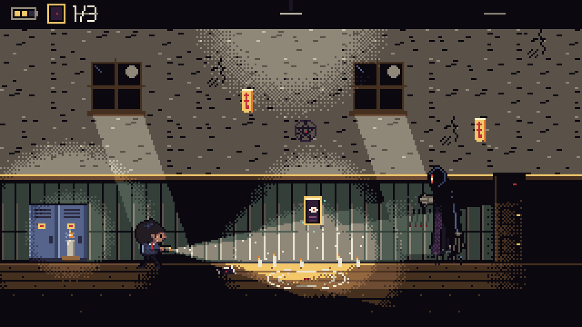

# 오리지널 픽셀 아트 (1차 콘셉트)

이 폴더는 이 프로젝트를 위해 새로 만든 픽셀 아트입니다. [`docs/design-references.md`](../../../docs/design-references.md)와 [`assets/third_party/`](../../third_party/README.md)에 모은 참고자료에서 **원리만** 가져왔고, 특정 팩이나 게임의 캐릭터·타일을 옮기거나 트레이스하지 않았습니다.

- 라이선스: [`../LICENSE.md`](../LICENSE.md) (All rights reserved). 저장소 루트의 GPL은 적용되지 않습니다.
- **AI 생성물입니다.** 전부 AI(Anthropic Claude, Claude Code)가 텍스트 픽셀 맵으로 작성했습니다. 경위와 Steam 공개 대상 여부는 [`../AI_CONTENT.md`](../AI_CONTENT.md)에 기록했습니다.
- 상태: **콘셉트·프로토타입용 1차안**입니다. 방향을 정하고 AGM G에서 그레이박싱하는 데 쓰고, 최종 아트는 사람 아티스트가 다듬거나 다시 그리는 것을 전제로 합니다.



| | | |
|---|---|---|
|  |  |  |
| 교실 | 운동장(패럴랙스) | 이계(팔레트 교체) |

## 비주얼 콘셉트: 밤의 학교 + 한국 민속 괴이

조사 보고서가 차별화 축으로 꼽은 "로컬 민속 호러"와 "쯔꾸르식 심리 서사 + 플랫포머 조작"에 맞춰, 무대를 **밤의 학교 복도**로, 괴이를 **한국 설화 모티프**(도깨비불, 소복 귀신, 금줄, 부적)로 잡았습니다. 설화 모티프는 누구의 소유도 아니지만, 특정 작품의 귀신 디자인(예: 특정 영화·게임의 장발 귀신)을 닮지 않도록 소복 저고리의 깃·고름 같은 한복 디테일로 차별화했습니다. 스토리와 대사는 정해지지 않았으므로 이 아트에는 이름·텍스트를 넣지 않았습니다.

참고자료에서 가져온 원리와 적용 위치:

| 원리 (출처) | 적용 |
|---|---|
| 크기 대비로 무력감 만들기 (design-references 2.2·2.3, Little Nightmares 분석) | 그림자 손님은 주인공 키의 약 2.2배 |
| 색 = 신호 (INSIDE, In Stars and Time) | 빨강은 위험·눈에만, 청록은 영적 존재에만, 노랑은 빛과 부적에만 |
| 어둠 오버레이 + 광원 (Fear & Hunger, Witch's House, 기법 표 2.3) | 목업은 어둠 78% + 손전등 원뿔·형광등·달빛·도깨비불 광원 |
| 어둠 속 실루엣은 테두리광으로 읽히게 | 그림자 손님 오른쪽 가장자리에 달빛색(M) 림라이트 |
| 팔레트 하나로 고정 (design-references 4절) | 아래 20색 `night-school` 팔레트 하나로 전부 그림 |

## 팔레트

[`palette/night-school.pal`](palette/night-school.pal), 견본 

| 키 | 색 | 용도 | 키 | 색 | 용도 |
|---|---|---|---|---|---|
| `K` | `#0d0b12` | 외곽선, 가장 깊은 그림자, 어둠 | `P` | `#6e4e3a` | 나무 |
| `D` | `#1c1a28` | 밤 남색, 실루엣 몸통 | `p` | `#4a3429` | 나무 그림자 |
| `N` | `#2b2b40` | 남색 그림자 | `s` | `#e0b493` | 피부 |
| `U` | `#3a4466` | 교복 | `h` | `#b07c64` | 피부 그림자 |
| `u` | `#56638a` | 교복 밝은 면 | `H` | `#2a2224` | 머리카락 |
| `M` | `#8798b8` | 달빛, 림라이트 | `R` | `#c0303a` | **위험·눈** (강조색) |
| `W` | `#c9c6b8` | 회벽, 소복 | `r` | `#7a1c26` | 빨강 그림자 |
| `w` | `#efebdc` | 하이라이트, 종이 | `Y` | `#f0d070` | 손전등, 부적 종이 |
| `G` | `#3b4740` | 징두리 판벽 어두운 면 | `C` | `#7fe0d0` | 영적 존재 (도깨비불) |
| `g` | `#56645a` | 징두리 판벽 | `c` | `#3a9a98` | 영적 존재 그림자 |

## 규격

| 항목 | 값 | 근거 |
|---|---|---|
| 타일 | 16x16 | AGM G는 타일 크기를 자유롭게 정함 (design-references 1.3) |
| 내부 해상도 | 320x180 (목업 기준), 640x360·1920x1080에 정수배 | Godot 문서의 640x360 기준과 정수 배율 권장 (1.3) |
| 주인공 | 24x32 셀, 실제 키 약 25px(타일 1.5개) | 쯔꾸르 2000의 캐릭터 셀과 같은 크기 |
| 얼굴 | 48x48, 9표정 | EasyRPG 문서 기준 쯔꾸르 2000 얼굴 크기 (다른 값도 있어 design-references 7절에 미확인으로 기록) |

## 파일

PNG는 모두 `src/`의 텍스트 원본에서 생성됩니다. PNG를 직접 고치지 말고 원본을 고친 뒤 다시 렌더링합니다(아래 "수정하는 법").

| 파일 | 크기·배치 | 내용 | 미리보기 |
|---|---|---|---|
| [`characters/protagonist_side.png`](characters/protagonist_side.png) | 24x32 셀, 7열x3행 | 주인공 횡스크롤(오른쪽을 봄, 왼쪽은 엔진에서 반전). `idle_0 idle_1 walk_0 walk_1 walk_2 walk_3 jump / fall crouch hurt interact turn_back(사물함·문 진입, 뒷모습) death_0 death_1 / death_2 run_0 run_1 run_2 run_3 climb_0 climb_1(사다리)`. 사망은 고어 없이 쓰러짐(D9), 손전등이 떨어짐 | [x6](previews/protagonist_side_x6.png) |
| [`characters/$protagonist_topdown.png`](characters/$protagonist_topdown.png) | 24x32 셀, 3열x4행 | 쯔꾸르 MV/MZ 단일 캐릭터(`$`) 배치. 행: 아래·왼쪽·오른쪽·위, 열: 걸음·정지·걸음. 좌우는 횡스크롤 프레임을 재사용 | [x6](previews/protagonist_topdown_x6.png) |
| [`characters/enemy_shadow_visitor.png`](characters/enemy_shadow_visitor.png) | 32x56 셀, 5열x3행 | **그림자 손님**: 긴 외투의 구부정한 실루엣, 붉은 외눈. `idle_0 idle_1(눈 깜박임) walk_0 walk_1 look(뒤돌아봄) / grab chase_0 chase_1 vanish_0 vanish_1 / vanish_2`. 상태와 모션의 대응은 [`docs/decisions.md`](../../../docs/decisions.md) | [x4](previews/enemy_shadow_visitor_x4.png) |
| [`characters/enemy_sobok_gwisin.png`](characters/enemy_sobok_gwisin.png) | 24x40 셀, 3열x2행 | **소복 귀신**: 흰 저고리·치마, 얼굴을 가린 장발, 발 대신 흐려지는 치맛단. `float_0 float_1 reveal(한쪽 눈) / vanish_0 vanish_1 vanish_2` | [x4](previews/enemy_sobok_gwisin_x4.png) |
| [`characters/enemy_dokkaebi_bul.png`](characters/enemy_dokkaebi_bul.png) | 16x16 셀, 4프레임 | **도깨비불**: 외곽선 없는 청록 불꽃 + 불티. 어둠 위에 그려 발광처럼 보이게 | [x8](previews/enemy_dokkaebi_bul_x8.png) |
| [`tiles/tiles_night_school.png`](tiles/tiles_night_school.png) | 16x16 타일, 8열 | 아래 타일 목록 참고 | [x4](previews/tiles_night_school_x4.png) |
| [`portraits/protagonist_faces.png`](portraits/protagonist_faces.png) | 48x48, 5열 | 대화용 얼굴. `neutral scared sad determined surprised / relieved angry smile eyes_closed(깜박임 겸용)`. 표정별 파일은 `@split`으로 [`../characters/protagonist/portraits/`](../characters/protagonist/character.json)에도 생성 | [x4](previews/protagonist_faces_x4.png) |
| [`mockups/corridor_night.png`](mockups/corridor_night.png) | 320x180 | 위 요소를 조합한 분위기 확인용 장면. 레벨 설계안이 아님 | [x3](previews/corridor_night_x3.png) |
| [`palette/night-school.png`](palette/night-school.png) | 8x8 x 20색 | 팔레트 견본 | [x4](previews/palette_swatch_x4.png) |
| [`lights/light_circle.png`](lights/light_circle.png), [`lights/light_cone.png`](lights/light_cone.png) | 64x64, 128x64 | PointLight2D용 라이트 텍스처. 흰색 4단계 투명도(`palette/light.pal`). 원뿔은 왼쪽 가운데가 광원 위치 | [원형](previews/light_circle_x2.png), [원뿔](previews/light_cone_x2.png) (흰 배경에서는 안 보임) |
| [`ui/ui_panel.png`](ui/ui_panel.png) | 24x24, 9-slice (여백 8) | 대화창·이름표·메뉴 공용 패널 | [x6](previews/ui_panel_x6.png) |
| [`ui/ui_bubble.png`](ui/ui_bubble.png) | 24x24, 9-slice (여백 8) | 바크용 말풍선. 꼬리는 `ui_small`의 `bubble_tail` | [x6](previews/ui_bubble_x6.png) |
| [`ui/ui_icons.png`](ui/ui_icons.png) | 12x12, 6열 | 키 프롬프트(`key_e f z x c s up down left right space menu`), 게임패드 버튼(위치로 표시, 상표 글자 없음: `pad_south east west north start`), 표시(`mark_alert` 적이 눈치챔, `mark_talk` 조사 가능) | [x6](previews/ui_icons_x6.png) |
| [`ui/ui_small.png`](ui/ui_small.png) | 8x8, 4열 | `advance_0/1`(다음 대사), `cursor`(선택지·메뉴), `bubble_tail` | [x6](previews/ui_small_x6.png) |
| [`mockups/dialogue_mock.png`](mockups/dialogue_mock.png) | 320x180 | 대화창 배치·대비 확인용. 회색 막대는 글자 자리 | [x3](previews/dialogue_mock_x3.png) |
| [`ui/ui_paper.png`](ui/ui_paper.png) | 24x24, 9-slice (여백 8) | 쪽지·일기 열람용 바랜 종이 | [x6](previews/ui_paper_x6.png) |

`ui_icons`에는 마우스 포인터(`pointer`, 기준점은 왼쪽 위 픽셀)와 로딩 표시(`loading_0~3`)도 있습니다.

### 공간별 타일셋 (16x16, 여러 칸짜리는 `이름_x_y`)

| 파일 | 내용 | 미리보기 |
|---|---|---|
| [`tiles/tiles_terrain_block.png`](tiles/tiles_terrain_block.png) | 콘크리트 블록 16종. Godot TileSet 지형(Terrain)의 **Match Sides** 모드용. 프레임 `block_NN`의 NN은 이어진 면의 합(N=1, E=2, S=4, W=8). 위가 드러난 칸에는 마루가 깔려 있어 한 지형으로 발판을 칠할 수 있음 | [x4](previews/tiles_terrain_block_x4.png) |
| [`tiles/tiles_stairs.png`](tiles/tiles_stairs.png) | 손잡이 있는 계단, 오른쪽·왼쪽 오름 각 3x3. 충돌은 엔진에서 경사로 | [x4](previews/tiles_stairs_x4.png) |
| [`tiles/tiles_classroom.png`](tiles/tiles_classroom.png) | 칠판(4x2, 지운 자국, 글자 없음), 교탁(2x1), 의자·넘어진 의자, 캐비닛(2x2), **4시 44분에 멈춘 시계**, 마른 화분, 천장 CRT TV(꺼짐·지지직 2프레임), 게시판 | [x4](previews/tiles_classroom_x4.png) |
| [`tiles/tiles_restroom.png`](tiles/tiles_restroom.png) | 벽·바닥 타일, 얼룩 타일, 거울(보통·**사람 없는데 비친 형체**·금 간 거울, 1x2), 세면대, 칸막이 문(닫힘·열림, 1x3) | [x4](previews/tiles_restroom_x4.png) |
| [`tiles/tiles_props.png`](tiles/tiles_props.png) | 음수대, 쓰레기통, 전등 스위치(켜짐·꺼짐), 열쇠, 찢어진 부적, 타 버린 부적, 커튼(2x2), 신발장(2x2), 대걸레 양동이, 상자 | [x4](previews/tiles_props_x4.png) |
| [`tiles/tiles_exterior.png`](tiles/tiles_exterior.png) | 운동장 흙(풀 가장자리), 철망 울타리(1x2), 가로등(1x3), 그네(2x2) | [x4](previews/tiles_exterior_x4.png) |

### 배경 (패럴랙스, 320x180, 가로로 이어짐)

| 파일 | 내용 | 스크롤 배율(시작값) | 미리보기 |
|---|---|---|---|
| [`backgrounds/bg_sky.png`](backgrounds/bg_sky.png) | 디더링 밤하늘, 달, 별, 구름 줄기. 불투명 | 0.05 | [x2](previews/bg_sky_x2.png) |
| [`backgrounds/bg_far.png`](backgrounds/bg_far.png) | 먼 산과 아파트, 드문드문 켜진 창 | 0.2 | [x2](previews/bg_far_x2.png) |
| [`backgrounds/bg_mid.png`](backgrounds/bg_mid.png) | 학교 건물(탑시계, 2층에 불 켜진 창 하나), 양옆 나무 | 0.5 | [x2](previews/bg_mid_x2.png) |

### 효과 (`fx/`)

| 파일 | 내용 | 미리보기 |
|---|---|---|
| [`fx/fx_transition.png`](fx/fx_transition.png) | 16x16 디더 타일 17단계. 화면을 채우고 프레임을 넘겨 픽셀아트식 페이드 | [x4](previews/fx_transition_x4.png) |
| [`fx/fx_vignette.png`](fx/fx_vignette.png) | 320x180 비네트(`palette/dark.pal`의 반투명 검정 4단계) | [x2](previews/fx_vignette_x2.png) |
| [`fx/fx_particles.png`](fx/fx_particles.png) | 8x8 파티클: 먼지, 불씨, 영혼 불티, 연기 3단계 | [x8](previews/fx_particles_x8.png) |
| [`fx/fx_ghost_swirl.png`](fx/fx_ghost_swirl.png) | 귀신 출현·소멸 안개 소용돌이 24x24, 4프레임 | [x6](previews/fx_ghost_swirl_x6.png) |
| [`fx/fx_static.png`](fx/fx_static.png) | 64x64 반복 노이즈 3프레임(점프스케어). "깜박임 줄이기" 옵션이면 한 프레임만 | [x4](previews/fx_static_x4.png) |

### 목업 (전부 320x180, 레벨 설계안이 아니라 조합 확인용)

| 파일 | 확인한 것 |
|---|---|
| [`mockups/classroom_night.png`](mockups/classroom_night.png) | 교실 타일셋, TV 불빛, 손전등에 비친 소복 귀신 |
| [`mockups/schoolyard_night.png`](mockups/schoolyard_night.png) | 패럴랙스 3층, 운동장 타일, 가로등과 도깨비불 |
| [`mockups/corridor_otherworld.png`](mockups/corridor_otherworld.png) | 이계 팔레트 교체(주인공만 원래 색) |
| [`mockups/title_mock.png`](mockups/title_mock.png) | 타이틀 화면: 배경 + 로고 자리(제목 미정) + 메뉴 |
| [`mockups/document_mock.png`](mockups/document_mock.png) | 쪽지 열람: 디더로 어둡게 한 화면 위 종이 |
| [`mockups/menu_mock.png`](mockups/menu_mock.png) | 일시정지 메뉴와 세이브 슬롯 3개(촛불 = 체크포인트) |

## 이계: 팔레트 교체

모든 그림이 같은 20개 팔레트 키를 쓰므로, 이계는 타일셋을 따로 그리지 않고 **같은 키에 다른 색을 넣은 팔레트**로 만듭니다(design-references 2.3의 "세계 전환 = 화풍 전환").

- [`palette/otherworld.pal`](palette/otherworld.pal): 밤의 푸른색 대신 녹·마른 피·뼈 색, 영적 존재는 산성 초록. 키는 `night-school.pal`과 같아야 합니다.
- 목업에서는 `.scene`의 `@swap ../palette/otherworld.pal`로 바꾸고, 원래 색을 유지할 스프라이트에 `keep`을 붙입니다.
- 게임에서는 [`shaders/palette_swap.gdshader`](../../../shaders/palette_swap.gdshader)(GPL 코드)를 씁니다. `palette/lut_night_school.png`와 `palette/lut_otherworld.png`(20x1, 키 순서대로 한 픽셀씩)를 넘기면 색을 바꿔 칠하고, `amount`로 두 세계 사이를 섞을 수 있습니다. AGM G에서 아직 시험하지 않았습니다.

### 타일 목록 (`tiles_night_school.png`, 왼쪽 위부터)

| 행 | 타일 | 충돌 |
|---|---|---|
| 1 | `floor_top` `floor_fill` `floor_edge_l` `floor_edge_r` `ceiling` `lamp_off` `lamp_on` `shelf` | 바닥·천장은 고체, `shelf`는 아래에서 통과(one-way), 형광등은 소품 |
| 2 | `wall_plaster` `wall_plaster_crack` `wall_rail` `wall_wainscot` `wall_wainscot_hand` `sign_plate` `talisman` `geumjul` | 벽은 배경 레이어, 명패·부적·금줄은 벽 위 소품 레이어 |
| 3 | `desk` `window_0_0` `window_1_0` `window_0_1` `window_1_1` `door_0_0` `door_1_0` `door_0_1` | 책상은 낮은 one-way 발판 후보. 창문은 2x2, 미닫이문은 2x3 타일 (`이름_x_y`) |
| 4 | `door_1_1` `door_0_2` `door_1_2` `door_open_0_0` `door_open_1_0` `door_open_0_1` `door_open_1_1` `door_open_0_2` | 열린 문은 닫힌 문과 같은 2x3 배치 |
| 5 | `door_open_1_2` `locker_0_0` `locker_0_1` `locker_open_0_0` `locker_open_0_1` `note` `note_glint` `candle_lit_0` | 사물함은 1x2 타일(숨는 곳). 쪽지는 `note`/`note_glint`를 번갈아 깜박임 |
| 6 | `candle_lit_1` `candle_out` | 촛불 체크포인트: 켜짐 2프레임 깜박임, 꺼짐 |

명패에는 글자 대신 자리표시 무늬만 넣었습니다. 반 이름 같은 텍스트는 대사 규칙상 데이터로 따로 관리하거나, 확정 후 아트로 그립니다.

## AGM G에서 쓰는 법 (예정)

AGM G 프로젝트가 아직 없으므로 실제 임포트는 확인하지 않았습니다.

- 횡스크롤 시트: 24x32 격자로 잘라 애니메이션을 만듭니다. 권장 속도는 걷기 8fps, 대기 2fps, 도깨비불 8fps(추정값, 플레이 테스트로 조정).
- `$protagonist_topdown.png`: AGM G v2.0의 MV/MZ 캐릭터 시트 임포트 대상 배치입니다 (design-references 1.2·1.3).
- 타일셋: TileSet의 Tile Size를 16x16으로 두고, 바닥·천장에 Physics Layer, `shelf`·`desk`에는 one-way 충돌을 줍니다.
- 지형: `tiles_terrain_block`을 Terrain Set(모드 Match Sides)에 넣고, 각 타일의 면 비트를 프레임 번호대로 지정하면 발판을 붓으로 칠할 수 있습니다.
- 배경: `backgrounds/`의 세 장을 Parallax2D 세 개에 넣고 위 표의 스크롤 배율에서 시작합니다. 가로로 이어지게 만들었으므로 Repeat Size는 320입니다.
- 어둠과 빛: 목업의 어둠·광원은 PNG에 구운 것입니다. 게임에서는 CanvasModulate + PointLight2D로 같은 효과를 냅니다 ([`visual_assets.md` Q7](../../../research_notes/쯔꾸르%20리소스와%20스토리%20자원%20분석/visual_assets.md)). 그림자 손님의 눈과 도깨비불은 조명을 받지 않는 레이어(또는 unshaded 머티리얼)에 둡니다.

## 수정하는 법

원본은 `src/`의 텍스트 파일입니다. 한 글자가 픽셀 하나이고, 글자는 팔레트 키입니다.

- `.pix`: 스프라이트·타일셋. `@frame 이름` 다음에 프레임 높이만큼 행을 씁니다. `.`은 투명, `base=다른프레임`과 `~`로 바뀐 부분만 쓰고, `mirror=`/`shift=`/`copy=파일:프레임`으로 재사용합니다. 이름이 `_`로 시작하면 시트에 넣지 않는 보조 프레임입니다.
- `.scene`: 타일 레이어 + 스프라이트 + 어둠·광원으로 목업을 합성합니다.
- 형식 전체는 [`tools/pixelart.py`](../../../tools/pixelart.py) 맨 위 설명에 있습니다.

```bash
python3 tools/pixelart.py            # src/의 모든 원본을 PNG로 렌더링
python3 tools/pixelart.py --check    # PNG가 원본과 일치하는지 확인 (CI가 실행)
```

원본과 PNG는 함께 커밋합니다. 어긋나면 CI의 "Pixel art PNGs match their text sources" 단계가 실패합니다. Pillow 같은 외부 패키지는 필요 없습니다.

원본이 텍스트라 diff로 리뷰할 수 있지만, 큰 그림을 텍스트로 계속 그리는 것은 비효율적입니다. 사람 아티스트가 맡게 되면 Aseprite·Pixelorama 원본(`.aseprite`, `.pxo`)을 `src/`에 두고, 그 파일에서 내보낸 PNG로 바꾸는 편이 낫습니다.

## 한계와 다음 단계

게임 전체 기준의 필요 목록과 우선순위는 [`docs/resource-needs.md`](../../../docs/resource-needs.md)에 있습니다.

- 1차안이라 프레임 수가 적습니다(걷기·달리기 4프레임, 적 2~4프레임). 전투가 없다는 잠정 결정(D2)에 따라 공격 모션은 없습니다.
- 정면/뒷모습은 횡스크롤보다 단순하고, 얼굴은 정면 한 각도뿐입니다.
- NPC, 보스, 입식, 로고·키 아트는 이야기(D1)가 정해진 뒤에 그립니다.
- 옥상, 과학실, 지하 같은 공간과 계단을 쓰는 다층 레벨 목업은 아직 없습니다.
