# 오리지널 픽셀 아트 (1차 콘셉트)

이 폴더는 이 프로젝트를 위해 새로 만든 픽셀 아트입니다. [`docs/design-references.md`](../../../docs/design-references.md)와 [`assets/third_party/`](../../third_party/README.md)에 모은 참고자료에서 **원리만** 가져왔고, 특정 팩이나 게임의 캐릭터·타일을 옮기거나 트레이스하지 않았습니다.

- 라이선스: [`../LICENSE.md`](../LICENSE.md) (All rights reserved). 저장소 루트의 GPL은 적용되지 않습니다.
- **AI 생성물입니다.** 전부 AI(Anthropic Claude, Claude Code)가 텍스트 픽셀 맵으로 작성했습니다. 경위와 Steam 공개 대상 여부는 [`../AI_CONTENT.md`](../AI_CONTENT.md)에 기록했습니다.
- 상태: **콘셉트·프로토타입용 1차안**입니다. 방향을 정하고 AGM G에서 그레이박싱하는 데 쓰고, 최종 아트는 사람 아티스트가 다듬거나 다시 그리는 것을 전제로 합니다.


| | | |
|---|---|---|
| 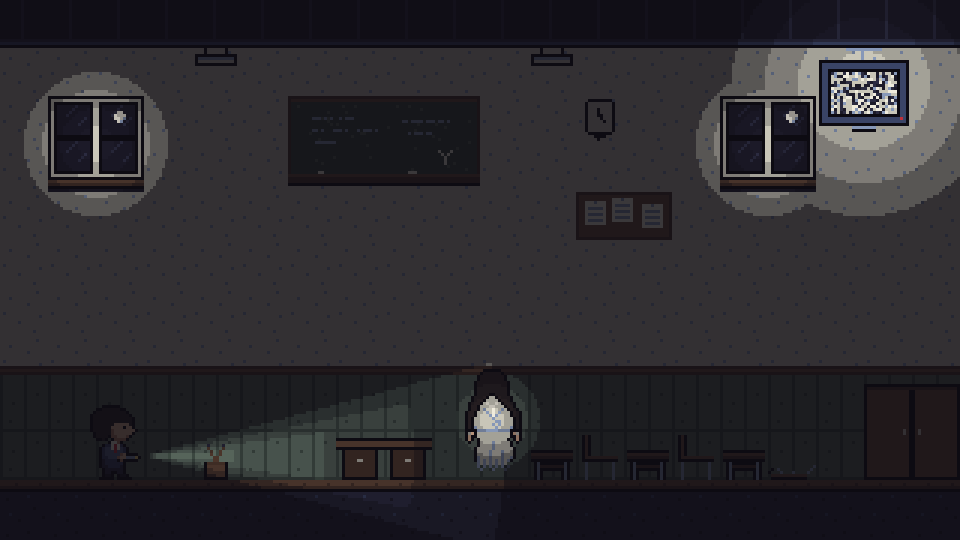 | 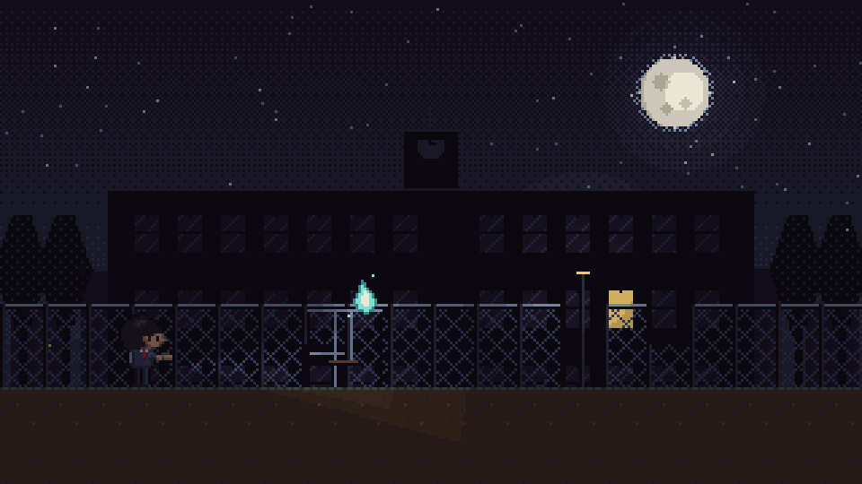 | 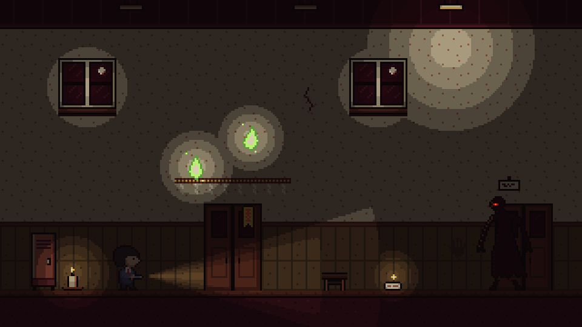 |
| 교실 | 운동장(패럴랙스) | 이계(팔레트 교체) |

## 비주얼 콘셉트: 밤의 학교 + 한국 민속 괴이

조사 보고서가 차별화 축으로 꼽은 "로컬 민속 호러"와 "쯔꾸르식 심리 서사 + 플랫포머 조작"에 맞춰, 무대를 **밤의 학교 복도**로, 괴이를 **한국 설화 모티프**(도깨비불, 소복 귀신, 금줄, 부적)로 잡았습니다. 설화 모티프는 누구의 소유도 아니지만, 특정 작품의 귀신 디자인(예: 특정 영화·게임의 장발 귀신)을 닮지 않도록 소복 저고리의 깃·고름 같은 한복 디테일로 차별화했습니다. 스토리와 대사는 정해지지 않았으므로 이 아트에는 이름·텍스트를 넣지 않았습니다.

참고자료에서 가져온 원리와 적용 위치:

| 원리 (출처) | 적용 |
|---|---|
| 크기 대비로 무력감 만들기 (design-references 2.2·2.3, Little Nightmares 분석) | 그림자 손님은 주인공 키의 약 2.2배 |
| 색 = 신호 (INSIDE, In Stars and Time) | 빨강은 위험·눈에만, 청록은 영적 존재에만, 노랑은 빛과 부적에만 |
| 어둠 오버레이 + 광원 (Fear & Hunger, Witch's House, 기법 표 2.3) | 목업은 어둠 78% + 손전등 원뿔·형광등·달빛·도깨비불 광원 |
| 어둠 속 실루엣은 테두리광으로 읽히게 | 그림자 손님 오른쪽 가장자리에 달빛색(M) 림라이트 |
| 팔레트 하나로 고정 (design-references 4절) | 아래 20색 `night-school` 팔레트 하나로 전부 그림 |

## 팔레트

[`palette/night-school.pal`](palette/night-school.pal), 견본 

| 키 | 색 | 용도 | 키 | 색 | 용도 |
|---|---|---|---|---|---|
| `K` | `#0d0b12` | 외곽선, 가장 깊은 그림자, 어둠 | `P` | `#6e4e3a` | 나무 |
| `D` | `#1c1a28` | 밤 남색, 실루엣 몸통 | `p` | `#4a3429` | 나무 그림자 |
| `N` | `#2b2b40` | 남색 그림자 | `s` | `#e0b493` | 피부 |
| `U` | `#3a4466` | 교복 | `h` | `#b07c64` | 피부 그림자 |
| `u` | `#56638a` | 교복 밝은 면 | `H` | `#2a2224` | 머리카락 |
| `M` | `#8798b8` | 달빛, 림라이트 | `R` | `#c0303a` | **위험·눈** (강조색) |
| `W` | `#c9c6b8` | 회벽, 소복 | `r` | `#7a1c26` | 빨강 그림자 |
| `w` | `#efebdc` | 하이라이트, 종이 | `Y` | `#f0d070` | 손전등, 부적 종이 |
| `G` | `#3b4740` | 징두리 판벽 어두운 면 | `C` | `#7fe0d0` | 영적 존재 (도깨비불) |
| `g` | `#56645a` | 징두리 판벽 | `c` | `#3a9a98` | 영적 존재 그림자 |

색 규칙의 예외는 두 곳뿐입니다. **고어 세트**의 피는 `R`·`r`로 칠하고(피도 위험 신호라 규칙과 어긋나지 않음), **굿 장면**은 오방색(파랑·하양·빨강·검정·노랑)을 옷과 깃발에 그대로 씁니다. 굿은 두 세계의 경계에서 벌어지는 일이라, 평소에는 위험·빛에만 쓰던 색이 화면에 함께 나오는 것 자체를 연출로 봅니다.

## 규격

| 항목 | 값 | 근거 |
|---|---|---|
| 타일 | 16x16 | AGM G는 타일 크기를 자유롭게 정함 (design-references 1.3) |
| 내부 해상도 | 320x180 (목업 기준), 640x360·1920x1080에 정수배 | Godot 문서의 640x360 기준과 정수 배율 권장 (1.3) |
| 주인공 | 24x32 셀, 실제 키 약 25px(타일 1.5개) | 쯔꾸르 2000의 캐릭터 셀과 같은 크기 |
| 얼굴 | 48x48, 9표정 | EasyRPG 문서 기준 쯔꾸르 2000 얼굴 크기 (다른 값도 있어 design-references 7절에 미확인으로 기록) |

## 파일

PNG는 모두 `src/`의 텍스트 원본에서 생성됩니다. PNG를 직접 고치지 말고 원본을 고친 뒤 다시 렌더링합니다(아래 "수정하는 법").

| 파일 | 크기·배치 | 내용 | 미리보기 |
|---|---|---|---|
| [`characters/protagonist_side.png`](characters/protagonist_side.png) | 24x32 셀, 7열x3행 | 주인공 횡스크롤(오른쪽을 봄, 왼쪽은 엔진에서 반전). `idle_0 idle_1 walk_0 walk_1 walk_2 walk_3 jump / fall crouch hurt interact turn_back(사물함·문 진입, 뒷모습) death_0 death_1 / death_2 run_0 run_1 run_2 run_3 climb_0 climb_1(사다리)`. 사망은 고어 없이 쓰러짐(D9), 손전등이 떨어짐 | [x6](previews/protagonist_side_x6.png) |
| [`characters/$protagonist_topdown.png`](characters/$protagonist_topdown.png) | 24x32 셀, 3열x4행 | 쯔꾸르 MV/MZ 단일 캐릭터(`$`) 배치. 행: 아래·왼쪽·오른쪽·위, 열: 걸음·정지·걸음. 좌우는 횡스크롤 프레임을 재사용. 탑다운 타일·맵은 아래 "탑다운" 절 | [x6](previews/protagonist_topdown_x6.png) |
| [`characters/enemy_shadow_visitor.png`](characters/enemy_shadow_visitor.png) | 32x56 셀, 5열x3행 | **그림자 손님**: 긴 외투의 구부정한 실루엣, 붉은 외눈. `idle_0 idle_1(눈 깜박임) walk_0 walk_1 look(뒤돌아봄) / grab chase_0 chase_1 vanish_0 vanish_1 / vanish_2`. 상태와 모션의 대응은 [`docs/decisions.md`](../../../docs/decisions.md) | [x4](previews/enemy_shadow_visitor_x4.png) |
| [`characters/enemy_sobok_gwisin.png`](characters/enemy_sobok_gwisin.png) | 24x40 셀, 3열x2행 | **소복 귀신**: 흰 저고리·치마, 얼굴을 가린 장발, 발 대신 흐려지는 치맛단. `float_0 float_1 reveal(한쪽 눈) / vanish_0 vanish_1 vanish_2` | [x4](previews/enemy_sobok_gwisin_x4.png) |
| [`characters/enemy_dokkaebi_bul.png`](characters/enemy_dokkaebi_bul.png) | 16x16 셀, 4프레임 | **도깨비불**: 외곽선 없는 청록 불꽃 + 불티. 어둠 위에 그려 발광처럼 보이게 | [x8](previews/enemy_dokkaebi_bul_x8.png) |
| [`tiles/tiles_night_school.png`](tiles/tiles_night_school.png) | 16x16 타일, 8열 | 아래 타일 목록 참고 | [x4](previews/tiles_night_school_x4.png) |
| [`portraits/protagonist_faces.png`](portraits/protagonist_faces.png) | 48x48, 5열 | 대화용 얼굴. `neutral scared sad determined surprised / relieved angry smile eyes_closed(깜박임 겸용)`. 표정별 파일은 `@split`으로 [`../characters/protagonist/portraits/`](../characters/protagonist/character.json)에도 생성 | [x4](previews/protagonist_faces_x4.png) |
| [`mockups/corridor_night.png`](mockups/corridor_night.png) | 320x180 | 위 요소를 조합한 분위기 확인용 장면. 레벨 설계안이 아님 | [x3](previews/corridor_night_x3.png) |
| [`palette/night-school.png`](palette/night-school.png) | 8x8 x 20색 | 팔레트 견본 | [x4](previews/palette_swatch_x4.png) |
| [`lights/light_circle.png`](lights/light_circle.png), [`lights/light_cone.png`](lights/light_cone.png) | 64x64, 128x64 | PointLight2D용 라이트 텍스처. 흰색 4단계 투명도(`palette/light.pal`). 원뿔은 왼쪽 가운데가 광원 위치 | [원형](previews/light_circle_x2.png), [원뿔](previews/light_cone_x2.png) (흰 배경에서는 안 보임) |
| [`ui/ui_panel.png`](ui/ui_panel.png) | 24x24, 9-slice (여백 8) | 대화창·이름표·메뉴 공용 패널 | [x6](previews/ui_panel_x6.png) |
| [`ui/ui_bubble.png`](ui/ui_bubble.png) | 24x24, 9-slice (여백 8) | 바크용 말풍선. 꼬리는 `ui_small`의 `bubble_tail` | [x6](previews/ui_bubble_x6.png) |
| [`ui/ui_icons.png`](ui/ui_icons.png) | 12x12, 6열 | 키 프롬프트(`key_e f z x c s up down left right space menu`), 게임패드 버튼(위치로 표시, 상표 글자 없음: `pad_south east west north start`), 표시(`mark_alert` 적이 눈치챔, `mark_talk` 조사 가능) | [x6](previews/ui_icons_x6.png) |
| [`ui/ui_small.png`](ui/ui_small.png) | 8x8, 4열 | `advance_0/1`(다음 대사), `cursor`(선택지·메뉴), `bubble_tail` | [x6](previews/ui_small_x6.png) |
| [`mockups/dialogue_mock.png`](mockups/dialogue_mock.png) | 320x180 | 대화창 배치·대비 확인용. 회색 막대는 글자 자리 | [x3](previews/dialogue_mock_x3.png) |
| [`ui/ui_paper.png`](ui/ui_paper.png) | 24x24, 9-slice (여백 8) | 쪽지·일기 열람용 바랜 종이 | [x6](previews/ui_paper_x6.png) |

`ui_icons`에는 마우스 포인터(`pointer`, 기준점은 왼쪽 위 픽셀)와 로딩 표시(`loading_0~3`)도 있습니다.

### 공간별 타일셋 (16x16, 여러 칸짜리는 `이름_x_y`)

| 파일 | 내용 | 미리보기 |
|---|---|---|
| [`tiles/tiles_terrain_block.png`](tiles/tiles_terrain_block.png) | 콘크리트 블록 16종. Godot TileSet 지형(Terrain)의 **Match Sides** 모드용. 프레임 `block_NN`의 NN은 이어진 면의 합(N=1, E=2, S=4, W=8). 위가 드러난 칸에는 마루가 깔려 있어 한 지형으로 발판을 칠할 수 있음 | [x4](previews/tiles_terrain_block_x4.png) |
| [`tiles/tiles_stairs.png`](tiles/tiles_stairs.png) | 손잡이 있는 계단, 오른쪽·왼쪽 오름 각 3x3. 충돌은 엔진에서 경사로 | [x4](previews/tiles_stairs_x4.png) |
| [`tiles/tiles_classroom.png`](tiles/tiles_classroom.png) | 칠판(4x2, 지운 자국, 글자 없음), 교탁(2x1), 의자·넘어진 의자, 캐비닛(2x2), **4시 44분에 멈춘 시계**, 마른 화분, 천장 CRT TV(꺼짐·지지직 2프레임), 게시판 | [x4](previews/tiles_classroom_x4.png) |
| [`tiles/tiles_restroom.png`](tiles/tiles_restroom.png) | 벽·바닥 타일, 얼룩 타일, 거울(보통·**사람 없는데 비친 형체**·금 간 거울, 1x2), 세면대, 칸막이 문(닫힘·열림, 1x3) | [x4](previews/tiles_restroom_x4.png) |
| [`tiles/tiles_props.png`](tiles/tiles_props.png) | 음수대, 쓰레기통, 전등 스위치(켜짐·꺼짐), 열쇠, 찢어진 부적, 타 버린 부적, 커튼(2x2), 신발장(2x2), 대걸레 양동이, 상자 | [x4](previews/tiles_props_x4.png) |
| [`tiles/tiles_exterior.png`](tiles/tiles_exterior.png) | 운동장 흙(풀 가장자리), 철망 울타리(1x2), 가로등(1x3), 그네(2x2) | [x4](previews/tiles_exterior_x4.png) |

### 배경 (패럴랙스, 320x180, 가로로 이어짐)

| 파일 | 내용 | 스크롤 배율(시작값) | 미리보기 |
|---|---|---|---|
| [`backgrounds/bg_sky.png`](backgrounds/bg_sky.png) | 디더링 밤하늘, 달, 별, 구름 줄기. 불투명 | 0.05 | [x2](previews/bg_sky_x2.png) |
| [`backgrounds/bg_far.png`](backgrounds/bg_far.png) | 먼 산과 아파트, 드문드문 켜진 창 | 0.2 | [x2](previews/bg_far_x2.png) |
| [`backgrounds/bg_mid.png`](backgrounds/bg_mid.png) | 학교 건물(탑시계, 2층에 불 켜진 창 하나), 양옆 나무 | 0.5 | [x2](previews/bg_mid_x2.png) |

### 효과 (`fx/`)

| 파일 | 내용 | 미리보기 |
|---|---|---|
| [`fx/fx_transition.png`](fx/fx_transition.png) | 16x16 디더 타일 17단계. 화면을 채우고 프레임을 넘겨 픽셀아트식 페이드 | [x4](previews/fx_transition_x4.png) |
| [`fx/fx_vignette.png`](fx/fx_vignette.png) | 320x180 비네트(`palette/dark.pal`의 반투명 검정 4단계) | [x2](previews/fx_vignette_x2.png) |
| [`fx/fx_particles.png`](fx/fx_particles.png) | 8x8 파티클: 먼지, 불씨, 영혼 불티, 연기 3단계 | [x8](previews/fx_particles_x8.png) |
| [`fx/fx_ghost_swirl.png`](fx/fx_ghost_swirl.png) | 귀신 출현·소멸 안개 소용돌이 24x24, 4프레임 | [x6](previews/fx_ghost_swirl_x6.png) |
| [`fx/fx_static.png`](fx/fx_static.png) | 64x64 반복 노이즈 3프레임(점프스케어). "깜박임 줄이기" 옵션이면 한 프레임만 | [x4](previews/fx_static_x4.png) |

### 목업 (전부 320x180, 레벨 설계안이 아니라 조합 확인용)

| 파일 | 확인한 것 |
|---|---|
| [`mockups/classroom_night.png`](mockups/classroom_night.png) | 교실 타일셋, TV 불빛, 손전등에 비친 소복 귀신 |
| [`mockups/schoolyard_night.png`](mockups/schoolyard_night.png) | 패럴랙스 3층, 운동장 타일, 가로등과 도깨비불 |
| [`mockups/corridor_otherworld.png`](mockups/corridor_otherworld.png) | 이계 팔레트 교체(주인공만 원래 색) |
| [`mockups/title_mock.png`](mockups/title_mock.png) | 타이틀 화면: 배경 + 로고 자리(제목 미정) + 메뉴 |
| [`mockups/document_mock.png`](mockups/document_mock.png) | 쪽지 열람: 디더로 어둡게 한 화면 위 종이 |
| [`mockups/menu_mock.png`](mockups/menu_mock.png) | 일시정지 메뉴와 세이브 슬롯 3개(촛불 = 체크포인트) |

## 괴이 도감 (귀신·괴물·크리쳐)

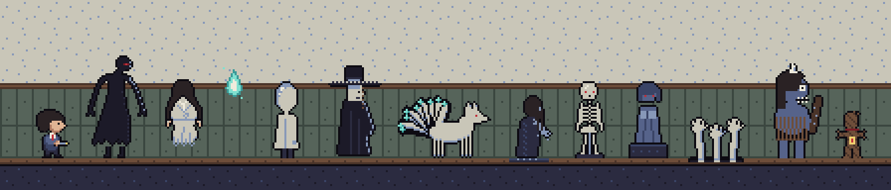

왼쪽부터 주인공(크기 비교용), 그림자 손님, 소복 귀신, 도깨비불, 그리고 새로 추가한 아홉 종입니다. 모두 횡스크롤용으로 오른쪽을 보며(정면 디자인 제외), 색 규칙(빨강은 위험·눈, 청록은 영적 존재)과 고어 없음(D9)을 지켰습니다. 모티프는 한국 설화와 학교 괴담에서 가져왔고, 특정 영화·드라마·게임의 디자인을 따르지 않았습니다.

**행동** 칸은 전투 없는 숨기·도주(D2)에 맞춘 **제안**이며, 이야기(D1)가 정해지면 다시 고릅니다.

| 시트 | 이름 | 모티프 | 셀·프레임 | 행동 제안 |
|---|---|---|---|---|
| [`creature_egg_ghost`](previews/creature_egg_ghost_x4.png) | 달걀귀신 | 설화: 얼굴 없는 귀신 | 24x40. `idle_0 idle_1 walk_0 walk_1 crack` | 천천히 따라오다 마주치면 멈춤. `crack`(알이 갈라지며 붉은 눈)은 한 번만 쓰는 놀래기 |
| [`creature_reaper`](previews/creature_reaper_x4.png) | 저승사자 | 설화: 망자를 데려가는 사자. 갓은 말총처럼 비치게 | 32x48. `idle_0 idle_1 walk_0 walk_1 summon` | 숨어도 "명부"로 찾아냄(숨기 무효). 대신 촛불(체크포인트) 빛 안으로는 못 들어옴 |
| [`creature_gumiho`](previews/creature_gumiho_x4.png) | 구미호 | 설화: 아홉 꼬리 여우 | 48x32. `idle_0 idle_1 run_0 run_1 pounce` | 빠른 돌진 뒤 멈칫하는 틈. 꼬리 끝 불꽃이 어둠 속 위치를 드러냄 |
| [`creature_water_ghost`](previews/creature_water_ghost_x4.png) | 물귀신 | 설화: 물로 끌어들이는 귀신 | 24x40. `rise_0 rise_1 idle_0 idle_1 reach` | 화장실·빗물 웅덩이에서 솟아 붙잡음. 웅덩이를 뛰어넘는 구간 |
| [`creature_skeleton_model`](previews/creature_skeleton_model_x4.png) | 과학실 해골 모형 | 학교 괴담 | 24x40, 정면. `on_stand awake walk_0 walk_1 collapse` | 소리가 나면 받침대에서 내려와 뻣뻣하게 쫓음. 부딪히면 무너졌다 다시 맞춰짐 |
| [`creature_reading_statue`](previews/creature_reading_statue_x4.png) | 책 읽는 소녀상 | 학교 괴담: 밤에 움직이는 동상 | 24x40, 정면. `still look reach` | 손전등으로 비추는 동안은 멈춤, 끄면 다가옴 |
| [`creature_floor_hands`](previews/creature_floor_hands_x4.png) | 바닥의 손 | 창작(함정) | 32x24. `shadow_0 shadow_1 emerge_0 emerge_1 grab` | 고정 함정. 그림자 일렁임으로 예고한 뒤 솟아오름 |
| [`creature_dokkaebi`](previews/creature_dokkaebi_x4.png) | 도깨비 | 설화: 장난꾸러기 도깨비(외뿔, 방망이, 짚 도롱이) | 32x48. `idle_0 idle_1 walk_0 walk_1 swing_0 swing_1` | 직접 해치기보다 길을 바꾸고 물건을 숨기는 훼방꾼. 방망이로 바닥을 내리쳐 발판을 흔듦 |
| [`creature_straw_doll`](previews/creature_straw_doll_x6.png) | 짚인형 | 저주 인형(붉은 실, 부적) | 16x24. `still hop_0 hop_1 turn` | 깡충 뛰어다니며 주인공을 발견하면 다른 귀신을 부르는 경보 역할 |

도깨비의 옷은 일본 오니의 호랑이 가죽 대신 짚 도롱이로 그렸습니다. 학교 동상 괴담은 실존 인물 동상 대신 이름 없는 "책 읽는 소녀상"으로 옮겼습니다.

## 좀비

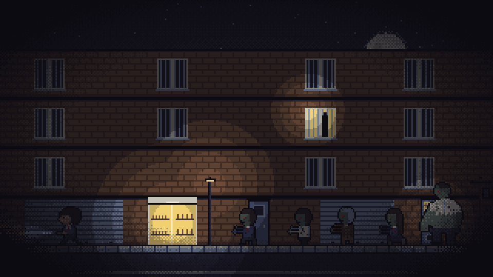

주인공과 같은 24x32 크기의 매개변수형 인간 그리기로 만들어, 옷차림 정의 하나에서 횡스크롤 시트와 탑다운 시트가 함께 나옵니다. 고어 없음(D9)에 따라 피 대신 회녹색 피부와 때 얼룩을 쓰고, 빨강은 눈의 한 점에만 썼습니다.

| 횡스크롤 시트 | 탑다운 시트 | 차림 |
|---|---|---|
| [`zombie_student`](previews/zombie_student_x6.png) | [`$zombie_student_topdown`](previews/zombie_student_topdown_x4.png) | 남학생 교복 |
| [`zombie_student_girl`](previews/zombie_student_girl_x6.png) | [`$zombie_student_girl_topdown`](previews/zombie_student_girl_topdown_x4.png) | 여학생 교복, 긴 머리, 치마 |
| [`zombie_office`](previews/zombie_office_x6.png) | [`$zombie_office_topdown`](previews/zombie_office_topdown_x4.png) | 회사원(흰 셔츠, 넥타이) |
| [`zombie_guard`](previews/zombie_guard_x6.png) | [`$zombie_guard_topdown`](previews/zombie_guard_topdown_x4.png) | 공무원·경비(모자, 배지) |
| [`zombie_elder`](previews/zombie_elder_x6.png) | [`$zombie_elder_topdown`](previews/zombie_elder_topdown_x4.png) | 마을 노인(무늬 조끼, 헐렁한 바지) |
| [`zombie_crawler`](previews/zombie_crawler_x6.png) | — | 바닥을 기어 다님, 32x16, 4프레임. 책상 밑·환기구 |
| [`zombie_brute`](previews/zombie_brute_x4.png) | — | 셔츠가 터진 거구, 32x48, 두 주먹 내려치기 |

횡스크롤 프레임: `idle_0 idle_1 walk_0~3(한쪽 발을 끄는 걸음) lunge(덮침) stun(손전등 빛에 눈을 가림)`. 탑다운은 MV/MZ `$` 배치이며 좌우는 횡스크롤 걸음을 재사용합니다. `stun`은 "손전등을 비추면 잠깐 멈춘다"는 숨기·도주용 규칙 제안에 맞춘 프레임입니다.

## 탑다운 (쯔꾸르식 3/4 시점)

횡스크롤 본편과 별도로, 쯔꾸르처럼 위에서 내려다보는 구간에 쓸 타일과 캐릭터입니다(D7: 첫 플레이어블에는 넣지 않지만 미리 준비). 타일은 **16x16**, 캐릭터 셀은 **24x32**로, 쯔꾸르 2000과 같은 비율입니다.

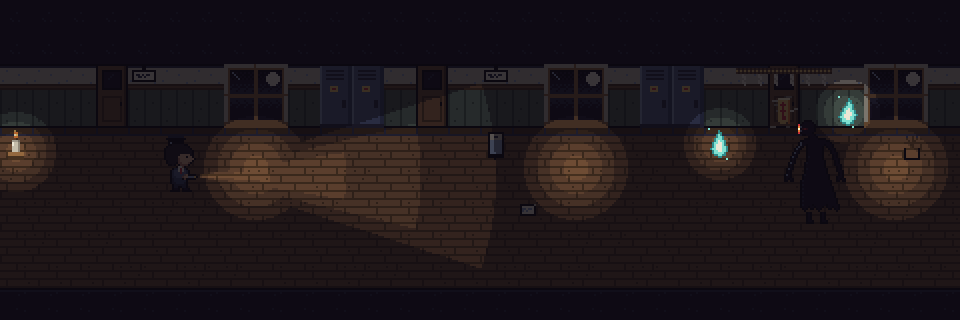

| 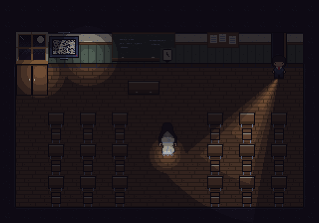 | 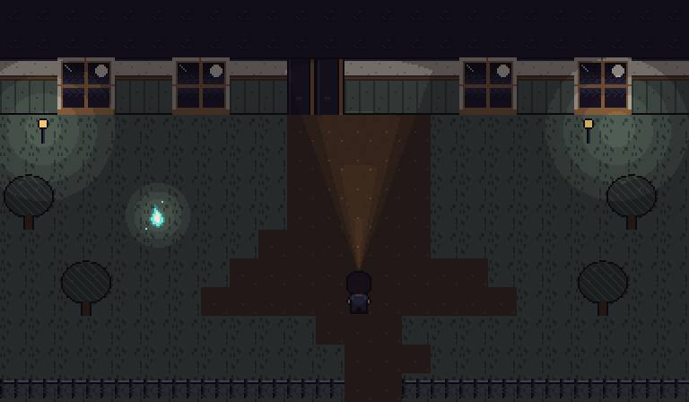 |
|---|---|
| 교실 | 운동장 |

| 파일 | 내용 | 미리보기 |
|---|---|---|
| [`tiles/tiles_topdown.png`](tiles/tiles_topdown.png) | 바닥(마루 2종·벽 그림자, 화장실 타일·그림자, 콘크리트, 흙, 풀), 벽면(`face_upper` 회벽+걸레받이 레일, `face_lower` 판벽), 미닫이문 1x2(닫힘·열림), 화장실 칸 문 1x2, 책상·의자·교탁(위에서 본 모습), 계단 2x2, 나무 2x2, 울타리(가로·세로), 가로등, 바닥의 쪽지 | [x4](previews/tiles_topdown_x4.png) |
| [`tiles/tiles_topdown_walltop.png`](tiles/tiles_topdown_walltop.png) | 위에서 본 벽 윗면 16종. Godot 지형 **Match Sides** 모드용, `walltop_NN`의 NN은 이어진 면의 합(N=1, E=2, S=4, W=8) | [x4](previews/tiles_topdown_walltop_x4.png) |
| [`characters/$protagonist_topdown.png`](characters/$protagonist_topdown.png) | 주인공 (위 표 참고) | [x6](previews/protagonist_topdown_x6.png) |
| [`characters/$enemy_shadow_visitor_topdown.png`](characters/$enemy_shadow_visitor_topdown.png) | 그림자 손님, 32x56 셀, MV/MZ `$` 배치. 정면·뒷모습은 새로 그리고 좌우는 횡스크롤 프레임 재사용 | [x4](previews/enemy_shadow_visitor_topdown_x4.png) |
| [`characters/$enemy_sobok_gwisin_topdown.png`](characters/$enemy_sobok_gwisin_topdown.png) | 소복 귀신, 24x40 셀, MV/MZ `$` 배치. 떠 있으므로 걸음 프레임 대신 1px 위아래로 흔들림 | [x4](previews/enemy_sobok_gwisin_topdown_x4.png) |
| [`mockups/map_corridor_td.png`](mockups/map_corridor_td.png), [`map_classroom_td.png`](mockups/map_classroom_td.png), [`map_schoolyard_td.png`](mockups/map_schoolyard_td.png) | 복도(480x160), 교실(320x224), 운동장(384x224) 맵 목업 | [복도](previews/map_corridor_td_x2.png), [교실](previews/map_classroom_td_x2.png), [운동장](previews/map_schoolyard_td_x2.png) |

### 마을·학교·관공서·회사 맵

| 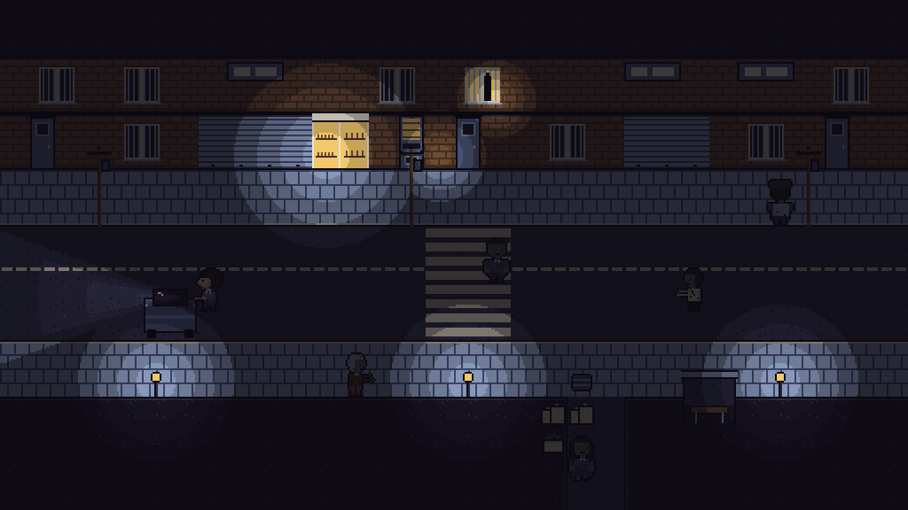 | 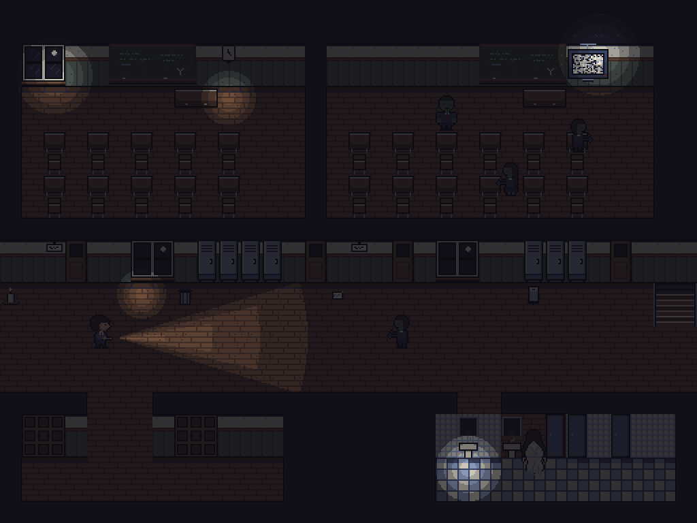 |
|---|---|
| 마을 거리 ([`map_village_td`](mockups/map_village_td.png), 512x288) | 학교 한 층 ([`map_school_floor_td`](mockups/map_school_floor_td.png), 512x384) |
| 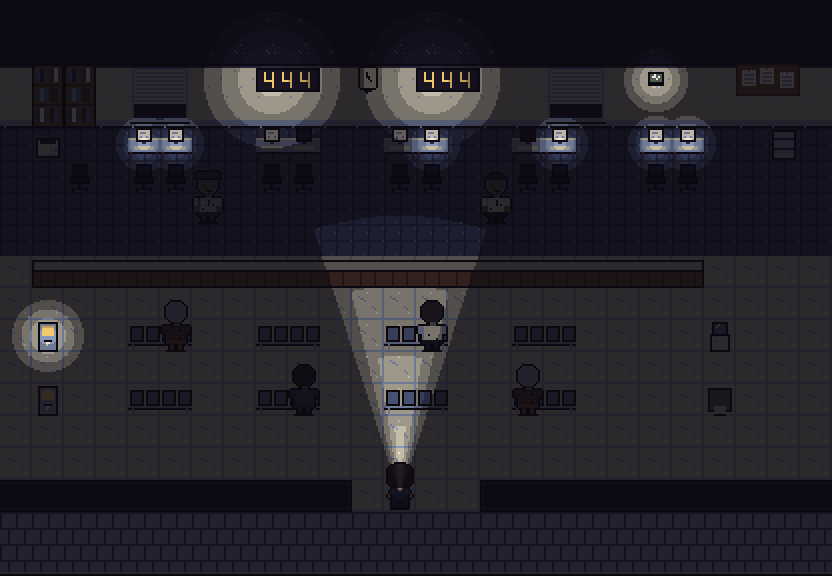 | 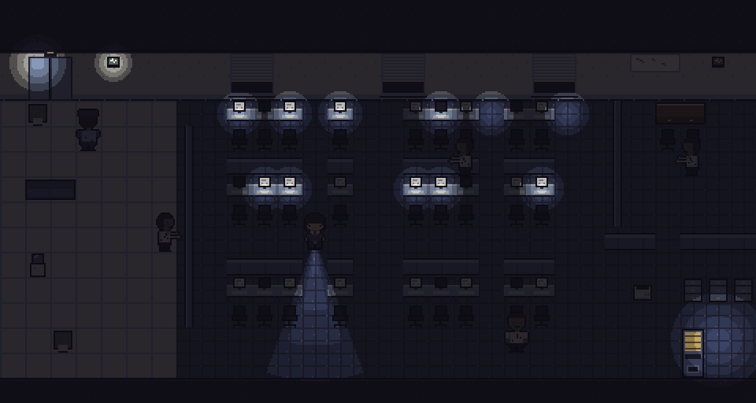 |
| 주민센터 ([`map_civic_td`](mockups/map_civic_td.png), 416x288) | 회사 사무실 ([`map_office_td`](mockups/map_office_td.png), 480x256) |

- **마을**: 3층 벽돌 빌라(방범창), 셔터 내린 가게, 혼자 불 켜진 편의점, 창가에 선 사람, 횡단보도, 전봇대, 주차된 차, 버스 정류장, 골목(쓰레기봉투, 스티로폼 화분). 좀비가 도로에 있고 주인공은 차 뒤에 숨음.
- **학교 한 층**: 북쪽 교실 두 칸(칠판, TV, 책상 줄), 복도(문, 사물함, 계단, 촛불), 남쪽 신발장 현관과 화장실(형체가 비친 거울과 소복 귀신). 교실에 좀비 학생.
- **주민센터**: 번호 표시기가 444에 멈춘 대기실, 대기 의자에 앉은 좀비들, 창구 뒤 직원 좀비, 번호표 발급기.
- **회사**: 정전된 층, 몇 대만 켜진 모니터, 칸막이 사이의 회사원 좀비, 엘리베이터 로비, 유리 회의실, 탕비실.

타일셋:

| 파일 | 내용 | 미리보기 |
|---|---|---|
| [`tiles/tiles_town_td.png`](tiles/tiles_town_td.png) | 도로·차선·횡단보도, 보도·연석, 벽돌 벽면, 방범창 창문(불 켜진 창과 사람 그림자 포함), 현관문, 셔터, 편의점 정면, 간판 자리(글자 없음), 전봇대·전선, 승용차, 버스 정류장, 맨홀, 쓰레기봉투, 자판기, 담장, 스티로폼 화분, 횡스크롤용 도로·보도 | [x4](previews/tiles_town_td_x4.png) |
| [`tiles/tiles_office_td.png`](tiles/tiles_office_td.png) | 카펫·사무실 바닥·대리석, 사무실 벽면, 블라인드 창, 엘리베이터, 유리문, 화이트보드, 444 번호 표시기, 비상구 표시, PC 책상(켜짐·꺼짐), 사무용 의자, 칸막이, 서류함, 프린터, 정수기, 소파, 화분, 민원 창구, 번호표 발급기, 대기 의자, 책장, 줄 서기 기둥 | [x4](previews/tiles_office_td_x4.png) |

쓰는 법:

- **벽**: 벽 윗면(`walltop`) 아래에 벽면 두 줄(`face_upper`, `face_lower`)을 둡니다. 3/4 시점의 벽면은 정면에서 보이므로, 횡스크롤용 소품을 그대로 벽면에 붙일 수 있습니다. 창문(2x2), 사물함(1x2), 칠판(4x2), TV(2x2), 거울(1x2), 게시판, 시계, 명패, 부적, 금줄이 모두 두 줄짜리 벽면에 맞습니다.
- **그림자**: 벽면 바로 아래 바닥에는 `floor_wood_shadow`·`floor_tile_shadow`를 깝니다.
- **남쪽 벽**: 바깥(아래)을 향한 벽은 면이 보이지 않으므로 윗면만 둡니다.
- **도깨비불**은 방향이 없으므로 기존 `enemy_dokkaebi_bul.png`을 그대로 씁니다.
- 목업 맵은 ASCII로 그린 배치를 저작용 스크립트로 `.scene`으로 바꾼 것입니다(벽 윗면 16종 자동 선택, 바닥 무늬 섞기, 벽 그림자). 실제 레벨은 AGM G의 TileMap 편집기에서 이 타일셋으로 만듭니다.

## 상황 컨셉 이미지

게임 속 장면을 실제 게임 화면 크기(320x180)로 합성한 컨셉입니다. 레벨 설계안이 아니라 분위기와 연출 방향을 맞추기 위한 그림입니다. 모두 [`concepts/`](concepts/)에 있습니다.

| | | |
|---|---|---|
| 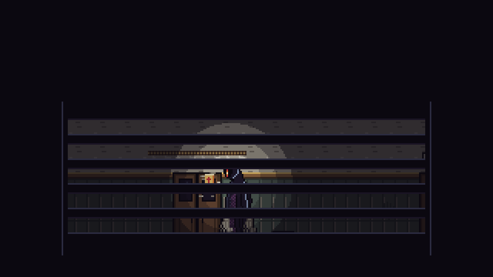 | 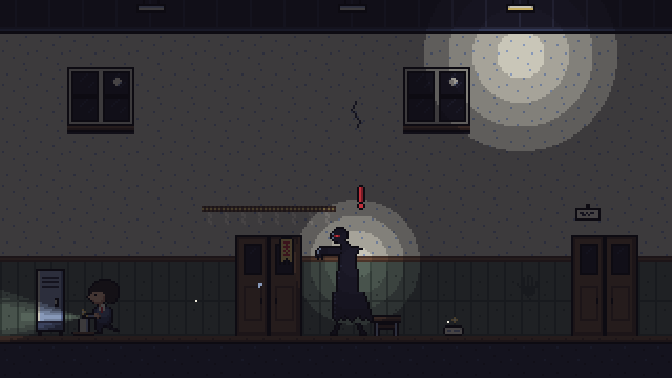 |  |
| **숨기**: 사물함 환기구 틈으로 본 복도. 그림자 손님이 손 닿을 거리로 지나가고, 틈 사이로 붉은 눈이 보임 (`fx/locker_vents.png` 덧씌우기) | **추격**: 손전등을 앞으로 비추며 달아나는 주인공, 팔을 뻗고 미끄러지듯 쫓는 그림자 손님, 머리 위 경고 표시 | **마을 습격**: 횡스크롤 거리. 불 켜진 편의점 앞을 지나 좀비 떼에게서 달아남. 창가의 사람 그림자 |
| 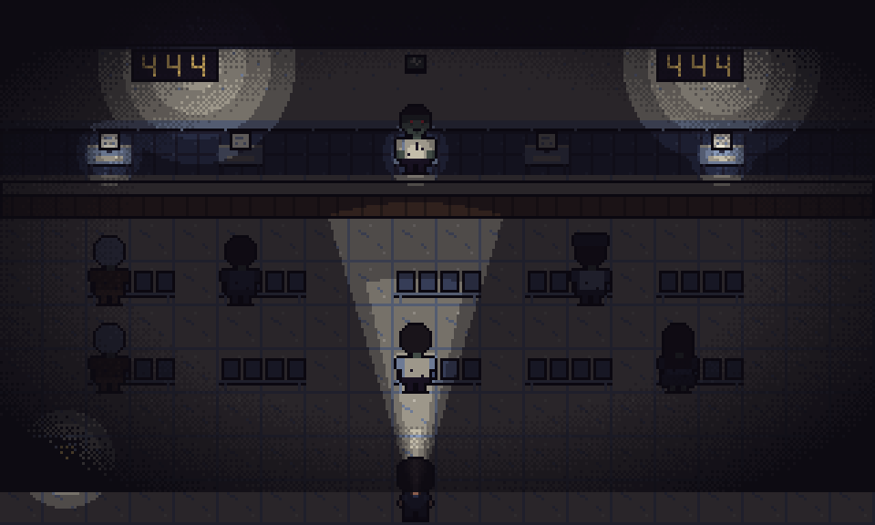 | 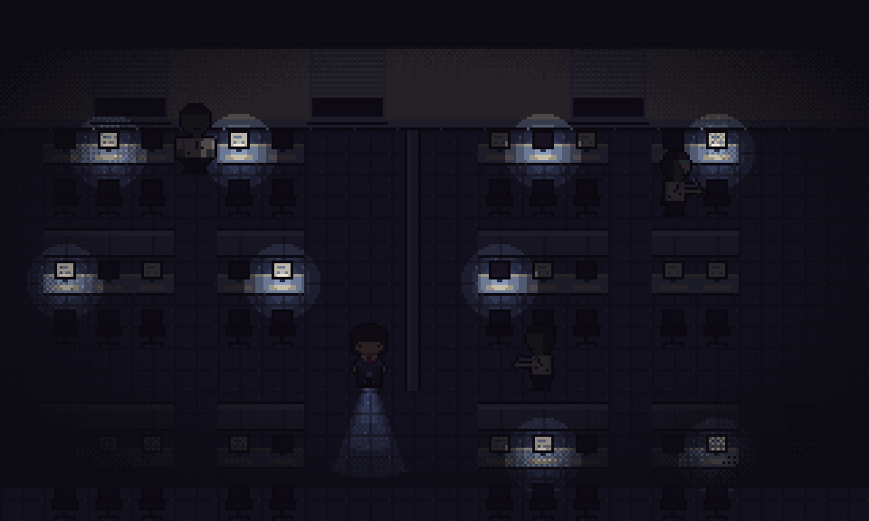 | 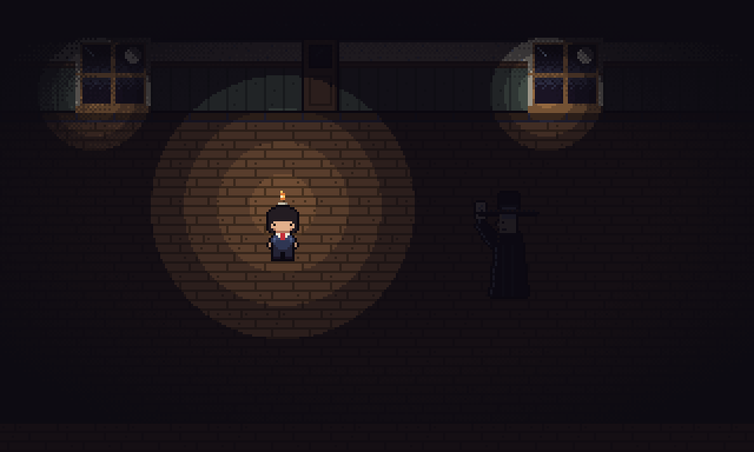 |
| **대기실**: 444번을 부르는 주민센터. 의자마다 일어나지 않을 사람이 앉아 있음 | **정전**: 몇 대 남은 모니터 불빛 사이를 떠도는 회사원 좀비, 칸막이 뒤에 숨은 주인공 | **촛불의 경계**: 체크포인트 촛불 안에 무릎 꿇은 주인공과 빛이 끝나는 곳에 멈춘 저승사자 |
| 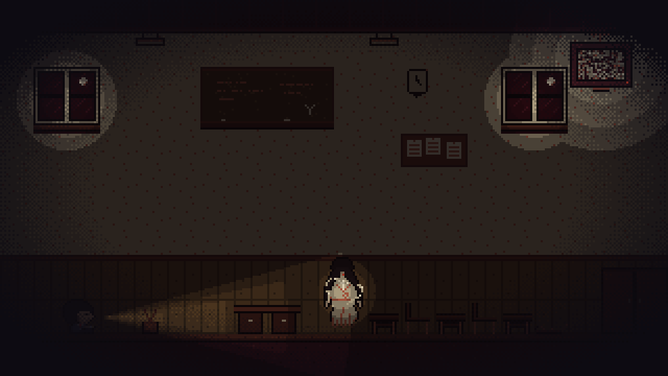 | 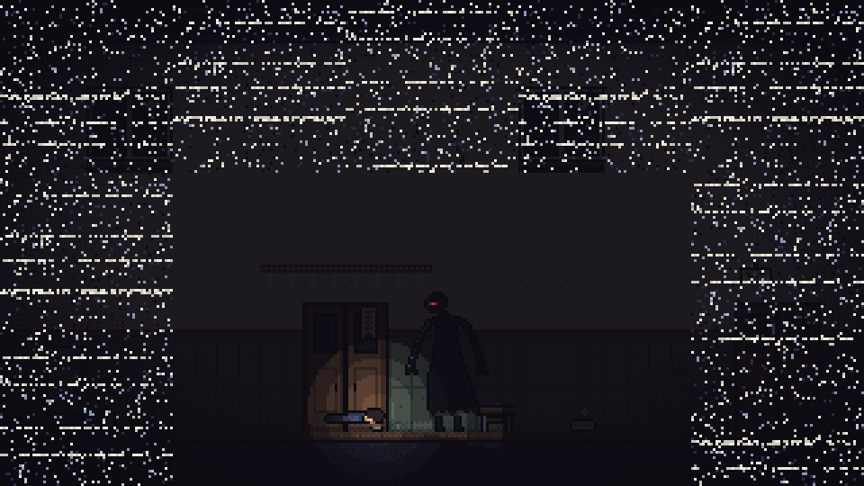 | 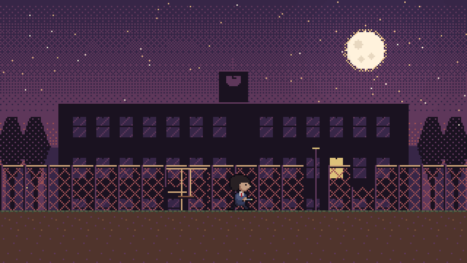 |
| **이계의 교실**: 이계 팔레트, 머리카락을 걷어 올리는 소복 귀신, 안개 소용돌이, 웅크린 주인공 | **게임 오버**: 떨어진 손전등, 내려다보는 그림자 손님, 가장자리부터 번지는 노이즈 | **새벽 탈출**: 운동장을 [`palette/dawn.pal`](palette/dawn.pal)로 바꿔 그린 새벽. 실루엣만 남은 학교, 열린 교문 |

`dawn.pal`은 이계 팔레트와 같은 방식(같은 키, 다른 색)이라, 엔딩이나 탈출 구간에 팔레트 교체 셰이더로 바로 쓸 수 있습니다.

## 점프스케어

화면 전체(320x180)를 덮는 점프스케어 그림입니다. 괴이의 얼굴을 클로즈업한 8종, 아래 **1인칭 시점** 8종, 고어 세트의 2종이 있습니다. [`jumpscares/`](jumpscares/)에 있고, 시트마다 프레임이 위에서 아래로 쌓여 있습니다(1열). 프레임을 차례로 보여 "다가온다·눈을 뜬다" 같은 짧은 움직임을 만듭니다.

| | | | |
|---|---|---|---|
| 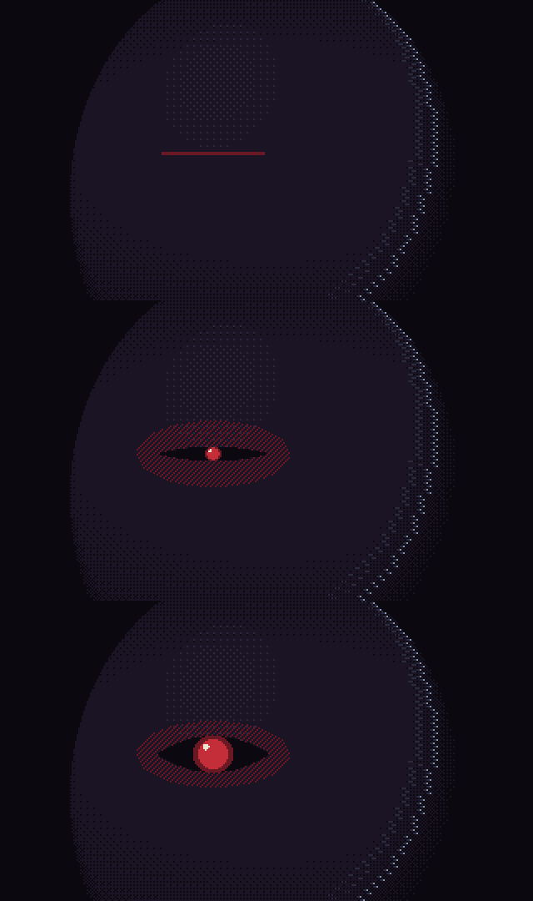 | 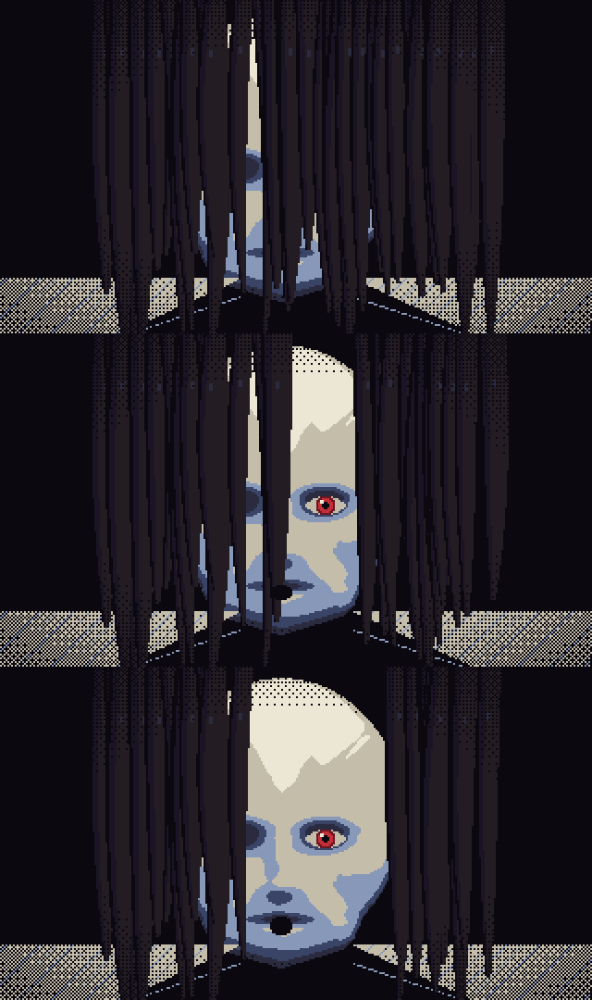 | 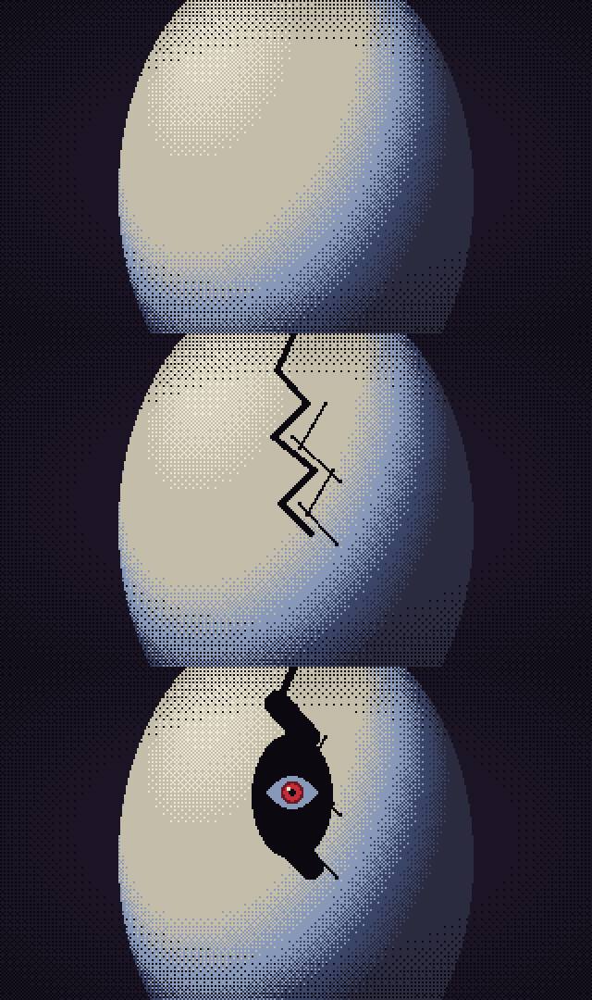 | 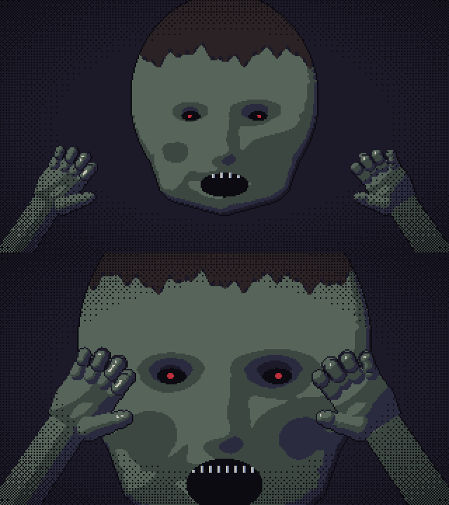 |
| **그림자 손님**: 얼굴 없는 어둠이 화면을 채우고 붉은 외눈이 뜸. `closed opening open` | **소복 귀신**: 얼굴을 가린 머리카락이 갈라지며 한쪽 눈과 벌린 입. `hair parting face` | **달걀귀신**: 매끈한 얼굴에 금이 가고 그 틈으로 눈이 내다봄. `smooth crack eye` | **좀비**: 퀭한 눈, 벌린 입, 뻗은 손으로 카메라를 덮침. `near closer` |
| 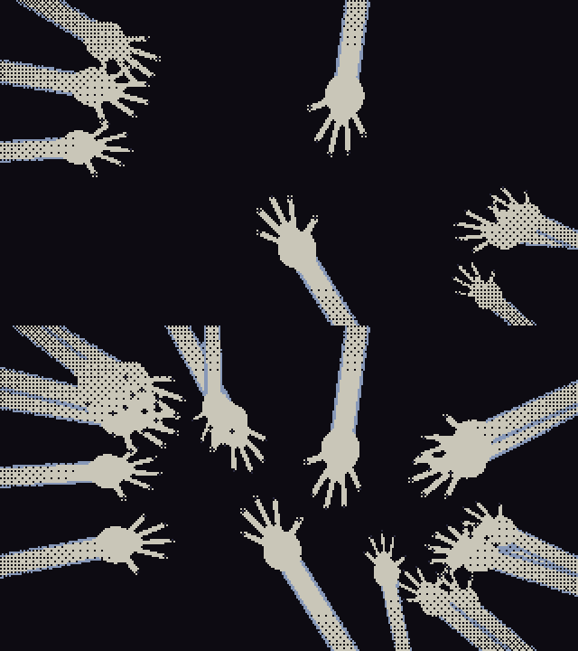 | 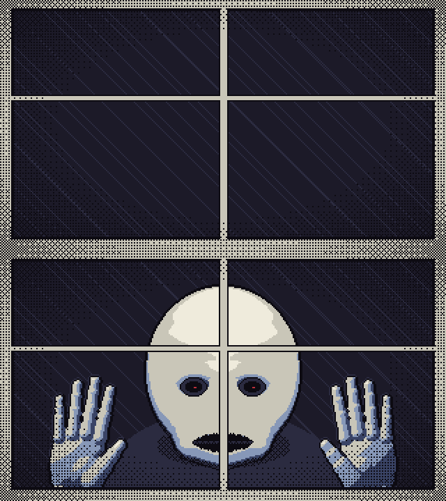 | 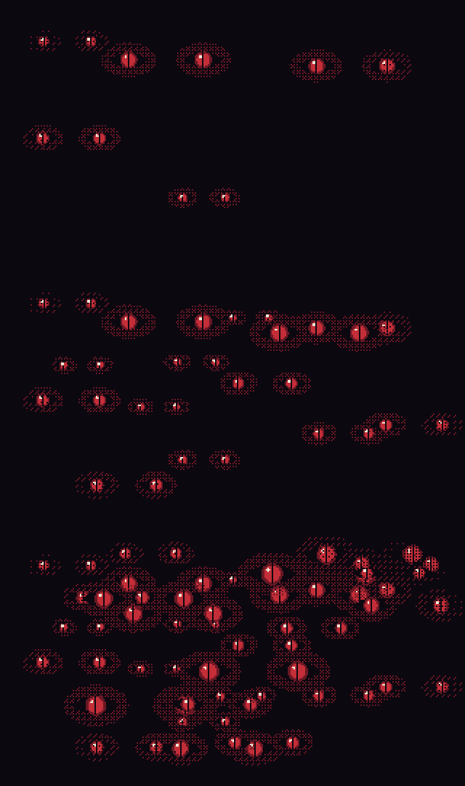 | 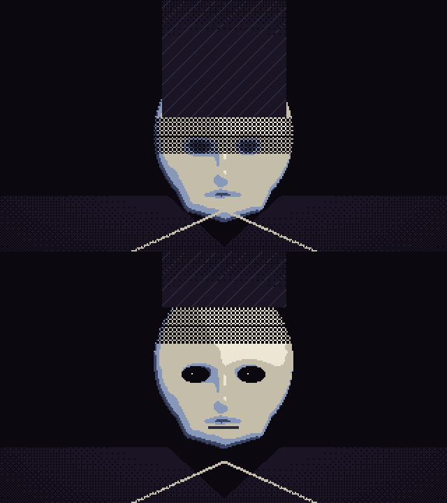 |
| **손**: 화면 가장자리 사방에서 창백한 손들이 가운데로 뻗어 옴. `few all` | **창문**: 빈 창밖에 누군가 얼굴과 손바닥을 붙이고, 입김이 유리에 서림. `empty face` | **눈**: 어둠 속에서 붉은 눈이 한 쌍씩 늘어남. `few more many` | **저승사자**: 숙인 갓 아래로 고개를 들면 창백하고 담담한 얼굴, 텅 빈 검은 눈. `bowed looks` |

쓰는 법(제안):

- **조용한 예고 뒤에 짧게**: 소리가 잦아들고(환경음 끊김, 형광등 꺼짐) 1~2초 뒤, 마지막 프레임까지 0.3~0.6초에 보여 주고 `sfx/jumpscare.wav`와 [`fx/fx_static.png`](fx/fx_static.png)을 겹칩니다. 남발하면 효과가 떨어지므로 구간마다 한 번 이하를 권합니다.
- **깜박임 줄이기**: 옵션이 켜져 있으면 프레임을 넘기지 않고 마지막 프레임만, 노이즈 없이 보여 줍니다([`docs/resource-needs.md`](../../../docs/resource-needs.md) 5절의 광과민성 옵션).
- **고어 없음**: 위 8종은 피·상처 없이 얼굴, 눈, 손, 실루엣만으로 겁을 줍니다. 빨강은 눈에만 썼습니다. 고어판은 아래 "고어 세트" 절.
- 주로 실패(잡힘) 직전이나 이벤트 연출에 씁니다. 실패 연출 자체는 암전·소리로 처리한다는 D9는 그대로입니다.

### 1인칭 시점 점프스케어

주인공의 눈으로 본 장면입니다. 손전등을 든 손, 휴대폰을 쥔 손, 세면대를 짚은 손처럼 **내 몸이 화면 가장자리에 보이게** 해서, 위의 클로즈업보다 "내가 거기 있다"는 느낌을 줍니다. 원근 복도·교실은 저작용 스크립트의 작은 조명 렌더러(재질별 색 단계 + 손전등 원)로 칠했습니다.

| | | | |
|---|---|---|---|
| 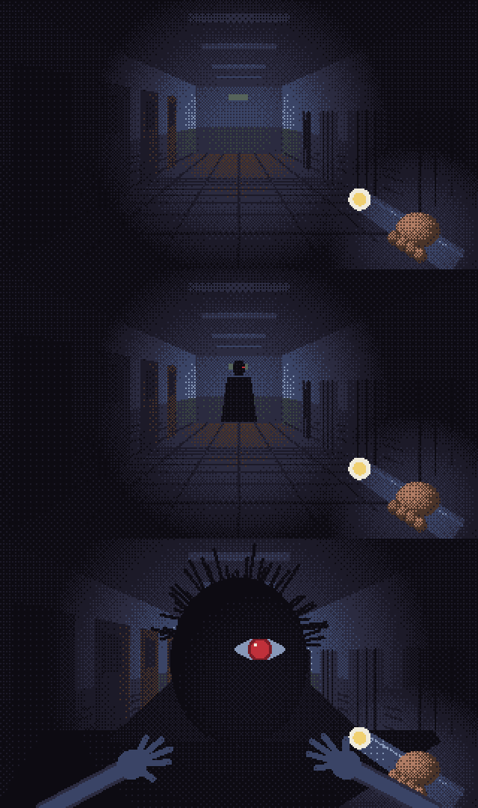 | 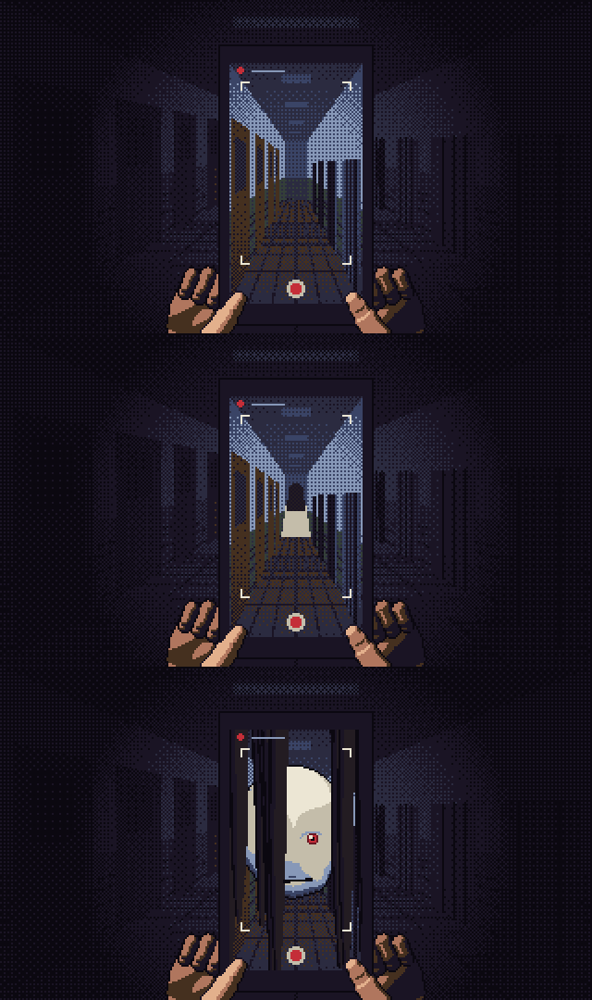 | 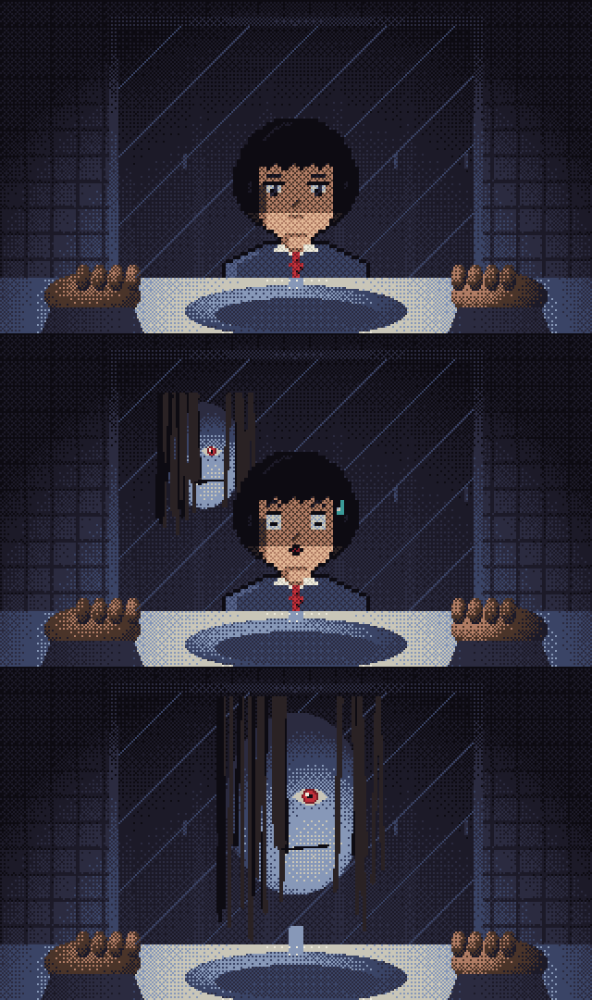 | 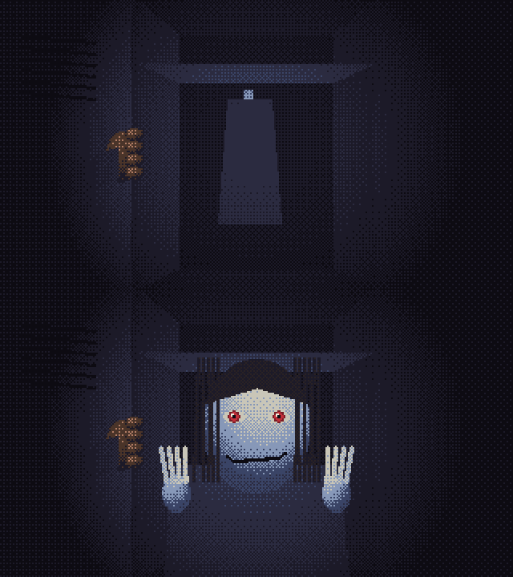 |
| **손전등**: 빈 복도 끝에 서 있던 형체가 다음 순간 코앞에서 손을 뻗음. `empty far near` | **휴대폰 화면**: 눈으로는 빈 복도인데 화면에만 서 있는 소녀, 이어서 화면을 채우는 얼굴. `empty there face` | **거울**: 내 어깨 너머의 얼굴, 그다음 거울에서 내가 사라지고 그것만 남음. `alone behind gone` | **사물함**: 열어 보니 걸린 교복, 다음엔 웅크려 들어앉은 누군가가 벽을 짚고 웃음. `jacket inside` |
| 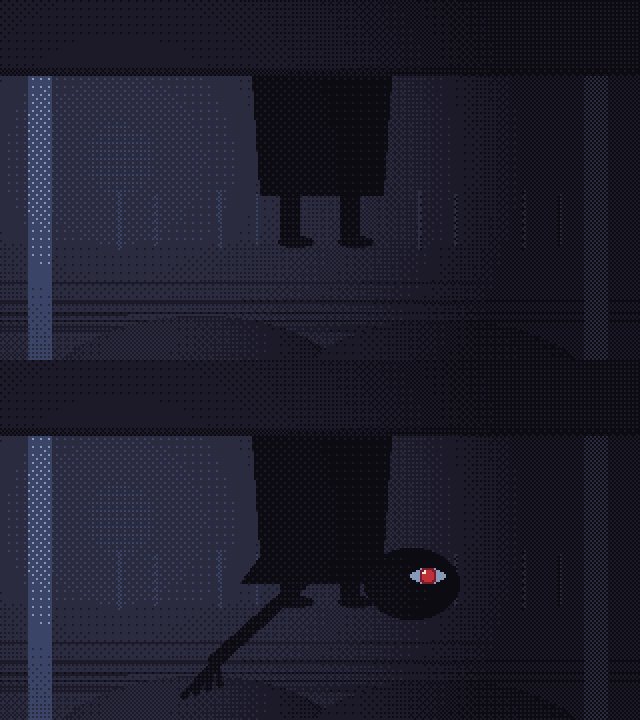 | 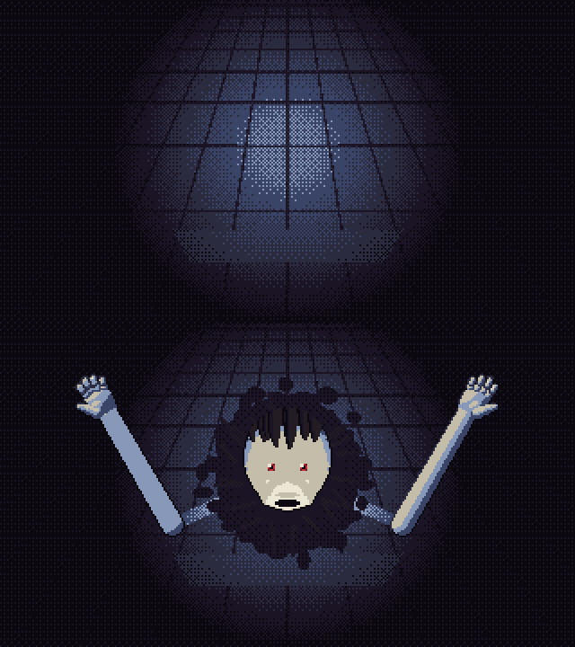 | 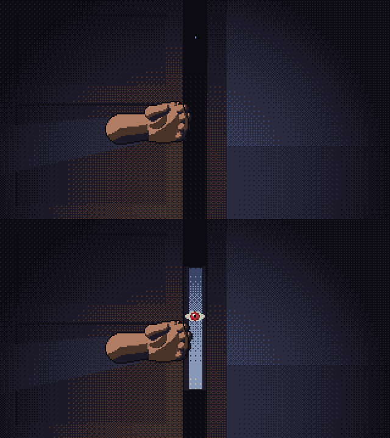 | 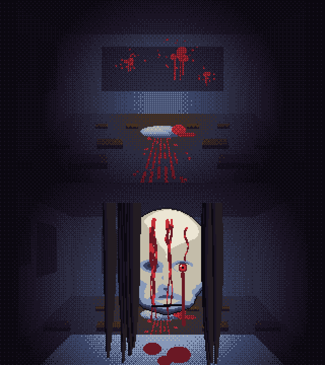 |
| **책상 밑**: 숨은 책상 앞에 멈춘 외투 자락과 발, 이어서 바닥까지 고개를 숙여 들여다보는 그림자 손님. `feet looks` | **천장**: 손전등으로 비춘 천장 타일, 그 빛 안에 매달린 여자와 늘어진 머리카락. `tiles there` | **문틈**: 살짝 열린 문틈 너머의 어둠, 다음엔 바로 맞은편에서 들여다보는 눈. `gap eye` | **교실 문 (고어)**: 칠판의 피, 통로를 따라 끌린 자국과 덮인 시신, 다음엔 코앞의 피투성이 원귀. `room there` |

고어가 아닌 7종은 `jumpscare_fp_*.png`, 고어판은 `jumpscare_fp_gore_classroom.png`입니다. 거울 장면의 비친 주인공은 대화용 얼굴(`protagonist_faces`)을 2배로 키워 아래에서 비춘 것처럼 어둡게 한 것이라, 얼굴 디자인이 바뀌면 다시 생성합니다.

## 바다·배·항구 마을

밤의 작은 어항입니다. 탑다운(쯔꾸르식)과 횡스크롤 양쪽 타일, 바다 배경, 오징어잡이 배, 맵·목업·컨셉을 함께 만들었습니다.

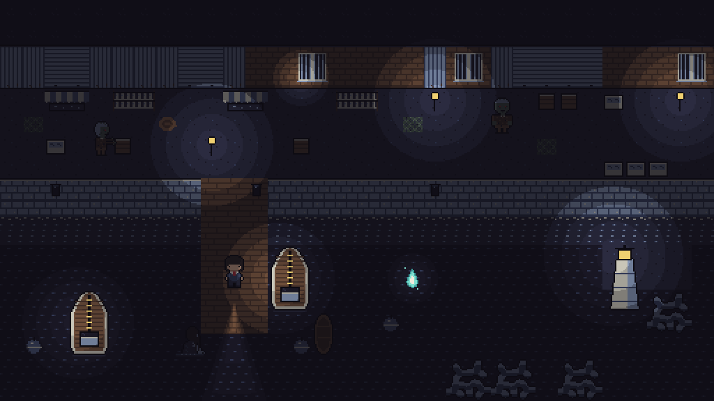

| 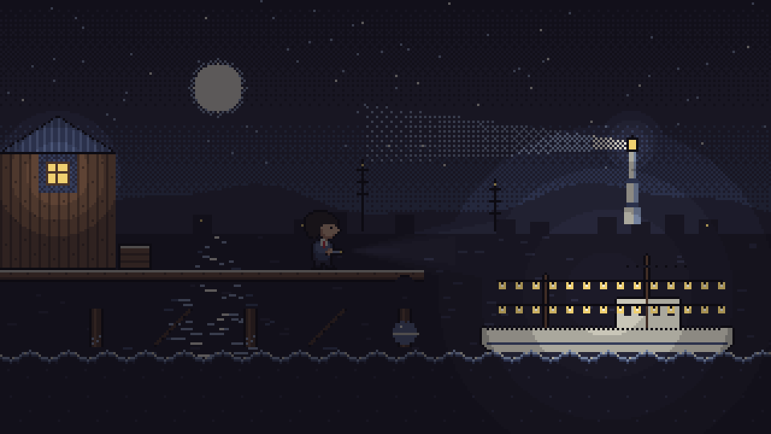 | 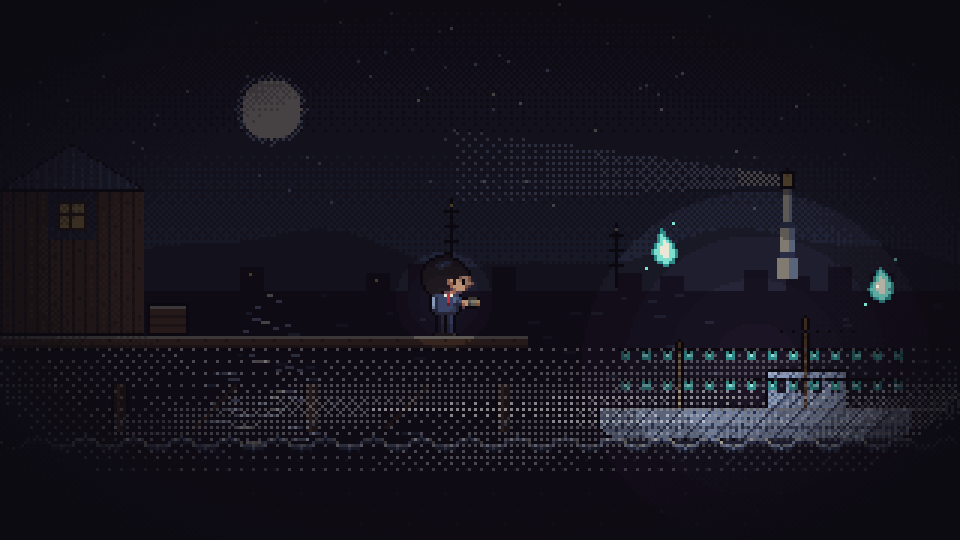 | 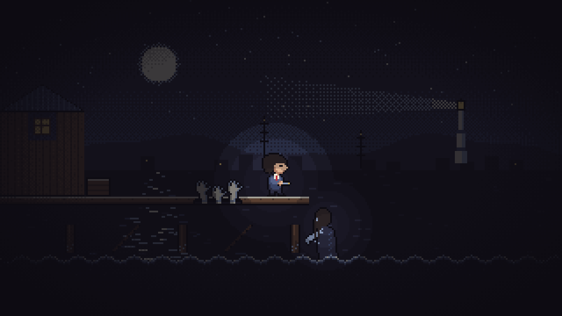 |
|---|---|---|
| **부두의 밤** (목업): 불 켜진 창의 항구 집, 말뚝 위 부두, 집어등을 켠 오징어잡이 배, 먼 곶의 등대 | **유령선** (컨셉): 바다 안개 속에서 청록 집어등을 단 배가 다가옴. 부두 끝의 주인공과 도깨비불 | **부두 끝** (컨셉): 물귀신이 부두 옆 물에서 올라와 손을 뻗고, 판자 틈으로 창백한 손들이 솟음 |

| 파일 | 내용 | 미리보기 |
|---|---|---|
| [`tiles/tiles_port_td.png`](tiles/tiles_port_td.png) | 탑다운 16x16. 깊은 물·얕은 물(각 2프레임 물결), 안벽 벽면(`quay_upper`·`quay_lower`, 벽면 두 줄 규칙과 같음), 부두 판자·끝, 계류 기둥(볼라드), 모래, 갯바위, 테트라포드 더미(2x2), 오징어잡이 배(2x3, 뱃머리가 위, 집어등 줄), 나룻배(1x2), 부표, 밧줄 더미, 상자, 생선 상자, 그물 더미, 오징어 덕장(2x1), 창고 벽면(골함석), 노점 천막(2x1), 등대(2x3) | [x4](previews/tiles_port_td_x4.png) |
| [`tiles/tiles_port_side.png`](tiles/tiles_port_side.png) | 횡스크롤 16x16. 부두 판자(아래에서 통과하는 one-way), 말뚝, 가새, 수면(2프레임, 닿으면 위험 지형 후보)·물속, 상자, 폐타이어 방현재, 매달린 부표, 항구 집 판벽·밑단, 함석지붕(3x1), 불 켜진 창·꺼진 창 | [x4](previews/tiles_port_side_x4.png) |
| [`backgrounds/bg_sea.png`](backgrounds/bg_sea.png) | 패럴랙스 맨 뒤: 밤하늘, 달, 수평선(y=96), 끊긴 줄로 그린 달빛 반사. 불투명. 시작 배율 0.05 | [x2](previews/bg_sea_x2.png) |
| [`backgrounds/bg_harbor.png`](backgrounds/bg_harbor.png) | `bg_sea` 위에 겹침: 먼 해안선과 마을 불빛, 곶의 등대와 빛줄기, 정박한 배의 돛대. 위쪽은 투명. 시작 배율 0.2 | [x2](previews/bg_harbor_x2.png) |
| [`characters/boat_squid.png`](characters/boat_squid.png) | 112x56, 1열 3프레임. 횡스크롤 오징어잡이 배 `bob_0 bob_1`(물결에 1px 흔들림, 노란 집어등 두 줄)과 `ghost`(유령선: 청록 집어등, 빗금으로 비친 선체, 아래로 흐려짐) | [x3](previews/boat_squid_x3.png) |
| [`fx/fx_sea_fog.png`](fx/fx_sea_fog.png) | 320x180 바다 안개 띠. `palette/light.pal`의 반투명 흰색 디더라 어둠 위에 덧씌움 | [x2](previews/fx_sea_fog_x2.png) |
| [`mockups/map_port_td.png`](mockups/map_port_td.png) | 512x288 탑다운 항구 맵: 창고·벽돌집 벽면, 노점과 오징어 덕장, 안벽, 바다로 난 부두, 집어등 켠 배 두 척, 나룻배, 부표, 방파제 테트라포드, 등대. 부두 옆 물에 물귀신, 바다 위에 도깨비불, 거리에 노인 좀비 | [x2](previews/map_port_td_x2.png) |
| [`mockups/port_night_side.png`](mockups/port_night_side.png), [`concepts/concept_ghost_ship.png`](concepts/concept_ghost_ship.png), [`concepts/concept_pier_grab.png`](concepts/concept_pier_grab.png) | 위 세 장면, 각 320x180 | [x3](previews/port_night_side_x3.png) |

쓰는 법:

- **물 앞뒤**: 횡스크롤 장면에서는 배·물귀신을 그린 **다음** 수면·물속 타일 레이어를 한 번 더 그려, 물체가 수면 아래로 잠기게 합니다(목업의 `.scene`이 그 순서). 게임에서는 수면 타일맵을 캐릭터보다 앞 레이어에 둡니다.
- **배의 흘수선**: `boat_squid`의 선체는 셀의 44번째 줄부터 아래가 어두운 배 밑(`N`)이라, 그 줄을 수면 높이에 맞추면 됩니다.
- **안벽**: 탑다운에서는 땅 끝에 `quay_upper`·`quay_lower` 두 줄을 두고 그 아래에 `shallow`, 그다음 `water`를 깝니다. 부두(`pier`)는 안벽을 끊고 바다까지 이어 깝니다.
- 집어등·등대·불 켜진 창은 빛을 받지 않는 레이어에 두거나 PointLight2D를 붙입니다.

## 고어 세트 (선택)

[`docs/decisions.md`](../../../docs/decisions.md)의 D9에 따라 고어 표현은 **따로 떼어 둔 선택 세트**입니다. 설정의 "고어 표현"을 켜면 아래 파일을 쓰고, 끄면 오른쪽 열의 비고어 원본을 씁니다. 모든 고어 파일 원본 머리말에 `GORE SET` 표시가 있습니다.

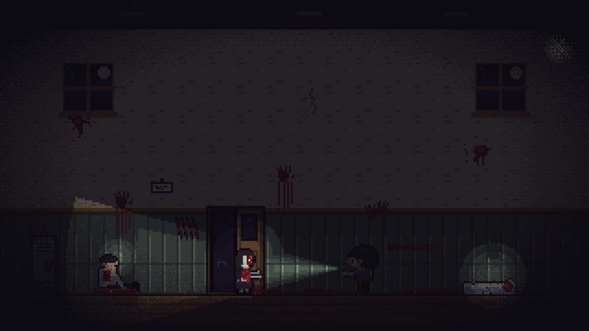

| 고어 파일 | 내용 | 끄면 대신 쓰는 것 | 미리보기 |
|---|---|---|---|
| [`tiles/tiles_gore.png`](tiles/tiles_gore.png) | 횡스크롤 데칼(투명 배경): 바닥 피 웅덩이(2x1·작은 것), 벽에 튄 피 3종, 손자국, 미끄러져 내린 손자국(1x2), 벽을 따라 끈 손자국(2x1), 바닥을 끈 자국(2x1), 천장에서 떨어지는 피(3프레임), 핏방울, 손톱 긁힌 자국, 흰 천을 덮은 시신(2x1), 환기구와 문 밑으로 피가 새는 사물함(1x2) | 데칼 없음. 사물함은 `locker` | [x4](previews/tiles_gore_x4.png) |
| [`tiles/tiles_gore_td.png`](tiles/tiles_gore_td.png) | 탑다운 데칼: 웅덩이(1x1·2x2), 튄 피, 끈 자국(가로 2x1·세로 1x2), 발자국(가로·세로), 손자국, 흰 천을 덮은 시신(2x1), 분필 윤곽선 | 데칼 없음 | [x4](previews/tiles_gore_td_x4.png) |
| [`characters/gore_corpses.png`](characters/gore_corpses.png) | 32x32, 시신 3종: 엎드린 학생, 눈을 뜬 채 누운 회사원, 벽에 기대 고개를 떨군 사람 | 흰 천을 덮은 시신도 빼거나 빈 자리 | [x4](previews/gore_corpses_x4.png) |
| `characters/zombie_*_gore.png` (5종) | 좀비 횡스크롤 시트의 고어판: 입가·셔츠 앞·손의 피. 프레임 배치가 같아 텍스처만 바꿈 | `zombie_*.png` | [학생](previews/zombie_student_gore_x6.png), [회사원](previews/zombie_office_gore_x6.png) |
| [`characters/creature_bloody_student.png`](characters/creature_bloody_student.png) | **피투성이 원귀**: 이마에서 쏟아진 피로 얼굴과 흰 블라우스가 젖은 여학생, 핏방울을 남기며 걸음. 24x32, `idle_0 idle_1 walk_0~3 lunge` | 소복 귀신 등 다른 괴이로 대체 | [x6](previews/creature_bloody_student_x6.png) |
| [`characters/protagonist_death_gore.png`](characters/protagonist_death_gore.png) | 40x32(주인공 셀을 오른쪽으로 8px 옮김). `hit`(잡힐 때 뒤로 튀는 핏방울, `death_0` 대신), `pool_0~2`(쓰러진 자리에 번지는 웅덩이, `death_2` 대신) | `protagonist_side`의 `death_0~2` | [x6](previews/protagonist_death_gore_x6.png) |
| [`fx/fx_blood_screen.png`](fx/fx_blood_screen.png) | 320x180 화면 덮개 3프레임: `hit`(두 모서리), `heavy`(가장자리 전체), `drip`(게임 오버: 위에서 흘러내림) | 비네트 또는 암전 | [x2](previews/fx_blood_screen_x2.png) |
| [`jumpscares/jumpscare_gore_bloody_tears.png`](jumpscares/jumpscare_gore_bloody_tears.png) | 소복 귀신의 눈에서 피눈물, 머리 가르마와 입에서 흐르는 피. `tears streams` | `jumpscare_sobok_ghost` | [x2](previews/jumpscare_gore_bloody_tears_x2.png) |
| [`jumpscares/jumpscare_gore_handprints.png`](jumpscares/jumpscare_gore_handprints.png) | 창밖에서 피 묻은 손바닥이 차례로 유리를 치고 흘러내림. `one three six` | `jumpscare_window` | [x2](previews/jumpscare_gore_handprints_x2.png) |
| [`jumpscares/jumpscare_fp_gore_classroom.png`](jumpscares/jumpscare_fp_gore_classroom.png) | 1인칭: 피로 물든 교실과 피투성이 원귀 (위 1인칭 절) | `jumpscare_fp_door_gap` | [x2](previews/jumpscare_fp_gore_classroom_x2.png) |
| [`concepts/concept_gore_aftermath.png`](concepts/concept_gore_aftermath.png), [`mockups/map_classroom_gore_td.png`](mockups/map_classroom_gore_td.png) | 복도 컨셉(위 그림)과 탑다운 교실 맵의 고어판 | `concept_hide` 등, `map_classroom_td` | [복도](previews/concept_gore_aftermath_x3.png), [교실](previews/map_classroom_gore_td_x2.png) |

수위는 "직접 보여 주되 오래 비추지 않는다"에 맞췄습니다. 상처 부위나 훼손된 몸을 클로즈업하지 않고 피, 끈 자국, 덮인 시신처럼 **일이 벌어진 뒤의 흔적**으로 상상하게 합니다. 등급(게임물관리위원회)과 Steam 성인 콘텐츠 설문에는 고어 세트를 켰을 때 기준으로 답해야 합니다.

## 무당과 굿

한국 무속의 굿을 이야기 장치로 쓸 수 있게 만든 인물과 장면입니다. 특정 실존 무당·굿당·무신도를 옮기지 않았고, 복식과 무구는 일반적인 형태(홍철릭·전립, 장삼·고깔, 부채·방울, 오방기, 작두, 지전, 넋당석, 질베)를 단순화했습니다. 실제 굿의 절차를 정확히 재현한 것이 아니라 공포 연출을 위한 각색이므로, 이야기에 넣을 때는 무속을 조롱하거나 악마화하지 않도록 대사와 맥락을 확인합니다.

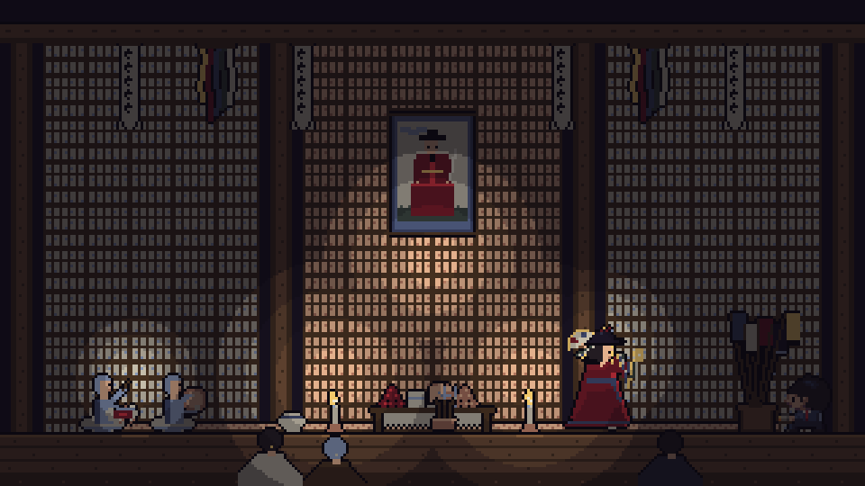

| | | |
|---|---|---|
| 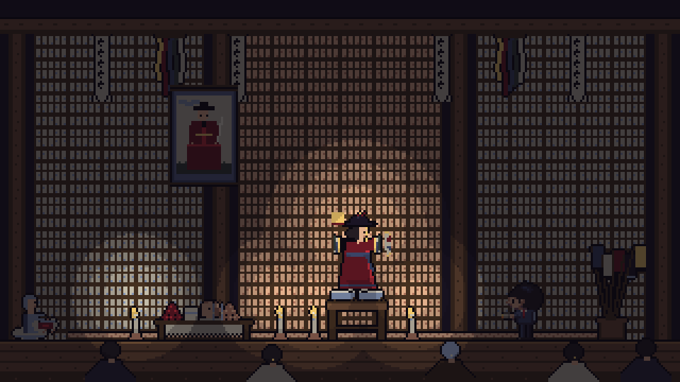 | 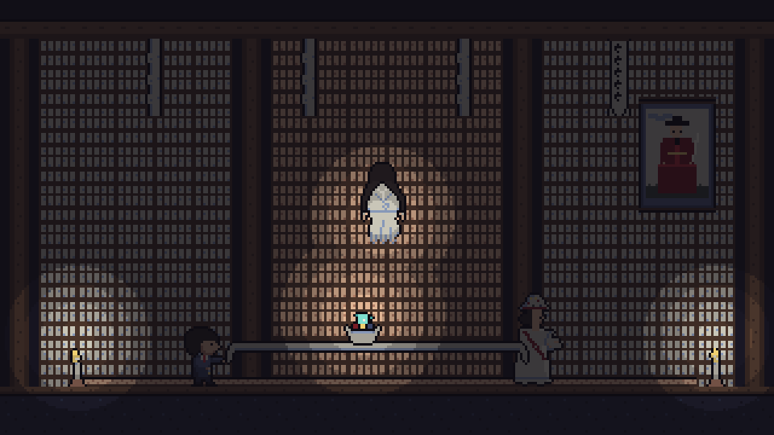 | 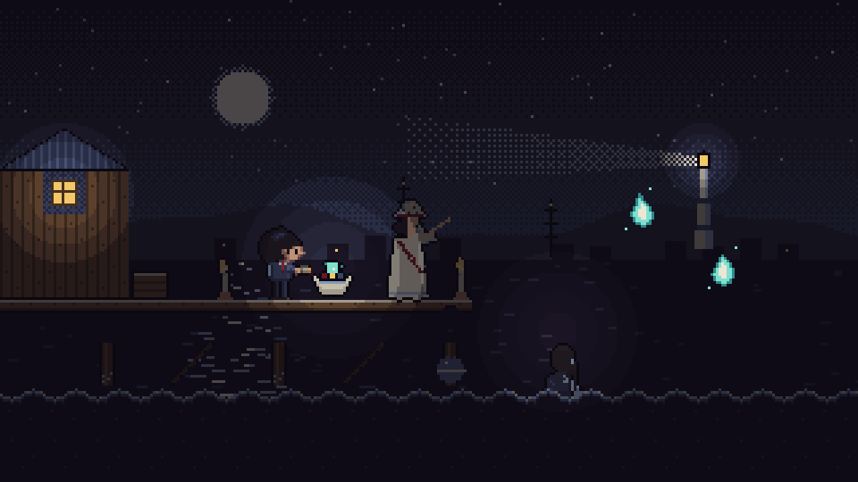 |
| **작두타기**: 두 개의 작두날 위에 맨발로 선 무당이 깃발과 부채로 균형을 잡고, 마을 사람들이 지켜봄 | **씻김굿 길닦음**: 주인공과 무당이 질베를 팽팽히 잡고, 넋이 든 넋당석이 그 위를 미끄러짐. 소복 귀신이 조용히 뒤따름 | **넋건지기**: 부두 끝에서 흰 옷의 무당이 신대를 바다로 내밀고, 넋당석과 촛불 앞에서 물귀신이 올라옴 (항구 타일 재사용) |
| 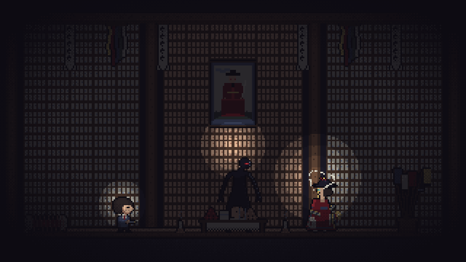 | 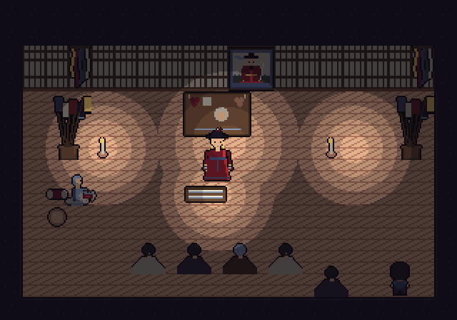 | |
| **굿이 틀어짐**: 촛불이 꺼지고 악사가 장구를 버리고 달아남. 무신도의 눈이 붉어지고, 신이 잘못 내린 무당이 칼을 들고 돌아서며, 굿상 뒤로 그림자 손님이 일어섬 | **탑다운 굿당** ([`map_gut_td`](mockups/map_gut_td.png), 320x224): 창호 벽과 무신도, 굿상, 네 귀퉁이의 오방기, 작두, 장구·징, 춤추는 무당, 등을 보인 마을 사람들 | |

인물:

| 파일 | 내용 | 미리보기 |
|---|---|---|
| [`characters/npc_mudang.png`](characters/npc_mudang.png) | **무당 (홍철릭·전립)**: 장군 거리 복식. 32x40(어른), 오른쪽을 봄. `idle_0 idle_1 walk_0~3 / dance_0~3(부채와 방울, 치맛자락이 퍼짐) bells fan warn(신칼을 겨눔) bison(꿇어앉아 비손) / possessed_0 possessed_1(고개를 젖히고 청록 눈) jakdu(작두 위에서 깃발과 부채) collapse(쓰러짐)` | [x4](previews/npc_mudang_x4.png) |
| [`characters/npc_mudang_white.png`](characters/npc_mudang_white.png) | **무당 (흰 장삼·고깔)**: 씻김굿·넋건지기 복식, 붉은 가사, 종이꽃 고깔. `idle walk dance_0~3 pole(신대를 내밂) cloth(질베를 잡음) bison collapse` | [x4](previews/npc_mudang_white_x4.png) |
| [`characters/$npc_mudang_topdown.png`](characters/$npc_mudang_topdown.png) | 홍철릭 무당 탑다운, MV/MZ `$` 배치, 32x40 셀 | [x4](previews/npc_mudang_topdown_x4.png) |
| [`portraits/mudang_faces.png`](portraits/mudang_faces.png) | 대화용 얼굴 48x48: `neutral stern shout(경고) possessed(신내림, 청록 눈) smile chant(눈 감고 축원)` | [x4](previews/mudang_faces_x4.png) |
| [`characters/npc_gut_musicians.png`](characters/npc_gut_musicians.png) | 악사 24x24, 앉은 자세: 장구 `janggu_0/1`, 징 `jing_0/1` | [x6](previews/npc_gut_musicians_x6.png) |
| [`characters/npc_onlookers.png`](characters/npc_onlookers.png) | 굿을 지켜보는 마을 사람(뒷모습) 24x32: 흰 한복에 비녀, 어두운 점퍼, 갈색 조끼의 노인. 선 자세·앉은 자세. 화면 앞쪽에 두어 관객 시점을 만듦 | [x6](previews/npc_onlookers_x6.png) |

타일:

| 파일 | 내용 | 미리보기 |
|---|---|---|
| [`tiles/tiles_gut.png`](tiles/tiles_gut.png) | 횡스크롤 16x16: 돗자리, 창호 벽(촛불에 물든 판 포함), 기둥, 대들보, 굿상(3x2: 사과·배 괴임, 떡, 돼지머리, 북어, 흰 천), 촛대(2프레임 깜박임·꺼짐), 향로, 무신도(2x3, 앉은 장군)와 **눈이 붉어진** 무신도, 오방기(2x3), 지전(1x2), 오색 천(1x2), 장구(2x1), 징 걸이(1x2), 작두(2x2), 신대(1x3), 넋당석(넋이 든 것 포함), 질베(왼끝·가운데·오른끝), 고(매듭 지은 흰 천, 1x2), 정화수, 문 위에 거는 북어 | [x4](previews/tiles_gut_x4.png) |
| [`tiles/tiles_gut_td.png`](tiles/tiles_gut_td.png) | 탑다운: 돗자리 바닥, 창호 벽면 두 줄, 위에서 본 굿상(3x2), 촛대, 작두(2x1), 장구, 징, 질베(가로·세로), 벽면용 무신도(2x2). 깃발·지전·넋당석은 횡스크롤 타일을 세워서 씀 | [x4](previews/tiles_gut_td_x4.png) |

쓰는 법(제안): 굿 장면은 장구·징 소리에 맞춰 `dance_0~3`을 돌리고, 촛불은 광원과 함께 깜박입니다. "굿이 틀어짐"으로 넘어갈 때는 촛대를 `candle_out`으로, 무신도를 `musindo_watch`로 바꾸고 무당을 `possessed_0/1`로 바꾸면 같은 무대에서 분위기만 뒤집을 수 있습니다.

## 이계: 팔레트 교체

모든 그림이 같은 20개 팔레트 키를 쓰므로, 이계는 타일셋을 따로 그리지 않고 **같은 키에 다른 색을 넣은 팔레트**로 만듭니다(design-references 2.3의 "세계 전환 = 화풍 전환").

- [`palette/otherworld.pal`](palette/otherworld.pal): 밤의 푸른색 대신 녹·마른 피·뼈 색, 영적 존재는 산성 초록. 키는 `night-school.pal`과 같아야 합니다.
- 목업에서는 `.scene`의 `@swap ../palette/otherworld.pal`로 바꾸고, 원래 색을 유지할 스프라이트에 `keep`을 붙입니다.
- 게임에서는 [`shaders/palette_swap.gdshader`](../../../shaders/palette_swap.gdshader)(GPL 코드)를 씁니다. `palette/lut_night_school.png`와 `palette/lut_otherworld.png`(20x1, 키 순서대로 한 픽셀씩)를 넘기면 색을 바꿔 칠하고, `amount`로 두 세계 사이를 섞을 수 있습니다. AGM G에서 아직 시험하지 않았습니다.

### 타일 목록 (`tiles_night_school.png`, 왼쪽 위부터)

| 행 | 타일 | 충돌 |
|---|---|---|
| 1 | `floor_top` `floor_fill` `floor_edge_l` `floor_edge_r` `ceiling` `lamp_off` `lamp_on` `shelf` | 바닥·천장은 고체, `shelf`는 아래에서 통과(one-way), 형광등은 소품 |
| 2 | `wall_plaster` `wall_plaster_crack` `wall_rail` `wall_wainscot` `wall_wainscot_hand` `sign_plate` `talisman` `geumjul` | 벽은 배경 레이어, 명패·부적·금줄은 벽 위 소품 레이어 |
| 3 | `desk` `window_0_0` `window_1_0` `window_0_1` `window_1_1` `door_0_0` `door_1_0` `door_0_1` | 책상은 낮은 one-way 발판 후보. 창문은 2x2, 미닫이문은 2x3 타일 (`이름_x_y`) |
| 4 | `door_1_1` `door_0_2` `door_1_2` `door_open_0_0` `door_open_1_0` `door_open_0_1` `door_open_1_1` `door_open_0_2` | 열린 문은 닫힌 문과 같은 2x3 배치 |
| 5 | `door_open_1_2` `locker_0_0` `locker_0_1` `locker_open_0_0` `locker_open_0_1` `note` `note_glint` `candle_lit_0` | 사물함은 1x2 타일(숨는 곳). 쪽지는 `note`/`note_glint`를 번갈아 깜박임 |
| 6 | `candle_lit_1` `candle_out` | 촛불 체크포인트: 켜짐 2프레임 깜박임, 꺼짐 |

명패에는 글자 대신 자리표시 무늬만 넣었습니다. 반 이름 같은 텍스트는 대사 규칙상 데이터로 따로 관리하거나, 확정 후 아트로 그립니다.

## AGM G에서 쓰는 법 (예정)

AGM G 프로젝트가 아직 없으므로 실제 임포트는 확인하지 않았습니다.

- 횡스크롤 시트: 24x32 격자로 잘라 애니메이션을 만듭니다. 권장 속도는 걷기 8fps, 대기 2fps, 도깨비불 8fps(추정값, 플레이 테스트로 조정).
- `$protagonist_topdown.png`: AGM G v2.0의 MV/MZ 캐릭터 시트 임포트 대상 배치입니다 (design-references 1.2·1.3).
- 타일셋: TileSet의 Tile Size를 16x16으로 두고, 바닥·천장에 Physics Layer, `shelf`·`desk`에는 one-way 충돌을 줍니다.
- 지형: `tiles_terrain_block`을 Terrain Set(모드 Match Sides)에 넣고, 각 타일의 면 비트를 프레임 번호대로 지정하면 발판을 붓으로 칠할 수 있습니다.
- 배경: `backgrounds/`의 세 장을 Parallax2D 세 개에 넣고 위 표의 스크롤 배율에서 시작합니다. 가로로 이어지게 만들었으므로 Repeat Size는 320입니다.
- 어둠과 빛: 목업의 어둠·광원은 PNG에 구운 것입니다. 게임에서는 CanvasModulate + PointLight2D로 같은 효과를 냅니다 ([`visual_assets.md` Q7](../../../research_notes/쯔꾸르%20리소스와%20스토리%20자원%20분석/visual_assets.md)). 그림자 손님의 눈과 도깨비불은 조명을 받지 않는 레이어(또는 unshaded 머티리얼)에 둡니다.

## 그리는 기준 (손·얼굴·머리카락)

손을 원과 선으로, 얼굴을 타원으로 그려 "도형을 이어붙인" 느낌이 나던 그림을 다시 그렸습니다. 원인, 레퍼런스, 규칙(구조로 그린 손, 면으로 나눈 얼굴, 덩어리 머리카락, 셀아웃, 뚜렷한 명암 단계)은 [`docs/pixel-technique.md`](../../../docs/pixel-technique.md)에 있습니다. 이전/이후 비교: [`comparisons/pixel_technique_before_after.png`](comparisons/pixel_technique_before_after.png) (원본 `.pix`가 없는 비교용 합성 이미지).

## 수정하는 법

원본은 `src/`의 텍스트 파일입니다. 한 글자가 픽셀 하나이고, 글자는 팔레트 키입니다.

- `.pix`: 스프라이트·타일셋. `@frame 이름` 다음에 프레임 높이만큼 행을 씁니다. `.`은 투명, `base=다른프레임`과 `~`로 바뀐 부분만 쓰고, `mirror=`/`shift=`/`copy=파일:프레임`으로 재사용합니다. 이름이 `_`로 시작하면 시트에 넣지 않는 보조 프레임입니다.
- `.scene`: 타일 레이어 + 스프라이트 + 어둠·광원으로 목업을 합성합니다.
- 형식 전체는 [`tools/pixelart.py`](../../../tools/pixelart.py) 맨 위 설명에 있습니다.

```bash
python3 tools/pixelart.py            # src/의 모든 원본을 PNG로 렌더링
python3 tools/pixelart.py --check    # PNG가 원본과 일치하는지 확인 (CI가 실행)
```

원본과 PNG는 함께 커밋합니다. 어긋나면 CI의 "Pixel art PNGs match their text sources" 단계가 실패합니다. Pillow 같은 외부 패키지는 필요 없습니다.

원본이 텍스트라 diff로 리뷰할 수 있지만, 큰 그림을 텍스트로 계속 그리는 것은 비효율적입니다. 사람 아티스트가 맡게 되면 Aseprite·Pixelorama 원본(`.aseprite`, `.pxo`)을 `src/`에 두고, 그 파일에서 내보낸 PNG로 바꾸는 편이 낫습니다.

## 한계와 다음 단계

게임 전체 기준의 필요 목록과 우선순위는 [`docs/resource-needs.md`](../../../docs/resource-needs.md)에 있습니다.

- 1차안이라 프레임 수가 적습니다(걷기·달리기 4프레임, 적 2~4프레임). 전투가 없다는 잠정 결정(D2)에 따라 공격 모션은 없습니다.
- 정면/뒷모습은 횡스크롤보다 단순하고, 얼굴은 정면 한 각도뿐입니다.
- NPC, 보스, 입식, 로고·키 아트는 이야기(D1)가 정해진 뒤에 그립니다.
- 옥상, 과학실, 지하 같은 공간과 계단을 쓰는 다층 레벨 목업은 아직 없습니다.
