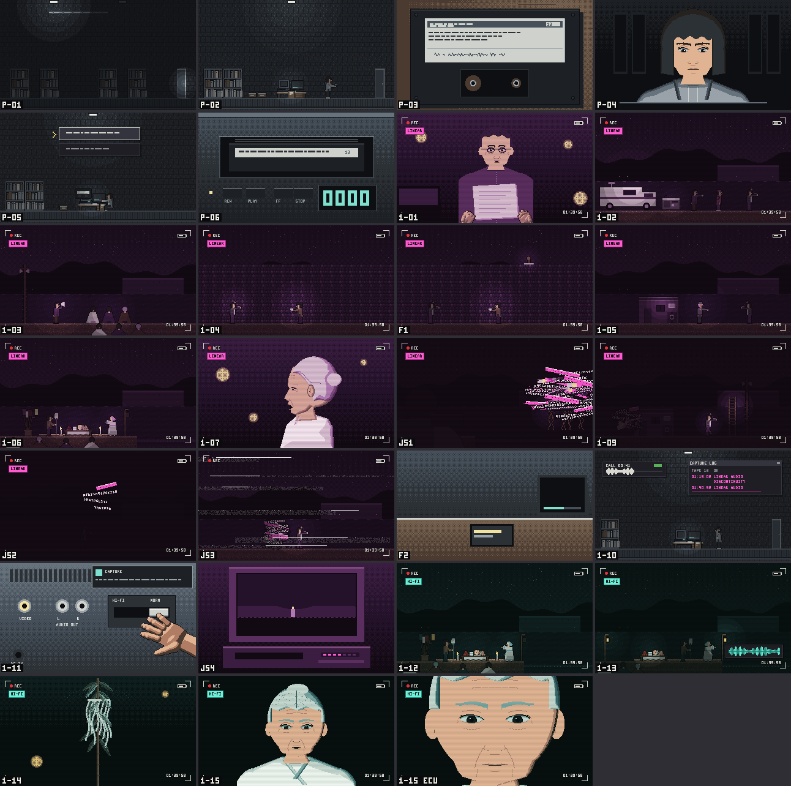
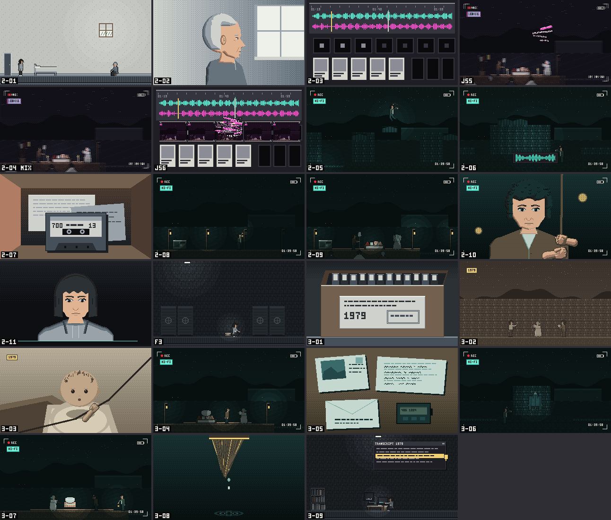
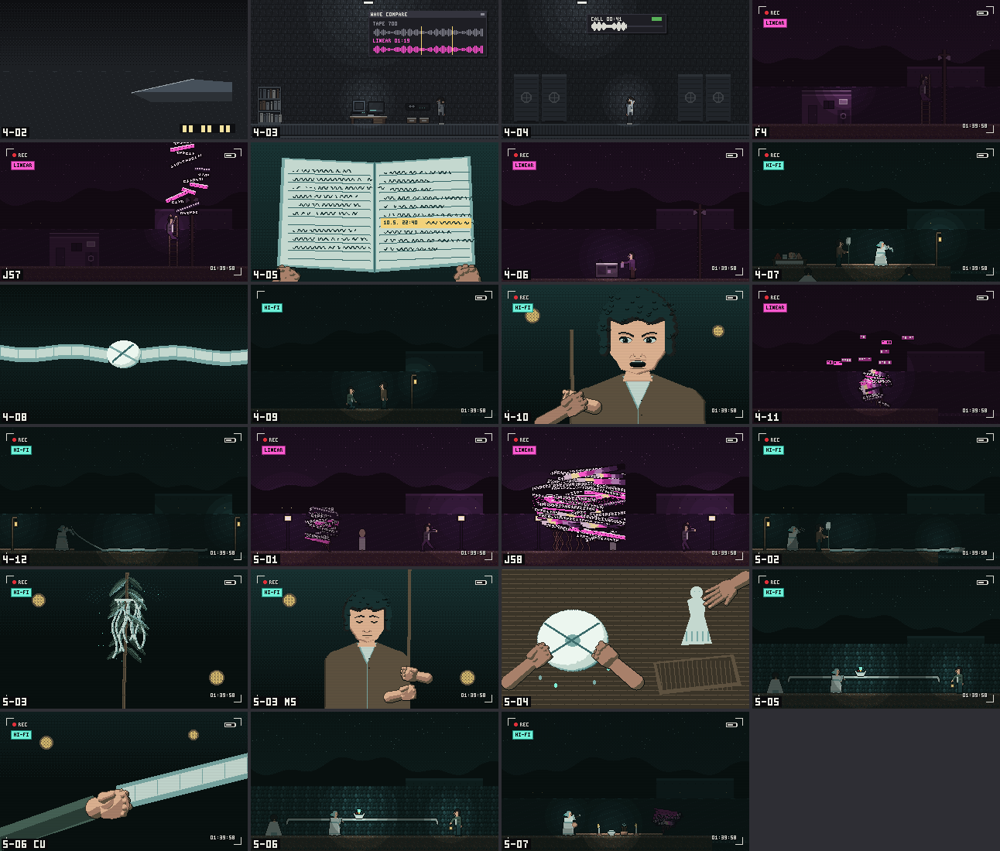
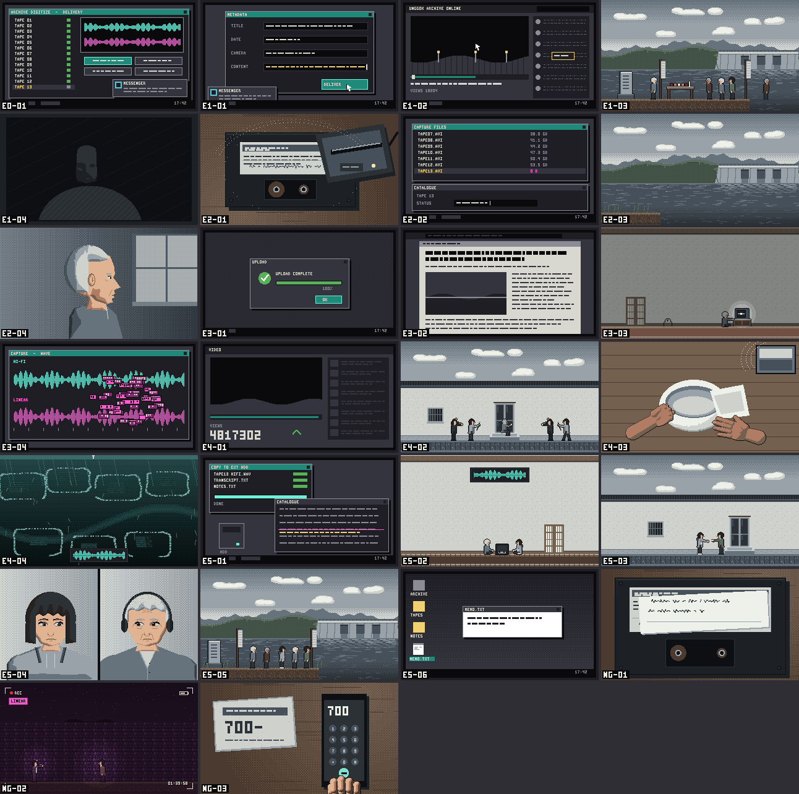

# 《미방송분》 디자인 구성 v0.2 (기준 콘티 v1.2 대응)

> **스포일러 주의.** 《미방송분》 기준 콘티 v1.2의 인물·장소·반전·엔딩이 드러나는 그림과 문서입니다. 콘티 원문은 비공개를 권했지만, 2026-11-17 프로젝트 책임자의 결정으로 디자인 소스만 이 공개 저장소에 올렸습니다. 콘티 원문, 설정집, 대사 원고는 올리지 않았습니다.

- 라이선스: [`../LICENSE.md`](../LICENSE.md) (All rights reserved). 저장소 루트의 GPL은 적용되지 않습니다.
- 기준: 《미방송분》 기준 콘티 v1.2 (2026-11-17, 스토리 75컷, 엔딩 26컷)
- 상태: 프로토타입용 1차안. 콘티 그림(선화) 작업과 AGM G 그레이박싱에 쓰고, 최종 아트는 사람 아티스트가 다듬는 것을 전제로 합니다.
- 변경: v0.1 → v0.2 (2026-11-17) 콘티의 나머지 컷을 모두 그렸습니다. 이제 콘티 101컷(스토리 75, 엔딩 26) 전부에 대응하는 그림이 있습니다(6절).
- 변경: v0.2.1 (2026-11-18)
  - 클로즈업 표정을 다시 잡았습니다. 표정마다 눈썹 안쪽·바깥쪽 높이, 미간 찌푸림, 위아래 눈꺼풀, 입꼬리, 광대 올림, 미간·이마 주름, 눈물을 따로 정했습니다.
  - 고개를 돌린 3/4 각도를 넣었습니다(4-10, 2-10, E5-04 등).
  - 옆얼굴은 눈·눈썹·입술·헤어라인을 새로 그렸습니다. 3-03 아기의 눈과 볼도 다시 그렸습니다.
  - E4-04는 저수지 위에서 내려다본 원근 구도로 다시 그렸습니다. 돌담, 집터 기단, 주춧돌, 무너진 기와, 우물, 골목, 물풀, 물빛 무늬가 보이고, 먼 물가에는 떨리지 않는 신대가 서 있습니다.
- 변경: v0.3 (2026-11-22) **무망판 추가 그림.** 프로젝트 책임자의 결정으로 희망 없는 진엔딩(E5 「대신」), 한국·중세 유럽·남미 오컬트 레퍼런스, 타로 카드 형식의 기괴한 그림, 고어 장면을 넣었습니다. 〈고을 기담〉 오프닝 소품 타로 카드 9장(XXII 「질문하는 사람」 포함)과 뒷면, E5의 새 컷 7장(9절). 카드 양식·팔레트·글꼴은 내부 컨셉 「ARCANUM XXII — 스물세 번째 패」를 따랐습니다. 고어 그림은 모두 **가린 판**이 있고, 게임 설정 「잔혹 표현: 가림」이면 가린 판(카드는 뒷면)이 나옵니다.
- 변경: v0.4 (2026-11-22) **ARCANUM XXII 픽셀 작업 반영.** 프로젝트 책임자가 보낸 개선안(「ARCANUM XXII 픽셀 작업」)으로 E5 컷 6장(`cu_e504`, `e503`, `e5_boat`, `cu_e5_rower`, `cu_e5_hand`, `e5_flooded`)을 바꾸고, 가린 판 2장(`e5_boat_veiled`, `e5_flooded_veiled`)을 그 그림에서 새로 만들었습니다. 확장 팔레트 `2026_ext.pal`, `linear_ext.pal`을 더했습니다(10절).
- 변경: v0.5 (2026-11-22) **중세 오컬트 컨셉 반영.** 같은 묶음의 중세 오컬트 그림 넷을 2장 「세계 괴담 회선 안내지」(1999)의 그림 `ins_hotline_*`로 넣었습니다. `arcanum22.pal`의 두 색(옛 금, 이끼)을 컨셉의 값으로 바로잡았습니다(11절).
- 변경: v0.7 (2026-11-22) **인물 초상.** 대사창과 「인물」 화면에 쓰는 64x64 초상 19장 `portraits/mbs_portraits`, 팔레트 `portraits.pal`(13절).
- 변경: v0.6 (2026-11-22) **저주 인서트.** 「ARCANUM XXII 성당·오컬트·저주 컨셉」 묶음의 짚인형과 저주 부적을 E5 인서트 `ins_e5_doll`, `ins_e5_talisman`으로 넣었습니다. 팔레트 `arcanum22_sacred.pal`(12절).
- 제작: **AI 생성물입니다.** AI(Anthropic Claude, Claude Code)가 텍스트 픽셀 원본(`.pix`, `.scene`)을 쓰고 저장소의 [`tools/pixelart.py`](../../../tools/pixelart.py)로 렌더링했습니다. v0.4의 E5 컷 6장은 프로젝트 책임자가 보낸 완성 PNG를 픽셀 그대로 `.pix`로 옮긴 것입니다(10절). 기록: [`../AI_CONTENT.md`](../AI_CONTENT.md)

컷 개요(콘티 순서, 썸네일 왼쪽 아래에 컷 번호):






인물 개요: [`overview/미방송분_인물_개요_v0.1.png`](overview/미방송분_인물_개요_v0.1.png) · 얼굴 개요: [`overview/미방송분_얼굴_개요_v0.1.png`](overview/미방송분_얼굴_개요_v0.1.png) · v0.2에서 추가한 인물·타일·UI: [`overview/미방송분_추가에셋_v0.2.png`](overview/미방송분_추가에셋_v0.2.png)

## 1. 콘티 규칙을 그림 규칙으로

| 콘티 규칙 | 그림에서 지킨 방법 |
|---|---|
| 은영은 형체로 그리지 않음(1979년 아기 제외) | 은영 스프라이트 없음. 3-02의 아기(미정 품의 포대기)와 3-03의 아기 CU만. 목소리는 파형 상자(`mbs_ui_voice`)와 자막(런타임)으로. 은영의 방(3-05)도 소지품만 |
| 덧녹음된 것은 사람 모양이 아니라 방송 문구 조각이 뭉친 덩어리 | 자막 상자(가짜 글자), 하단 자막 띠(자홍), 컬러바 조각, 타임코드 상자, ARS 파형이 뭉치고 테이프가 흘러내리는 덩어리. 줄이 옆으로 밀리는 트래킹 흔들림. 글자는 아무 뜻이 없고, 실제 문구("이 이야기는, 실제 제보를—")는 런타임에 그림(번역 대응) |
| 4-02(테이프 꼬리)에는 사람 형체를 넣지 않음 | 검은 물, 뱃머리, 날짜 표시 자리만 (`ins_402`) |
| 해원 장면은 고정 샷과 긴 호흡 | 3-07, 5-05, 5-07은 위협 요소 없이 등불 빛만 |
| 스케어 그림은 면적 ≤20%, 빨강 금지, 번쩍임은 스케어당 1회 | 큰 덧녹음 프레임은 생성할 때 면적을 계산해 20%를 넘으면 실패하게 함(가장 큰 `cover`가 약 12%). LINEAR 팔레트에는 채도 높은 빨강이 없음. REC 램프의 빨강은 UI에만 |
| 트랙 배지: LINEAR 자홍, HI-FI 청록, MIX, 1998, 1979, REC·타임코드 = 경호의 뷰파인더 | 트랙별 팔레트 + 배지 + 뷰파인더 덮개 |
| 5-06 카메라를 끄면 REC 표시와 VHS 질감이 처음으로 사라짐 | 5-05(뷰파인더 있음)와 5-06(없음)을 같은 구도로. 손 CU `506cu`도 뷰파인더 있는 판과 없는 판(`plates/cu_506cu`) 둘 |
| 5-04 그릇 속을 들여다보는 연출 금지 | 건져 올린 넋밥그릇은 천으로 덮고 무명으로 묶은 채로만 그림 |
| 혐오 댓글을 구체적으로 쓰지 않음(E1-02) | 댓글은 흐린 점선, 읽히는 칸은 한 단어 자리 하나(글자는 런타임) |
| 글자는 런타임 | 화면·라벨·서류의 한국어 문장은 막대(자리 표시)로, 숫자와 라틴 대문자 라벨(타임코드, 파일명 등)만 3x5 글꼴로 |
| (v0.3) 고어는 가린 판과 짝으로 | 고어 컷마다 가린 판(`*_veiled`)을 함께 그림. 타로 카드는 가린 판 대신 뒷면(`card_back`). 피는 `arcanum22.pal`의 `r`(말라붙은 피)·`R`(피)·`b`(진홍). 정지 그림만, 번쩍임 없음. (v0.4) 바꾼 E5 컷은 피 대신 형태(불은 살, 갈대, 테이프, 빠진 손톱)로 보여 주고 채도 높은 빨강을 쓰지 않음 |
| (v0.3) 은영의 몸에는 고어를 쓰지 않음 | 배의 노꾼은 수몰과 댐 공사에서 물에 든 이름 없는 사람들. 은영은 여전히 형체로 그리지 않음 |

## 2. 트랙 팔레트 (같은 키, 다른 색)

모든 인물·타일은 [`../art/palette/night-school.pal`](../art/palette/night-school.pal)의 키로 그렸고(이 팩은 원래 20키만 씀. 공용 아트 v2에서 9키가 늘어 트랙 팔레트에도 같은 9키를 더함), 장면에서 아래 팔레트로 바꿔 칠합니다. 게임에서는 저장소의 `shaders/palette_swap.gdshader`로 LINEAR ↔ HI-FI 전환을 실시간으로 할 수 있습니다.

| 파일 | 트랙 | 성격 |
|---|---|---|
| `art/palette/2026.pal` | 2026 작업실·요양원 | 형광등 아래 중성 회색. 청록은 파형에만 |
| `art/palette/linear.pal` | LINEAR (덧녹음된 밤) | 자홍 기운의 밤. 빨강을 자홍·고동으로 바꿔 빨강 금지를 지킴. `C` = 덧녹음된 것의 자홍 |
| `art/palette/hifi.pal` | HI-FI (원래 소리의 밤) | 청록 기운의 고요한 밤. `C` = 넋의 빛 |
| `art/palette/1979.pal` | 1979 (카세트 속 기억) | 세피아, 낮은 대비. "소리가 먼저, 그림은 흐릿하게" |
| `art/palette/ui.pal` | 화면 UI | 뷰파인더, 배지, 추리 보드, 테이프 화면 |
| `art/palette/2026_ext.pal` | 2026 확장 (v0.4) | `2026.pal`의 20키 + 클로즈업 피부·머리 10색(`q j t e l L X x v o`) + 테이프 3색 + 배수구 물·불은 손 11색. 트랙 전환에 쓰지 않는 그림 전용 |
| `art/palette/linear_ext.pal` | LINEAR 확장 (v0.4) | `linear.pal`의 20키 + 등불에 비친 살 1색 + 테이프 3색 + 갈대 3색 + 물에 불은 살 5색. 빨강 없음은 그대로 |

MIX(2-04)는 LINEAR와 HI-FI를 한 픽셀씩 번갈아 겹치고 HI-FI를 3px 밀어, 등불 위치와 순례가 두 겹으로 보이게 했습니다(`cuts/204_mix.png`). 게임에서는 두 화면을 셰이더로 섞습니다(저장소의 `shaders/track_mix.gdshader`, 프로토타입 `scripts/proto/proto_screen.gd`).

## 3. 인물

모두 횡스크롤, 오른쪽을 봄, 32x40 셀(어른 키 약 34px). 대화 얼굴은 48x48. 클로즈업(정면·측면 상반신)은 시트가 아니라 컷마다 큰 그림으로 그렸습니다(6절의 `cu_*`, `plates/`).

| 인물 | 시트 (`art/characters/`) | 주요 프레임 | 얼굴 (`art/portraits/`) |
|---|---|---|---|
| 류서진 (2026) | `mbs_seojin` | 대기·걷기 4, 조사, 웅크려 줍기, 휴대폰, 헤드폰, 의자에 앉기, 바닥에 앉기(E5-02), 테이프 들기 | `mbs_face_seojin`: neutral tired surprised sad focused tearful |
| 류경호 (1998, 31세) — 테이프 속 플레이어 | `mbs_gyeongho` | 어깨 카메라 대기·걷기 4·달리기 2·점프(REC 램프), 사다리 2, 카메라 내림, 등불 들기, 등불 걸기, 잡힘, 카메라를 내려놓고 무릎 꿇기(4-09) | `mbs_face_gyeongho`: neutral down focused tearful |
| 류경호 (2026, 59세) | `mbs_gyeongho_old` | 창가 의자에 앉음 2, 헤드폰(E5-04) | `mbs_face_gyeongho_old`: vacant humming tearful gentle |
| 순례 (1998, 72세 당골) | `mbs_sunrye` | 대기·걷기, 당부(1-06), 지전 춤 2(2-09), 빗자루 씻김(3-07), 무명 흔들기 2(4-07), 소금(5-02), 넋당석 밀기(5-05), 징(5-07), 렌즈 보기(1-15), 절 | `mbs_face_sunrye`: neutral stern chant gentle |
| 미정 (1998, 47세) | `mbs_mijeong` | 대기, 밥그릇(1-04), 신대 잡기 2(떨림), 울음, 고개 듦, 반말 터짐(4-10), 걷기, 아기 안기(1979, 3-02) | `mbs_face_mijeong`: neutral sad shout crying gentle |
| 미정 (2026, 75세) | `mbs_mijeong_old` | 서기, 의자에 앉기, 밥그릇 들기, 바닥에 앉기(E5-02), 바닥에 앉아 손 뻗기(E3-03 TV 끄기) | `mbs_face_mijeong_old`: neutral tearful |
| 마종길 (1998, PD) | `mbs_jonggil` | 대기, 지시, 확성기(1-03), 걷기 4, 발전기 스위치(4-06) | `mbs_face_jonggil`: grin pressed stern down |
| 도만수 (수문지기) | `mbs_mansu` | 대기, 막아섬(1-05), 근무 일지 내밂(4-05), 걷기 | `mbs_face_mansu`: neutral tired |
| 기태 (1998, 막내) | `mbs_gitae` | 케이블 멘 대기·걷기 | (2026년은 전화 목소리만) |
| 남궁연 (1979, 조사요원) | `mbs_namgung` | 마이크 내밀기 | — |
| 덧녹음된 것 | `mbs_overdub` (48x64), `mbs_overdub_big` (120x120) | 흔들림 3, 덮침, 조각 떨어짐, 매듭 4·7개 풀린 뒤(작아짐), 상 앞에 앉음(5-07), 꺼짐 / 큰 프레임: edge(JS1), cover(JS8), fragment(JS2), pour(JS7), reflection(JS9) | 없음(얼굴이 없음) |
| 마종길 (2026, 72세) | `mbs_jonggil_old` | 서기, 계단에 앉기, 고개 숙이고 앉기(E4-02) | — |
| 도만수의 조카딸 (50대) | `mbs_niece` | 서기, 받기, 읽기(E5-03) | — |
| 취재진 | `mbs_reporter_a`(어깨 카메라), `mbs_reporter_b`(마이크) | 서기, 걷기(E4-02) | — |
| 마을 사람들 (1998) | `assets/original/art/`의 `npc_onlookers` 재사용 | 뒷모습 서기·앉기 | — |
| 마을 사람들 (2026 망향제) | `mbs_villager_m`, `mbs_villager_f` | 서기 2(E1-03, E5-05) | — |

## 4. 장소·소품

| 파일 | 내용 | 쓰는 컷 |
|---|---|---|
| `art/tiles/mbs_tiles_workroom` | 지하 작업실: 블록 벽, 배관, 리놀륨 바닥, 형광등(켜짐·꺼짐), 테이프 상자 선반(2x3), 데크·CRT·캡처 PC 책상(3x2)과 테이프 씹힘 상태, 휴대폰, 운곡유선 상자, 의자, 철문(빛 새는 틈), 이동식 서가(2x4), 카세트 데크 | P-01~07, 1-10·11, F2, JS4, F3, 3-01, 4-03, E0~E5 |
| `art/tiles/mbs_tiles_shore` | 1998 물가: 자갈 물가, 갈대, 저수지 수면(2프레임)·물속, 돌담, 콘크리트, 등불 걸이(꺼짐·켜짐), 사다리, 발전기(2x2), 확성기 전봇대(1x6), 수문 관리동 정면(4x3), 선착장, 옛 너울리 지붕, 저수지 바닥 진흙, 담 너머 개(F1) | 1장~5장 |
| `art/tiles/mbs_tiles_village` | 새너울 골목(B 구역): 시멘트 블록 담(갓돌·이끼), 슬레이트 지붕(용마루·처마), 회벽(아랫단 페인트), 창 2x2, 나무 문 1x2, 철 대문 2x2, 담에 붙은 망향제 안내문(글자 없음), 전봇대 스티커(물가 시트의 전봇대 위에 겹침), 장독, 문턱 | 1-04, 1-05, F1 |
| `art/tiles/mbs_tiles_extra` | 요양원 벽·창(낮)·침대, 촬영 세트 조명 스탠드, 재연용 소품 인형 | 2-01, E2-04, E5-04, 5-01, JS8 |
| `art/backgrounds/mbs_bg_reservoir` | 운곡댐 저수지의 밤: 산, 오른쪽 댐 벽, 건너편 불빛 | 1998 물가 전부 |
| `art/backgrounds/mbs_bg_reservoir_day` | 2026 저수지의 낮(흐린 봄): 구름, 먼 능선, 숲 언덕, 댐(난간·여수로 문), 수면 | E1-03, E2-03, E4-02, E5-03, E5-05 |
| `art/tiles/mbs_tiles_house` | 새너울 집: 회벽, 천장 보, 걸레받이, 창호 미닫이(1x3), 장판, 마루, CRT TV(꺼짐·켜짐·꺼지는 순간, 2x2), 전화 탁자 / 집 앞: 처마, 외벽 기초, 알루미늄 유리문과 시멘트 계단(3x4), 방범창(2x2) / 망향제: 망향비(2x3, 글자 없음), 깃발 장대(1x4), 제사상(3x2) | E3-03, E4-02, E5-02·03, E1-03, E5-05 |
| `art/tiles/mbs_prop_jacket` | 돌 말뚝에 걸린 젖은 잠바(32x48) | 3-06 |
| `art/tiles/mbs_prop_cloth` | 풀린 무명: 손에서 늘어져 물가까지 / 땅에 깔리고 끝에 넋밥그릇이 물에 듦(176x40) | 4-12, 5-02 |
| `art/characters/mbs_obvan` | 중계차(로고 글자 없음) | 1-02 |
| `art/characters/mbs_birds` | 지붕에서 날아오르는 새 3프레임 | F4 |
| `art/characters/mbs_ots` | 경호의 어깨 너머 전경(카메라 포함) | 1-08, JS1 |
| `art/ui/mbs_items` (32x32) | 증거·인서트: VHS 테이프(라벨), '700 원고 13' 카세트, 방송국 엽서, 삐삐, 표준어 연습 메모, 출연료 봉투, 은영의 잠바, 근무 일지, 넋밥그릇, 솥뚜껑, 영돈말이, 일곱 매듭 무명, 외장하드, 벌크 이레이저, 헤드폰, 휴대용 카세트 플레이어 | 추리 보드 카드, P-03, 2-07, 3-05·06, 3-07, 4-05, 5-04, E2-01, E5-01 |
| `assets/original/art/` 재사용 | `tiles_gut`(굿상, 촛대, 오방기, 돗자리, 질베, 넋당석, 향로, 정화수), `npc_onlookers` | 굿 장면 전부 |

## 5. 화면·UI

| 파일 | 내용 |
|---|---|
| `art/fx/mbs_fx_viewfinder` | 경호의 뷰파인더: 모서리, REC 램프, 배터리, 타임코드, 대비 8% 주사선(콘티 안전 기준 ≤8%). `rec`, `standby`, `clean` |
| `art/fx/mbs_fx_tracking` | 트래킹 노이즈 와이프 4프레임(P-07, 루프 끝) |
| `art/fx/mbs_fx_tear` | 잡혔을 때의 트래킹 찢김(JS3). 빨강 없음, 번쩍임 1회. 광과민 안전 설정에서는 정지 노이즈로 |
| `art/fx/mbs_fx_screens` | 컬러바(P-07), 블루백(5-08) |
| `art/ui/mbs_ui_badges` | 트랙 배지: LINEAR, HI-FI, MIX, 1998, 1979, 2026 |
| `art/fx/mbs_ui_board` | 추리 보드 배치(2-03, 4-01): 타임코드 축, HI-FI·LINEAR 파형(편집점, 01:40:52의 작은 봉우리), 일곱 매듭 칸, 증거 카드, 결론 칸 셋. 글자는 런타임 |
| `art/ui/mbs_ui_panels` | 대화창(뷰파인더 모서리), 화자 이름표, 선택된 선택지 바탕, 선택 커서, 문서용 종이(테이프 두 조각). 나인슬라이스(24x24), 글자는 런타임 |
| `art/ui/mbs_ui_font` | 타임코드·카운터·배지용 3x5 픽셀 글꼴(숫자, 콜론, 일부 대문자) |
| `art/ui/mbs_ui_voice` | 은영의 목소리 파형 상자 3프레임(형체 대신). ui.pal이라 트랙 팔레트에 물들지 않음(LINEAR에서도 자홍이 아님) |
| `art/ui/mbs_ui_popups` | 장면 안의 작은 창: 선택지 2칸, 캡처 로그(LINEAR 불연속 두 줄), 한쪽만 들리는 통화, 1979 전사 창, 파형 비교, 메신저, 떨어져 나가는 문구 조각 |

## 6. 컷 대응표

콘티의 모든 컷에 그림이 있습니다(✅). 파일은 모두 `art/cuts/`에 있습니다.

- `p01`, `101`, `e103`처럼 컷 번호로 된 것: 장면 합성(`.scene`). 테이프 속 1998·1979 컷에는 뷰파인더와 트랙 배지가 겹쳐 있습니다.
- `ins_*`: 물건·화면 인서트. `cu_*`: 통째로 그린 클로즈업(2026, 손 인서트).
- `plates/cu_*`: 뷰파인더를 씌우기 전의 깨끗한 판(1998·1979 클로즈업). 게임에서는 이 판 위에 뷰파인더 레이어를 따로 얹습니다.
- 여러 프레임인 `.pix`는 PNG 한 장에 프레임이 위에서 아래로 쌓여 있습니다(예: `cu_p04`의 `still`/`mouth`).

| 시퀀스 | 컷 | 상태 | 파일·메모 |
|---|---|---|---|
| 프롤로그 | P-01 | ✅ | `p01` 보존서고 복도, 형광등 하나, 문틈 빛 |
| | P-02 | ✅ | `p02` 작업실 허브 |
| | P-03 | ✅ | `ins_p03` 테이프 라벨: 인쇄 라벨과 그 아래 볼펜 글씨 자리 |
| | P-04 | ✅ | `cu_p04` 모니터 빛의 서진 CU (`still`/`mouth`: 입이 먼저 움직임) |
| | P-05 | ✅ | `p05` 책상 앞 선택지(어느 쪽이든 같은 테이프로) |
| | P-06 | ✅ | `ins_p06` 데크 투입구, 카운터 0000 (`in`/`taken`) |
| | P-07 | ✅ | `mbs_fx_screens/bars` → `mbs_fx_tracking` |
| 1장 | 1-01 | ✅ | `101` 종길 정면 MS, 슬레이트 대신 종이를 읽음 |
| | 1-02 | ✅ | `102` 중계차·발전기 |
| | 1-03 | ✅ | `103` 확성기 |
| | 1-04 / F1 | ✅ | `104`, `f1` |
| | 1-05 | ✅ | `105` 관리동 문 앞 |
| | 1-06 | ✅ | `106_linear` |
| | 1-07 | ✅ | `107` 순례 측면 MCU, 초가망석 축원(LINEAR) |
| | 1-08 / JS1 | ✅ | `js1` |
| | 1-09 | ✅ | `109` 01:40 암전 추격, 관리동 사다리 쪽으로 |
| | JS2 / JS3 | ✅ | `js2`, `js3` |
| | F2 | ✅ | `ins_f2` (`still`/`buzz`) |
| | 1-10 | ✅ | `110` 주무관 전화(한쪽만) + 캡처 로그의 LINEAR 불연속 두 줄 |
| | 1-11 | ✅ | `ins_111` 데크 뒷면 HI-FI/NORM 스위치를 찾는 손, 캡처 알림이 끼어듦 |
| | JS4 | ✅ | `ins_js4` (`calm`/`chew`) |
| | 1-12 | ✅ | `112_hifi` (1-06과 같은 구도) |
| | 1-13 | ✅ | `113` 넋 부르기, 물 쪽의 아주 작은 목소리(파형 상자) |
| | 1-14 | ✅ | `114_still` → `114_once` 신대 끝 ECU, 딱 한 번 떨림 |
| | 1-15 | ✅ | `115_cu` → `115_ecu` 순례가 렌즈를 똑바로 봄 |
| 2장 | 2-01 | ✅ | `201` 요양원 |
| | 2-02 | ✅ | `cu_202` 경호(59) 측면 MCU, 받는소리 가락 허밍 |
| | 2-03 / JS5 | ✅ | `mbs_ui_board`, `js5` |
| | 2-04 / JS6 | ✅ | `204_mix`, `js6` |
| | 2-05 | ✅ | `205` 옛 너울리 하강 |
| | 2-06 | ✅ | `206` 미정의 옛집 돌담 + 은영의 목소리(파형만) |
| | 2-07 | ✅ | `ins_207` 운곡유선 상자 바닥의 카세트 '700 원고 13' |
| | 2-08 | ✅ | `208` 물가 길에 등불을 하나씩 거는 경호 |
| | 2-09 | ✅ | `209` |
| | 2-10 | ✅ | `210` 신대를 쥔 미정 CU, 무언가 들은 듯 고개를 듦 |
| | 2-11 | ✅ | `cu_211` 헤드폰을 쓴 서진 MCU |
| 3장 | 3-01 / F3 | ✅ | `ins_301` 1979 미전사 상자, `f3` |
| | 3-02 | ✅ | `302` (1979 팔레트) |
| | 3-03 | ✅ | `303` 마이크 줄을 쥐고 옹알이하는 아기(1979). 은영을 그리는 유일한 컷 |
| | 3-04 | ✅ | `304` 등불 아래 굿청, 영돈말이에 쓸 옷이 모자람 |
| | 3-05 | ✅ | `ins_305` 은영의 방: 엽서, 삐삐, 표준어 연습 메모, 출연료 봉투 |
| | 3-06 | ✅ | `306` 가장 깊은 곳 돌담에 걸린 잠바 |
| | 3-07 | ✅ | `307` 영돈말이 씻김 |
| | 3-08 | ✅ | `ins_308` 빗자루 끝 물방울 (`drop_0`/`drop_1`) |
| | 3-09 | ✅ | `309` 1979 전사 화면에서 문장 하나를 보드로 |
| 4장 | 4-01 | ✅ | `mbs_ui_board` |
| | 4-02 | ✅ | `ins_402` (사람 형체 없음) |
| | 4-03 | ✅ | `403` 카세트 데크 도착, 테이프 목소리와 LINEAR 01:19 파형이 겹침 |
| | 4-04 | ✅ | `404` 서고 사이에서 기태(51)에게 전화(한쪽만) |
| | F4 / JS7 | ✅ | `f4`, `js7` |
| | 4-05 | ✅ | `cu_405` 만수가 내미는 근무 일지(‘10.5. 22:40’ 칸) |
| | 4-06 | ✅ | `406` 01:39 발전기 옆, 스위치에 손을 얹은 종길(앙각) |
| | 4-07 | ✅ | `407` 고풀이 |
| | 4-08 | ✅ | `cu_408` 매듭 ECU (`tied`/`loose`/`untied`). 일곱 번 반복할 때마다 조금씩 밝게 |
| | 4-09 | ✅ | `409` |
| | 4-10 | ✅ | `410` 미정 CU, 반말이 터짐. 신대를 놓으려는 손을 순례가 잡음 |
| | 4-11 | ✅ | `411` LINEAR, 덧녹음된 것에서 문구 조각이 떨어져 나감 |
| | 4-12 | ✅ | `412` 풀린 무명을 물가 쪽으로 길게 |
| 5장 | 5-01 / JS8 | ✅ | `501`, `js8` |
| | 5-02 | ✅ | `502` 소금, 무명에 매단 넋밥그릇을 다시 물에. 신대는 미정 혼자(대안 A) |
| | 5-03 | ✅ | `503_leaves_0`·`503_leaves_1` 신대 잎이 떨림 → `503_mijeong` MS |
| | 5-04 | ✅ | `cu_504` 덮인 그릇(속을 보지 않음), 종이 넋을 넋당석으로 |
| | 5-05 | ✅ | `505` 길닦음 |
| | 5-06 | ✅ | `506cu` 질베 끝을 쥔 손(REC) → `506` 카메라를 끈 화면 |
| | 5-07 | ✅ | `507` 종천멕이 |
| | 5-08 | ✅ | `mbs_fx_screens/blueback` |
| 엔딩 | E0-01 | ✅ | `ins_e001` 납품 화면 위 선택 네 칸, 주무관 메신저 |
| | E1-01·02 | ✅ | `ins_e101` 메타데이터와 납품 버튼, `ins_e102` 열람 서비스(댓글 흐림, 읽히는 칸 하나) |
| | E1-03 | ✅ | `e103` 망향제(낮), 망향비·깃발·제사상 |
| | E1-04 / JS9 | ✅ | `ins_e104` (`reflection`/`js9`) |
| | E2-01·02 | ✅ | `ins_e201` 테이프 위의 벌크 이레이저, `ins_e202` 0바이트 캡처 파일 |
| | E2-03 | ✅ | `e203` 바람만 부는 2026 저수지 |
| | E2-04 | ✅ | `cu_e204` 허밍이 가락 한가운데서 멈춤(어두워짐) |
| | E3-01·02 | ✅ | `ins_e301` 업로드 완료 창, `ins_e302` 기사(제목은 오답에 따라 런타임) |
| | E3-03 | ✅ | `e303` 새너울, TV를 끄는 미정(75) |
| | E3-04 | ✅ | `ins_e304` 파형 위로 조금 더 커진 덧녹음된 것(E4와 공유) |
| | E4-01 | ✅ | `ins_e401` 끝없이 오르는 조회수 (`count_0`/`count_1`) |
| | E4-02 | ✅ | `e402` 종길(72)의 집 앞 취재진, 계단에 주저앉음 |
| | E4-03 | ✅ | `cu_e403` 울리는 전화, 오래된 밥그릇을 닦는 손 |
| | E4-04 | ✅ | `e404` 물 밑 옛 너울리 부감(돌담·기단·주춧돌·우물·골목, 먼 물가의 신대는 그대로) + ‘…여기.’ 파형 |
| | E5-01 | ✅ | `ins_e501` 외장하드 복사와 기록관 목록 정정 |
| | E5-02 | ✅ | `e502` 미정의 마루, 작은 플레이어, 옆에 앉은 서진 |
| | E5-03 | ✅ | `e503` 만수의 조카딸에게 근무 일지 사본과 전사본 |
| | E5-04 | ✅ | `cu_e504` CU 두 개: 헤드폰을 씌우는 서진 / 서진에게 머무는 경호의 눈 |
| | E5-05 | ✅ | `e505` 2026 망향제, 사람들 사이의 서진. 유령 없음 |
| | E5-06 | ✅ | `ins_e506` 바탕화면 메모 |
| 2회차 | NG-01 | ✅ | `ins_ng01` 바뀐 라벨(새 스티커) |
| | NG-02 | ✅ | `ng02` 1장의 골목, 렌즈를 보는 미정 |
| | NG-03 | ✅ | `ins_ng03` 스티커의 700번으로 거는 전화 |

컷 그림 PNG 100장(`art/cuts/`, 합성 3장 포함)과 깨끗한 판 10장(`art/cuts/plates/`), 인물 시트 17개, 얼굴 8세트(33표정), 타일셋 4개 + 소품 2개, 배경 2장, UI·화면 9종입니다.

## 7. 다음 단계

1. **사람 아티스트의 다듬기**: 클로즈업(`cu_*`, `plates/`)은 표정 표(v0.2.1)로 다시 잡았지만 여전히 생성 그림입니다. 1-15의 눈빛, 4-10의 반말, E5-04의 눈빛처럼 연기가 중요한 컷은 최종 단계에서 손으로 다듬는 것을 권합니다.
2. **글자는 엔진에서**: 화면 인서트(E0~E5)의 막대는 자리 표시입니다. 실제 문장은 번역 대응을 위해 런타임에 폰트로 그립니다.
3. **조사 필요(콘티 확인 목록과 같음)**: 3-07·5-02에서 경호의 위치(지금은 대안 A: 미정 혼자 신대를 잡음), 무구·복식 고증(당골 복식, 신대, 넋당석, 씻김굿 무구)은 무속 자문 후 수정.
4. **AGM G 연결**: 트랙 전환은 팔레트 교체 셰이더, MIX는 두 화면 섞기, 뷰파인더·배지·파형 상자는 화면 덮개 레이어. 클로즈업은 `plates/`의 깨끗한 판을 쓰고 뷰파인더를 따로 얹습니다.

## 8. 다시 만드는 법

원본은 `art/src/`의 텍스트 파일입니다. 같은 저장소의 렌더러로 PNG를 만들고, CI도 같은 검사를 합니다.

```bash
python3 tools/pixelart.py --root assets/original/mibangsong/art/src           # 렌더링
python3 tools/pixelart.py --check --root assets/original/mibangsong/art/src   # 원본과 PNG가 일치하는지
```

- 팔레트 `night-school.pal`과 공용 타일(`tiles_gut`, `npc_onlookers`)은 `../art/`를 참조합니다.
- `cuts/204_mix.png`, `cuts/js5.png`, `cuts/js6.png`와 `overview/`의 그림은 렌더링된 컷을 겹치거나 모은 합성 이미지라 원본 `.pix`가 없고 `--check` 대상이 아닙니다.
- 장면의 `@layer`는 매번 맨 윗줄(0행)부터 깔립니다. 바닥 줄은 벽과 같은 레이어의 아래쪽(10~11행)에 둡니다. v0.1의 `p01`·`p02`·`f3`는 바닥이 화면 위쪽에 깔려 있던 것을 v0.2에서 고쳤습니다.
- 원본을 만든 저작용 스크립트는 저장소에 두지 않습니다(`.pix` 텍스트가 원본). v0.1 스크립트는 함께 전달한 `미방송분_아트팩_v0.1.zip`의 `tools_private/`에 있고, v0.2에서 추가한 스크립트는 따로 요청하면 같은 방식으로 묶어 드립니다.

## 9. 무망판 추가 그림 (v0.3)

팔레트 `art/palette/arcanum22.pal`: 내부 카드 컨셉 「ARCANUM XXII — 스물세 번째 패」의 22색을 그대로 쓰고, 그리는 키(뼈·살·물·등불…) 33개가 그 22색을 나눠 씁니다. `ui.pal`처럼 트랙 팔레트와 따로 둔 팔레트입니다. 모두 320x180 컷이고 원본은 `art/src/`의 `.pix`입니다.

### 9.1 〈고을 기담〉 오프닝 소품 타로 카드

카드 양식은 내부 컨셉 「ARCANUM XXII」를 따랐습니다: 검은 바탕, 금색 이중 테두리, 위에 `+ —— 숫자 —— +`, 금테 그림 창, 금테 이름판의 영어 이름. 숫자와 이름은 컨셉과 같은 글꼴인 갈무리(Galmuri11 Bold, 넘치면 Condensed, 12 px, `assets/third_party/quiple-galmuri/`, SIL OFL 1.1)를 앤티에일리어싱 없이 찍었습니다. 카드는 96x170(그림 창 84x130)이고, 컷은 작업실 책상(보라 천) 위에 카드 한 장이 놓인 구도입니다. 한국어 이름과 그림 설명은 런타임 문서로 나옵니다.

| 파일 | 카드 | 그림 | 쓰는 곳 |
|---|---|---|---|
| `cuts/card_10` | X WHEEL OF FORTUNE | 테이프 릴이 바퀴, 묶인 셋이 감겨 돈다. 받침대는 물속 | 2회차 프롤로그 |
| `cuts/card_12` | XII HANGED MAN | 자기 테이프에 한 발이 묶여 저수지 위에 거꾸로 매달린 사람, 입과 손끝의 피가 물로. 어둠 속의 붉은 눈들 | E5 카드 석 장 |
| `cuts/card_13` | XIII DEATH (이름이 칼로 긁혀 있음) | 핏빛 달을 등진 해골이 낫으로 물가를 벤다. 잘린 머리 둘(하나는 왕관)과 손발, 눈마다 방송용 모자이크 | E5 카드 석 장 |
| `cuts/card_15` | XV THE DEVIL | 펜타클 고리 앞, 컬러바·자막 띠로 기운 뿔 달린 것이 브라운관 위에. 사슬에 묶여 입이 꿰매진 둘 | E1 끝 |
| `cuts/card_16` | XVI THE TOWER | 카메라 플래시를 맞은 댐 취수탑, 거꾸로 떨어지는 둘, 콘크리트 이음매에서 나온 손들 | E4 끝 |
| `cuts/card_17` | XVII THE STAR | 검은 별, 물에서 나온 불은 손이 빈 항아리를 거꾸로 쥔다(E5에서는 카드가 거꾸로 놓임) | E5 카드 석 장 |
| `cuts/card_18` | XVIII THE MOON | 두 취수탑, 짖는 개 둘, 웅덩이에서 기어 나오는 벗겨진 팔 | E2 끝 |
| `cuts/card_20` | XX JUDGEMENT | 확성기를 든 천사, 물에 뜬 관에서 일어서는 묶이고 불어 터진 시신들, 얼굴에 모자이크 | E3 끝 |
| `cuts/card_22` | XXII THE QUERENT | 스물세 번째 패. 테이프와 피로 감긴 고리 안의 큰 눈, 네 방향에서 뻗은 물에 불은 손, 세로 동공 안에 헤드폰을 쓴 작은 사람 | E5 마지막 패 |
| `cuts/card_back` | 뒷면 | 컨셉의 뒷면: 금빛 방사선, 고리, 삼각형 안의 눈, 위아래 달의 위상 | '가림'일 때 모든 카드 |

### 9.2 E5 「대신」 컷

| 파일 | 컷 | 그림 | 가린 판 |
|---|---|---|---|
| `cuts/e5_boat` | E5-05 밤 | (v0.4) 망향제 밤 저수지에 불 켠 배, 물에 든 이들이 노를 젓는다(초록으로 불은 얼굴, 눈자리의 갈대). 뱃머리에 카메라를 멘 사람, 물가에 사람들의 뒷모습과 만장·촛불, 멀리 댐 | `e5_boat_veiled`(v0.4: 장대마다 등을 단 잔치 배, 배 위 사람들은 작고 등불 빛에 묻혀 얼굴이 안 보임. 뱃머리의 카메라 든 사람은 `e5_boat`에서 옮김) |
| `cuts/cu_e5_rower` | E5-05 CU | (v0.4) 노꾼 한 사람의 얼굴: 불어 터진 얼굴, 빈 눈자리에서 자란 갈대, 갈색 테이프로 꿰맨 입, 볼에 붙은 부적 | (`e5_boat_veiled` 그대로) |
| `cuts/ins_e5_spread` | E5-07 | 책상 위 카드 석 장: XII, XIII, 거꾸로 놓인 XVII | `ins_e5_spread_veiled`(뒷면 석 장) |
| `cuts/cu_e5_hand` | E5-09 CU | (v0.4) 위에서 본 작업실 바닥 타일. 배수구 뚜껑이 밀려나고 검은 물이 번진 곳에서 불은 손이 올라온다. 빠진 손톱이 물에 떠 있다 | (`e5_flooded_veiled` 그대로) |
| `cuts/e5_flooded` | E5-09 | (v0.4) 작업실 책상 앞의 서진. 눈이 뒤집히고 입에서 갈색 테이프가 끝없이 풀려 나와 책상과 바닥까지 엉킨다. 뒤로 테이프 선반과 파형이 뜬 모니터 | `e5_flooded_veiled`(v0.4: 같은 작업실이 형광등 높이까지 물에 잠김. 빈 의자, 떠다니는 헤드폰과 테이프 가닥, 파형이 아직 뜬 모니터) |

E5에서 다시 쓰는 기존 컷: `ins_e501`, `e502`, `e503`, `cu_e504`, `ins_e104`(reflection), `ins_e506`. 옛 E5의 `e505`(낮 망향제, 유령 없음)는 무망판에서 쓰지 않습니다.

### 9.3 다시 만드는 법

저작용 스크립트는 비공개 스토리 팩(`private/tools_private/tarot_art.py`)에 있고 저장소에는 두지 않습니다. `.pix` 텍스트가 원본이므로 렌더링과 CI 검사는 8절과 같습니다.

## 10. ARCANUM XXII 픽셀 작업 반영 (v0.4)

프로젝트 책임자가 「ARCANUM XXII 픽셀 작업」 묶음(1x PNG와 4x·6x 확대본, 전후 비교)으로 기존 컷의 개선안을 보냈습니다. 그중 이 팩의 컷에 바로 대응하는 6장을 1x 원본 그대로 옮겼습니다.

| 파일 | 원래 그림 | 개선안 (묶음 안 이름) | 팔레트 |
|---|---|---|---|
| `cuts/cu_e504` | 2026 팔레트의 CU 두 개 | `04_mibangsong_cuts/01_E5-04_closeup_pair` | `2026_ext` |
| `cuts/e503` | 타일과 스프라이트로 짠 장면(`cut_e503.scene`, 삭제) | `04_mibangsong_cuts/03_E5-03_house_front` | `2026_ext` |
| `cuts/e5_boat` | v0.3 `arcanum22` 그림 | `05_mibangsong_monsters/02_boat_passengers` | `linear_ext` |
| `cuts/cu_e5_rower` | v0.3 `arcanum22` 그림 | `05_mibangsong_monsters/01_reed_eyes_face` | `linear_ext` |
| `cuts/cu_e5_hand` | v0.3 `arcanum22` 그림(데크 위의 손) | `05_mibangsong_monsters/03_drain_hand` | `2026_ext` |
| `cuts/e5_flooded` | v0.3 `arcanum22` 그림 | `05_mibangsong_monsters/04_seojin_tape` | `2026_ext` |

- 옮긴 6장은 렌더 결과가 보내온 1x PNG와 픽셀 단위로 같습니다. 확장 팔레트에는 그 그림에 쓰인 색만 넣었습니다.
- 개선안은 E5 대사와 더 잘 맞습니다. 손 CU는 "바닥 배수구에서 물이 올라온다"는 줄에 맞춰 바닥 배수구에서 올라오는 손이 되었고, `e5_flooded`는 "입에서 테이프가 풀려 나온다"는 줄의 그림이 되었습니다.
- 가린 판 2장은 개선안에서 만들었습니다. `e5_boat_veiled`는 묶음의 「망향제의 밤」에 `e5_boat` 뱃머리의 카메라 든 사람(대사 `e5_daesin_033`이 두 갈래 모두에 있음)을 옮겨 붙였고, `e5_flooded_veiled`는 테이프 컷에서 서진과 테이프를 지우고(벽돌은 22×18 주기로 메움) 빈 의자·헤드폰·테이프 가닥을 그린 뒤 형광등 아래까지 물빛으로 다시 칠했습니다.
- 다시 만들기: `py -I private/tools_private/pixel_works_import.py <묶음 폴더>` (비공개 스토리 팩). 이어서 8절처럼 렌더링합니다.
- 반영하지 않은 것: 같은 묶음의 `01_arcanum_xxii`(첫 컨셉 묶음과 같음), `02_medieval_occult`(중세 오컬트 컨셉 4장), `03_platformer_redesign`(공용 플랫포머 아트 리디자인: 24×32 주인공, 29색 팔레트, 타일 24종)은 이 팩의 컷이 아니어서 넣지 않았습니다. v0.3의 타로 카드 10장과 `ins_e5_spread`도 그대로입니다.
- 이 묶음에서 배운 그리기 기준은 [`docs/pixel-technique.md`](../../../docs/pixel-technique.md) 7절에 정리했습니다.

## 11. 중세 오컬트 컨셉: 세계 괴담 회선 안내지 (v0.5)

2장 작업실에서 「700 원고 13」 카세트와 함께 나오는 1999년 '세계 괴담 회선' 접지의 그림입니다. 「ARCANUM XXII 픽셀 작업」의 중세 오컬트 그림 넷을 썼습니다. 세 장은 1x 원본을 픽셀 그대로, 금서 사본(144x200)은 화면 높이에 맞춰 위아래를 조금 잘라(12~191행) 가운데에 놓았습니다. 팔레트는 모두 `arcanum22.pal`입니다.

| 파일 | 접지의 자리 | 그림 (묶음 안 이름) |
|---|---|---|
| `cuts/ins_hotline_cover` | 표지 | 해골로 벽을 쌓은 지하실, 붉은 두건을 쓴 사람들과 촛불 원, 벽의 XXII 카드 (`03_crypt_ritual`) |
| `cuts/ins_hotline_09` | 9번 회선 | 새부리 가면 의사가 등불을 든 골목, 문마다 붉은 X, 덮인 시신을 실은 수레 (`02_plague_street`) |
| `cuts/ins_hotline_11` | 11번 회선 | 연금술사의 책상, 펼친 금서, 눈이 든 병, 벽의 손 그림자 (`01_alchemist_study`) |
| `cuts/ins_hotline_back` | 뒷면 | 금서 「LIBER ARCANI」 한 장을 찍은 사진, 눈 문양 아래 XXII (`04_grimoire_page`) |

- 고어 그림이 아니어서 가린 판이 없습니다(수레의 시신은 천으로 덮여 있음). 그림 속 글자는 라틴 대문자 제목과 숫자뿐이고, 한국어 문구는 런타임 문서로 나옵니다.
- `arcanum22.pal`의 `y`·`p`(옛 금)와 `g`(이끼)는 컨셉 색표와 한 자리씩 달랐습니다(`825222`→`825422`, `46542e`→`465430`). 바로잡아 카드와 E5 컷이 아주 조금 다시 렌더링되었습니다.
- 다시 만들기: `py -I private/tools_private/medieval_import.py <묶음 폴더>` (비공개 스토리 팩).

## 12. 저주 인서트 두 장 (v0.6)

「ARCANUM XXII 성당·오컬트·저주 컨셉」 묶음 아홉 장 가운데, 한국 마을의 이야기에 자리가 있는 저주 그림 두 장을 E5에 넣었습니다. 1x 원본을 픽셀 그대로 옮겼고, 팔레트는 `arcanum22.pal`의 33키에 묶음의 추가 8색을 숫자 키(`1`~`8`)로 더한 `arcanum22_sacred.pal`입니다(묶음의 글자 키는 `arcanum22`와 겹침).

| 파일 | 컷 | 그림 (묶음 안 이름) |
|---|---|---|
| `cuts/ins_e5_doll` | E5-03b | 금줄 두른 고목에 박힌 짚인형. 가슴 쪽지의 이름은 비어 있음(이름은 대사가 말함) (`05_curses/01_straw_doll`) |
| `cuts/ins_e5_talisman` | E5-03c | 문에 녹슨 못으로 박힌 부적, 감긴 머리카락, 문짝의 붉은 얼룩 (`05_curses/02_cursed_talisman`) |

- 고어 그림이 아니어서 가린 판이 없습니다.
- 쓰지 않은 일곱 장: 가톨릭 오컬트(베일 덮인 성상, 고해소, 밤의 성당), 검은 미사, 변하는 성화 세 단계, 스테인드글라스, 사슬에 묶인 금서. 1978년 수몰 마을과 2026년 작업실의 이야기에 성당이나 교단이 나오지 않아, 넣으려면 새 줄거리가 필요합니다. 묶음은 그대로 두었습니다.
- 다시 만들기: `py -I private/tools_private/sacred_import.py <묶음 폴더>` (비공개 스토리 팩).

## 13. 인물 초상 (v0.7)

대사창 왼쪽과 일시정지 메뉴 「인물」(호감도 게이지)에 나오는 64x64 상반신 초상입니다. `portraits/mbs_portraits.png`, 5열, 프레임 이름은 아래 순서. 고개를 오른쪽으로 조금 돌리고 왼쪽 위에서 빛을 받는 한 가지 방식으로 그렸고(얼굴 그림자 면을 한 덩어리로, 피부 램프 `q h j s t e`), 배경은 인물마다 단색에 그림자 쪽 디더 띠 하나입니다.

`seojin` `gyeongho` `gyeongho_old` `sunrye` `mijeong` / `mijeong_old` `jonggil` `jonggil_old` `mansu` `gitae` / `gitae_old` `archivist` `carer` `namgung` `niece` / `elder` `woman` `eunyoung` `dub`

- `eunyoung`: 은영은 형체로 그리지 않는다는 규칙(1절)대로 사람 대신 걸이봉에 건 잠바와 지퍼 고리의 인형(얼굴 없음).
- `dub`: 덧녹음된 것. 사람 모양이 아닌 자막 상자·가짜 글자·자홍 하단 띠·컬러바 조각·파형·타임코드 상자·흘러내리는 테이프의 덩어리.
- 팔레트 `portraits.pal`: `2026_ext.pal`의 44키 + 남색 셋(점퍼·잠바), 카키 셋(수문 관리 제복), 벽돌색 둘(패딩), 자홍 둘(덧녹음).
- 대사창에 띄우는 규칙과 나이별 초상(E3·E4·E5의 미정·종길)은 레벨의 `art.portraits`가 정합니다(`prototype/README.md`).
- 약한 곳: 얼굴 생김새가 서로 조금 닮았고(같은 머리 구성), 순례의 동정과 고름이 작습니다. 사람 아티스트가 다듬을 첫 대상입니다.
- 다시 만들기: `py -I private/tools_private/portraits.py` (비공개 스토리 팩) 뒤 8절처럼 렌더링.
