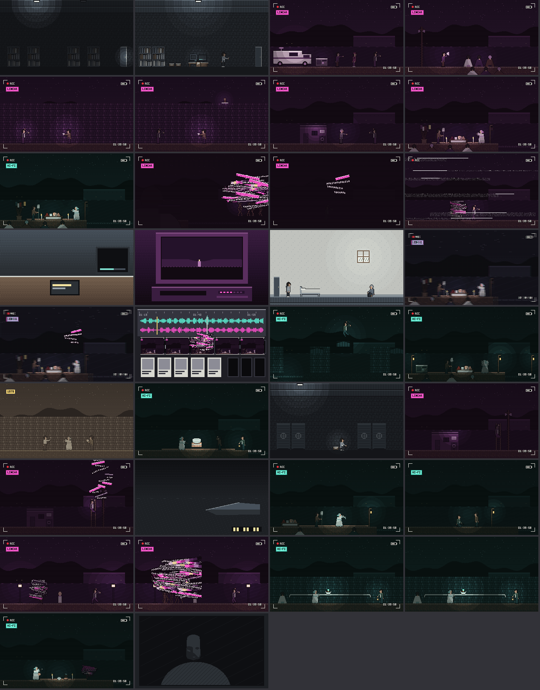

# 《미방송분》 디자인 구성 v0.1 (기준 콘티 v1.2 대응)

> **스포일러 주의.** 《미방송분》 기준 콘티 v1.2의 인물·장소·반전·엔딩이 드러나는 그림과 문서입니다. 콘티 원문은 비공개를 권했지만, 2026-11-17 프로젝트 책임자의 결정으로 디자인 소스만 이 공개 저장소에 올렸습니다. 콘티 원문, 설정집, 대사 원고는 올리지 않았습니다.

- 라이선스: [`../LICENSE.md`](../LICENSE.md) (All rights reserved). 저장소 루트의 GPL은 적용되지 않습니다.
- 기준: 《미방송분》 기준 콘티 v1.2 (2026-11-17, 스토리 75컷, 엔딩 26컷)
- 상태: 프로토타입용 1차안. 콘티 그림(선화) 작업과 AGM G 그레이박싱에 쓰고, 최종 아트는 사람 아티스트가 다듬는 것을 전제로 합니다.
- 제작: **AI 생성물입니다.** AI(Anthropic Claude, Claude Code)가 텍스트 픽셀 원본(`.pix`, `.scene`)을 쓰고 저장소의 [`tools/pixelart.py`](../../../tools/pixelart.py)로 렌더링했습니다. 기록: [`../AI_CONTENT.md`](../AI_CONTENT.md)



인물 개요: [`overview/미방송분_인물_개요_v0.1.png`](overview/미방송분_인물_개요_v0.1.png) · 얼굴 개요: [`overview/미방송분_얼굴_개요_v0.1.png`](overview/미방송분_얼굴_개요_v0.1.png)

## 1. 콘티 규칙을 그림 규칙으로

| 콘티 규칙 | 그림에서 지킨 방법 |
|---|---|
| 은영은 형체로 그리지 않음(1979년 아기 제외) | 은영 스프라이트 없음. 3-02의 아기만 미정 품의 포대기로. 목소리는 파형·자막 UI로(엔진) |
| 덧녹음된 것은 사람 모양이 아니라 방송 문구 조각이 뭉친 덩어리 | 자막 상자(가짜 글자), 하단 자막 띠(자홍), 컬러바 조각, 타임코드 상자, ARS 파형이 뭉치고 테이프가 흘러내리는 덩어리. 줄이 옆으로 밀리는 트래킹 흔들림. 글자는 아무 뜻이 없고, 실제 문구("이 이야기는, 실제 제보를—")는 런타임에 그림(번역 대응) |
| 4-02(테이프 꼬리)에는 사람 형체를 넣지 않음 | 검은 물, 뱃머리, 날짜 표시 자리만 (`ins_402`) |
| 해원 장면은 고정 샷과 긴 호흡 | 3-07, 5-05, 5-07은 위협 요소 없이 등불 빛만 |
| 스케어 그림은 면적 ≤20%, 빨강 금지, 번쩍임은 스케어당 1회 | 큰 덧녹음 프레임은 생성할 때 면적을 계산해 20%를 넘으면 실패하게 함(가장 큰 `cover`가 약 12%). LINEAR 팔레트에는 채도 높은 빨강이 없음. REC 램프의 빨강은 UI에만 |
| 트랙 배지: LINEAR 자홍, HI-FI 청록, MIX, 1998, 1979, REC·타임코드 = 경호의 뷰파인더 | 트랙별 팔레트 + 배지 + 뷰파인더 덮개 |
| 5-06 카메라를 끄면 REC 표시와 VHS 질감이 처음으로 사라짐 | 5-05(뷰파인더 있음)와 5-06(없음)을 같은 구도로 |

## 2. 트랙 팔레트 (같은 키, 다른 색)

모든 인물·타일은 [`../art/palette/night-school.pal`](../art/palette/night-school.pal)의 20개 키로 그렸고, 장면에서 아래 팔레트로 바꿔 칠합니다. 게임에서는 저장소의 `shaders/palette_swap.gdshader`로 LINEAR ↔ HI-FI 전환을 실시간으로 할 수 있습니다.

| 파일 | 트랙 | 성격 |
|---|---|---|
| `art/palette/2026.pal` | 2026 작업실·요양원 | 형광등 아래 중성 회색. 청록은 파형에만 |
| `art/palette/linear.pal` | LINEAR (덧녹음된 밤) | 자홍 기운의 밤. 빨강을 자홍·고동으로 바꿔 빨강 금지를 지킴. `C` = 덧녹음된 것의 자홍 |
| `art/palette/hifi.pal` | HI-FI (원래 소리의 밤) | 청록 기운의 고요한 밤. `C` = 넋의 빛 |
| `art/palette/1979.pal` | 1979 (카세트 속 기억) | 세피아, 낮은 대비. "소리가 먼저, 그림은 흐릿하게" |
| `art/palette/ui.pal` | 화면 UI | 뷰파인더, 배지, 추리 보드, 테이프 화면 |

MIX(2-04)는 LINEAR와 HI-FI를 한 픽셀씩 번갈아 겹치고 HI-FI를 3px 밀어, 등불 위치와 순례가 두 겹으로 보이게 했습니다(`cuts/204_mix.png`). 게임에서는 두 화면을 셰이더로 섞습니다.

## 3. 인물

모두 횡스크롤, 오른쪽을 봄, 32x40 셀(어른 키 약 34px). 대화 얼굴은 48x48.

| 인물 | 시트 (`art/characters/`) | 주요 프레임 | 얼굴 (`art/portraits/`) |
|---|---|---|---|
| 류서진 (2026) | `mbs_seojin` | 대기·걷기 4, 조사, 웅크려 줍기, 휴대폰, 헤드폰, 앉기, 테이프 들기 | `mbs_face_seojin`: neutral tired surprised sad focused tearful |
| 류경호 (1998, 31세) — 테이프 속 플레이어 | `mbs_gyeongho` | 어깨 카메라 대기·걷기 4·달리기 2·점프(REC 램프), 사다리 2, 카메라 내림, 등불 들기, 등불 걸기, 잡힘, 카메라를 내려놓고 무릎 꿇기(4-09) | `mbs_face_gyeongho`: neutral down focused tearful |
| 류경호 (2026, 59세) | `mbs_gyeongho_old` | 창가 의자에 앉음 2, 헤드폰(E5-04) | `mbs_face_gyeongho_old`: vacant humming tearful gentle |
| 순례 (1998, 72세 당골) | `mbs_sunrye` | 대기·걷기, 당부(1-06), 지전 춤 2(2-09), 빗자루 씻김(3-07), 무명 흔들기 2(4-07), 소금(5-02), 넋당석 밀기(5-05), 징(5-07), 렌즈 보기(1-15), 절 | `mbs_face_sunrye`: neutral stern chant gentle |
| 미정 (1998, 47세) | `mbs_mijeong` | 대기, 밥그릇(1-04), 신대 잡기 2(떨림), 울음, 고개 듦, 반말 터짐(4-10), 걷기, 아기 안기(1979, 3-02) | `mbs_face_mijeong`: neutral sad shout crying gentle |
| 미정 (2026, 75세) | `mbs_mijeong_old` | 서기, 마루에 앉기, 밥그릇 닦기(E4-03) | `mbs_face_mijeong_old`: neutral tearful |
| 마종길 (1998, PD) | `mbs_jonggil` | 대기, 지시, 확성기(1-03), 걷기 4, 발전기 스위치(4-06) | `mbs_face_jonggil`: grin pressed stern down |
| 도만수 (수문지기) | `mbs_mansu` | 대기, 막아섬(1-05), 근무 일지 내밂(4-05), 걷기 | `mbs_face_mansu`: neutral tired |
| 기태 (1998, 막내) | `mbs_gitae` | 케이블 멘 대기·걷기 | (2026년은 전화 목소리만) |
| 남궁연 (1979, 조사요원) | `mbs_namgung` | 마이크 내밀기 | — |
| 덧녹음된 것 | `mbs_overdub` (48x64), `mbs_overdub_big` (120x120) | 흔들림 3, 덮침, 조각 떨어짐, 매듭 4·7개 풀린 뒤(작아짐), 상 앞에 앉음(5-07), 꺼짐 / 큰 프레임: edge(JS1), cover(JS8), fragment(JS2), pour(JS7), reflection(JS9) | 없음(얼굴이 없음) |
| 마을 사람들 | `assets/original/art/`의 `npc_onlookers` 재사용 | 뒷모습 서기·앉기 | — |

## 4. 장소·소품

| 파일 | 내용 | 쓰는 컷 |
|---|---|---|
| `art/tiles/mbs_tiles_workroom` | 지하 작업실: 블록 벽, 배관, 리놀륨 바닥, 형광등(켜짐·꺼짐), 테이프 상자 선반(2x3), 데크·CRT·캡처 PC 책상(3x2)과 테이프 씹힘 상태, 휴대폰, 운곡유선 상자, 의자, 철문(빛 새는 틈), 이동식 서가(2x4), 카세트 데크 | P-01~07, 1-10·11, F2, JS4, F3, 3-01, 4-03, E0~E5 |
| `art/tiles/mbs_tiles_shore` | 1998 물가: 자갈 물가, 갈대, 저수지 수면(2프레임)·물속, 돌담, 콘크리트, 등불 걸이(꺼짐·켜짐), 사다리, 발전기(2x2), 확성기 전봇대(1x6), 수문 관리동 정면(4x3), 선착장, 옛 너울리 지붕, 저수지 바닥 진흙, 담 너머 개(F1) | 1장~5장 |
| `art/tiles/mbs_tiles_village` | 새너울 골목(B 구역): 시멘트 블록 담(갓돌·이끼), 슬레이트 지붕(용마루·처마), 회벽(아랫단 페인트), 창 2x2, 나무 문 1x2, 철 대문 2x2, 담에 붙은 망향제 안내문(글자 없음), 전봇대 스티커(물가 시트의 전봇대 위에 겹침), 장독, 문턱 | 1-04, 1-05, F1 |
| `art/tiles/mbs_tiles_extra` | 요양원 벽·창(낮)·침대, 촬영 세트 조명 스탠드, 재연용 소품 인형 | 2-01, E2-04, E5-04, 5-01, JS8 |
| `art/backgrounds/mbs_bg_reservoir` | 운곡댐 저수지의 밤: 산, 오른쪽 댐 벽, 건너편 불빛 | 1998·2026 물가 전부 |
| `art/characters/mbs_obvan` | 중계차(로고 글자 없음) | 1-02 |
| `art/characters/mbs_birds` | 지붕에서 날아오르는 새 3프레임 | F4 |
| `art/characters/mbs_ots` | 경호의 어깨 너머 전경(카메라 포함) | 1-08, JS1 |
| `art/ui/mbs_items` (32x32) | 증거·인서트: VHS 테이프(라벨), '700 원고 13' 카세트, 방송국 엽서, 삐삐, 표준어 연습 메모, 출연료 봉투, 은영의 잠바, 근무 일지, 넋밥그릇, 솥뚜껑, 영돈말이, 일곱 매듭 무명, 외장하드, 벌크 이레이저, 헤드폰, 휴대용 카세트 플레이어 | 추리 보드 카드, P-03, 2-07, 3-05·06, 3-07, 4-05, 5-04, E2-01, E5-01 |
| `assets/original/art/` 재사용 | `tiles_gut`(굿상, 촛대, 오방기, 돗자리, 질베, 넋당석, 향로, 정화수), `npc_onlookers` | 굿 장면 전부 |

## 5. 화면·UI

| 파일 | 내용 |
|---|---|
| `art/fx/mbs_fx_viewfinder` | 경호의 뷰파인더: 모서리, REC 램프, 배터리, 타임코드, 대비 8% 주사선(콘티 안전 기준 ≤8%). `rec`, `standby`, `clean` |
| `art/fx/mbs_fx_tracking` | 트래킹 노이즈 와이프 4프레임(P-07, 루프 끝) |
| `art/fx/mbs_fx_tear` | 잡혔을 때의 트래킹 찢김(JS3). 빨강 없음, 번쩍임 1회. 광과민 안전 설정에서는 정지 노이즈로 |
| `art/fx/mbs_fx_screens` | 컬러바(P-07), 블루백(5-08) |
| `art/ui/mbs_ui_badges` | 트랙 배지: LINEAR, HI-FI, MIX, 1998, 1979, 2026 |
| `art/fx/mbs_ui_board` | 추리 보드 배치(2-03, 4-01): 타임코드 축, HI-FI·LINEAR 파형(편집점, 01:40:52의 작은 봉우리), 일곱 매듭 칸, 증거 카드, 결론 칸 셋. 글자는 런타임 |
| `art/ui/mbs_ui_panels` | 대화창(뷰파인더 모서리), 화자 이름표, 선택된 선택지 바탕, 선택 커서, 문서용 종이(테이프 두 조각). 나인슬라이스(24x24), 글자는 런타임 |
| `art/ui/mbs_ui_font` | 타임코드·카운터·배지용 3x5 픽셀 글꼴(숫자, 콜론, 일부 대문자) |

## 6. 컷 대응표

✅ 컷 그림 있음 (`art/cuts/`) · 🧩 에셋으로 조립 가능(그림 없음) · ⬜ 미제작

| 시퀀스 | 컷 | 상태 | 파일·메모 |
|---|---|---|---|
| P | P-01 | ✅ | `p01` 보존서고 복도, 형광등 하나, 문틈 빛 |
| | P-02 | ✅ | `p02` 작업실 허브 |
| | P-03 | 🧩 | 아이템 `tape`(라벨 글씨는 런타임) |
| | P-04 | 🧩 | 얼굴 `seojin/surprised`. 모니터 빛 CU는 미제작 |
| | P-05·06 | 🧩 | 데크 투입구 ECU는 `ins_js4`의 `calm` 데크 부분 |
| | P-07 | ✅ | `mbs_fx_screens/bars` → `mbs_fx_tracking` |
| 1장 | 1-01 | 🧩 | 뷰파인더 + 종길 정면 MS(정면 스프라이트 ⬜) |
| | 1-02 | ✅ | `102` 중계차·발전기 |
| | 1-03 | ✅ | `103` 확성기 |
| | 1-04 / F1 | ✅ | `104`, `f1` |
| | 1-05 | ✅ | `105` 관리동 문 앞 |
| | 1-06 | ✅ | `106_linear` |
| | 1-07 | 🧩 | 순례 `jijeon`·`rules` + LINEAR. MCU ⬜ |
| | 1-08 / JS1 | ✅ | `js1` |
| | 1-09 / JS2 / JS3 | ✅ | `js2`, `js3` (추격 레벨은 `mbs_tiles_shore`로) |
| | F2 / 1-10 | ✅ | `ins_f2` (`still`/`buzz`) |
| | 1-11 / JS4 | ✅ | `ins_js4` (`calm`/`chew`). 데크 뒷면 스위치 INSERT ⬜ |
| | 1-12 | ✅ | `112_hifi` (1-06과 같은 구도) |
| | 1-13 | 🧩 | 1-12 구도 + 은영 목소리 파형 UI(⬜) |
| | 1-14 | ⬜ | 신대 끝 ECU |
| | 1-15 | 🧩 | 순례 `lens` + 얼굴. 정면 CU ⬜ |
| 2장 | 2-01 | ✅ | `201` 요양원 |
| | 2-02 | 🧩 | 얼굴 `gyeongho_old/humming` |
| | 2-03 / JS5 | ✅ | `mbs_ui_board`, `js5` |
| | 2-04 / JS6 | ✅ | `204_mix`, `js6` |
| | 2-05 | ✅ | `205` 옛 너울리 하강 |
| | 2-06 | 🧩 | `205` 돌담 + 은영 목소리(형체 없음) |
| | 2-07 | 🧩 | 아이템 `cassette` |
| | 2-08 | 🧩 | 경호 `hang_lantern` + 등불 걸이(꺼짐→켜짐) |
| | 2-09 | ✅ | `209` |
| | 2-10 | 🧩 | 미정 `look_up`, `sindae` |
| | 2-11 | 🧩 | 서진 `headphones` + 보드 파형 |
| 3장 | 3-01 / F3 | ✅ | `f3` (상자 INSERT는 아이템) |
| | 3-02·03 | ✅ | `302` (1979 팔레트) |
| | 3-04 | 🧩 | 순례·미정 + 등불 |
| | 3-05 | 🧩 | 아이템 `postcard` `pager` `memo` `envelope`. 은영의 방 세트 ⬜ |
| | 3-06 | 🧩 | `205` + 아이템 `jacket` |
| | 3-07 | ✅ | `307` 영돈말이 씻김 |
| | 3-08·09 | ⬜ | 물방울 ECU, 전사 화면 |
| 4장 | 4-01 | ✅ | `mbs_ui_board` |
| | 4-02 | ✅ | `ins_402` (사람 형체 없음) |
| | 4-03 | 🧩 | `cassette_deck` 타일 + 보드 파형 |
| | 4-04 | 🧩 | 서진 `phone` |
| | F4 / JS7 | ✅ | `f4`, `js7` |
| | 4-05 | 🧩 | 만수 `logbook` + 아이템 `logbook` |
| | 4-06 | 🧩 | 종길 `switch` + 발전기 |
| | 4-07 | ✅ | `407` 고풀이 |
| | 4-08 | 🧩 | 아이템 `cotton_7` |
| | 4-09 | ✅ | `409` |
| | 4-10 | 🧩 | 미정 `shout` 얼굴·스프라이트 |
| | 4-11 | 🧩 | 덧녹음된 것 `shed` |
| | 4-12 | ⬜ | 풀린 무명을 물가로 |
| 5장 | 5-01 / JS8 | ✅ | `501`, `js8` (촬영 세트 길) |
| | 5-02·03·04 | 🧩 | 순례 `salt`, 미정 `sindae_1`, 아이템 `soul_bowl` |
| | 5-05 | ✅ | `505` 길닦음 |
| | 5-06 | ✅ | `506` 카메라를 끈 화면 |
| | 5-07 | ✅ | `507` 종천멕이 |
| | 5-08 | ✅ | `mbs_fx_screens/blueback` |
| 에필로그·엔딩 | E0-01, E1-01·02, E3-01·02, E4-01, E5-01·06 | ⬜ | 모니터 UI(납품 화면, 열람 서비스, 업로드 창, 기사, 조회수, 바탕화면 메모). 글자가 많아 엔진 UI로 만드는 편이 맞음 |
| | E1-04 / JS9 | ✅ | `ins_e104` (`reflection`/`js9`) |
| | E1-03, E5-05 | 🧩 | 저수지 배경 + 마을 사람들(망향제 소품 ⬜) |
| | E2-01·02 | 🧩 | 아이템 `eraser`, 캡처 화면 |
| | E2-03 | 🧩 | 저수지 배경(2026 팔레트) |
| | E2-04, E5-04 | 🧩 | 요양원 + 경호(59) `sit`·`headphones` |
| | E3-03, E5-02 | 🧩 | 미정(75) `sit` + 새너울 마루 세트 ⬜ |
| | E4-02·03 | 🧩 | 종길(72) ⬜, 미정(75) `bowl` |
| | E4-04 | 🧩 | `205` 옛 너울리(물 밑) |
| | E5-03 | ⬜ | 만수의 조카딸 |
| | NG-01~03 | 🧩 | 아이템 `tape`, 1-04 구도, 휴대폰 |

컷 그림 34장(인서트·합성 포함), 인물 시트 11개, 얼굴 8세트(33표정), 타일셋 3개, 배경 1장, UI·화면 7종입니다.

## 7. 다음 단계

1. **정면·CU 그림**: 1-01(종길 정면), 1-15(순례 CU), P-04(모니터 빛의 서진)처럼 클로즈업이 연출의 핵심인 컷은 큰 그림(인서트)으로 따로 그립니다.
2. **은영의 방(3-05)과 새너울 마루(E3-03, E5-02)** 세트.
3. **엔딩 UI 화면**: 글자가 많아 엔진 UI(폰트 렌더링)로 만들고, 그림은 창 틀과 아이콘만.
4. **조사 필요(콘티 확인 목록과 같음)**: 3-07·5-02에서 경호의 위치(대안 A: 미정 혼자), 무구·복식 고증(당골 복식, 씻김굿 무구)은 무속 자문 후 수정.
5. **AGM G 연결**: 트랙 전환은 팔레트 교체 셰이더, MIX는 두 화면 섞기, 뷰파인더·배지는 화면 덮개 레이어.

## 8. 다시 만드는 법

원본은 `art/src/`의 텍스트 파일입니다. 같은 저장소의 렌더러로 PNG를 만들고, CI도 같은 검사를 합니다.

```bash
python3 tools/pixelart.py --root assets/original/mibangsong/art/src           # 렌더링
python3 tools/pixelart.py --check --root assets/original/mibangsong/art/src   # 원본과 PNG가 일치하는지
```

- 팔레트 `night-school.pal`과 공용 타일(`tiles_gut`, `npc_onlookers`)은 `../art/`를 참조합니다.
- `cuts/204_mix.png`, `cuts/js5.png`, `cuts/js6.png`와 `overview/`의 그림은 렌더링된 컷을 겹치거나 모은 합성 이미지라 원본 `.pix`가 없고 `--check` 대상이 아닙니다.
- 원본을 만든 저작용 스크립트는 저장소에 두지 않습니다(`.pix` 텍스트가 원본). 함께 전달한 `미방송분_아트팩_v0.1.zip`의 `tools_private/`에 있습니다.
