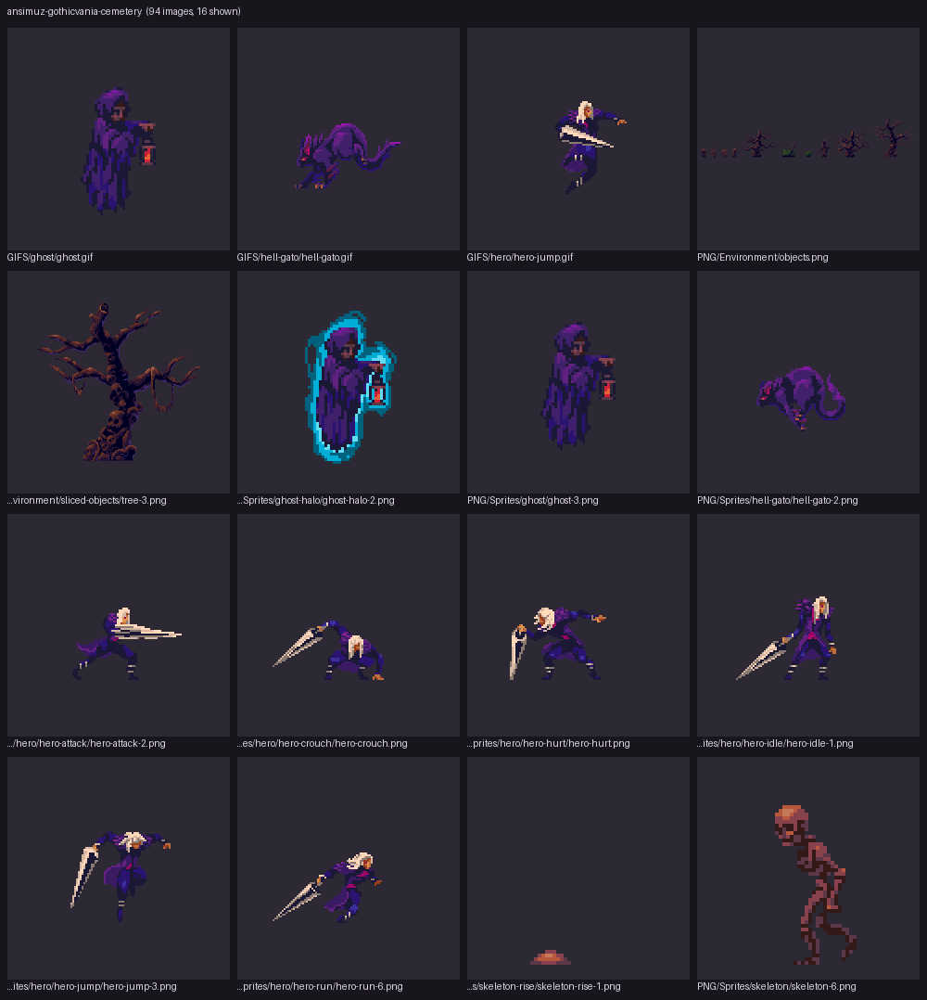

# GothicVania Cemetery Pack

- Author: ansimuz (Luis Zuno)
- Source URL: <https://opengameart.org/content/gothicvania-cemetery-pack>
- License: CC0 1.0
- Download date / version: 2026-11-17
- Credit required: no (appreciated: "Artwork created by Luis Zuno @ansimuz")
- Modifications: Subset. Not included: the music by Pascal Belisle (its license only says "free to use in your projects with credit" and does not allow redistributing the files), the Phaser demo code, and the PSD source files. Get them from the source page if needed.

Contents: Side-view gothic cemetery: hero, skeleton, ghost, hell-cat (hell-gato), parallax backgrounds, 16x16 tileset.

