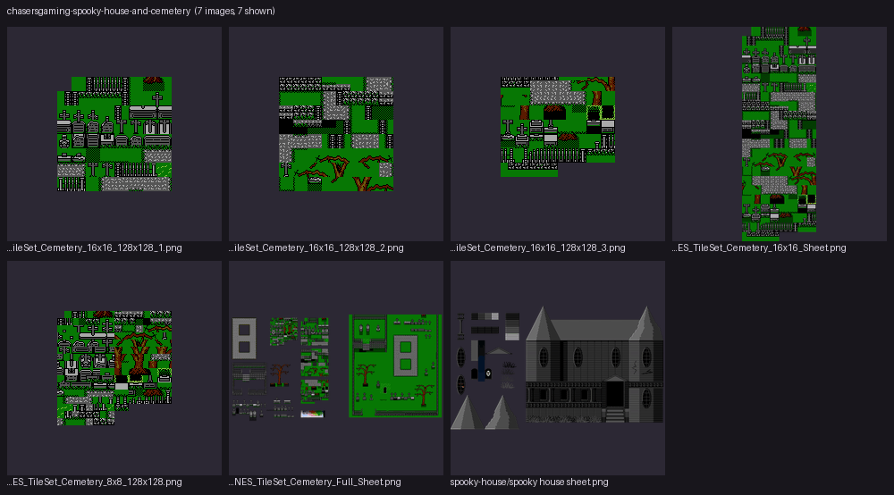

# Spooky House + RPG Asset Tile Set 'Cemetery' NES

- Author: Chasersgaming
- Source URL: <https://opengameart.org/content/spooky-house>, <https://opengameart.org/content/rpg-asset-tile-set-cemetery-nes>
- License: CC0 1.0
- Download date / version: 2026-11-17
- Credit required: no
- Modifications: None. Two pages by the same author combined (subfolders spooky-house/ and cemetery-nes/).

Contents: Haunted house split into 16x16 tiles (4 colours) and an NES-palette cemetery tileset (8x8 and 16x16).

