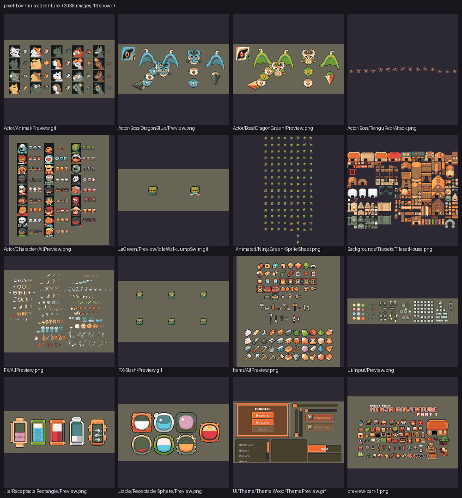

# Ninja Adventure - Asset Pack

- Author: Pixel-boy and AAA
- Source URL: <https://pixel-boy.itch.io/ninja-adventure-asset-pack>
- License: CC0 1.0
- Download date / version: 2026-11-17
- Credit required: no (appreciated)
- Modifications: Subset. Graphics are complete. From Audio/ (about 100 MB) only five files are included as placeholders for the first playable build: `Audio/Musics/40 - Crypt.ogg` (exploration), `Audio/Musics/28 - Tension.ogg` (chase), `Audio/Sounds/Menu/Move1.wav`, `Accept.wav`, `Cancel.wav` (UI). Example 1-4.gif and the bundled .ttf font are not included.

Contents: Top-down 16x16: 50+ characters with facesets, monsters, bosses, animals, tilesets, items, FX, UI.

