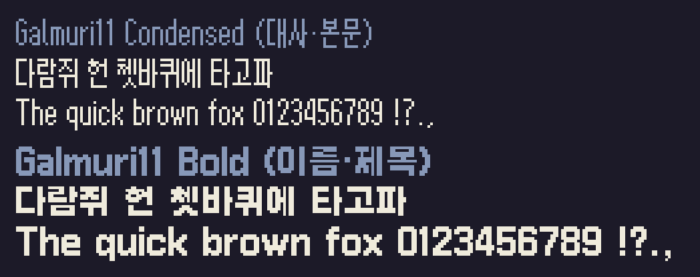

# Galmuri (Galmuri11 Condensed, Galmuri11 Bold)

- Author: Lee Minseo (quiple)
- Source URL: <https://galmuri.quiple.dev>, npm package <https://www.npmjs.com/package/galmuri> (repository: <https://github.com/quiple/galmuri>)
- License: SIL Open Font License 1.1 (`LICENSE`, copied unchanged from the package's `dist/LICENSE.txt`)
- Download date / version: 2026-11-17 / 2.40.3, from the npm registry tarball (sha512 integrity checked)
- Credit required: the OFL requires that the copyright notice and the license text ship with the font. Put `LICENSE` next to the font files in game builds and list the font in the credits
- Modifications: none. Only two of the package's fonts are included; `preview.png` is a specimen rendered from them

Contents: Korean/Latin pixel fonts covering all 11,172 Hangul syllables and ASCII (Condensed also has kana). Galmuri11 Condensed for dialogue and body text, Galmuri11 Bold for names and headings. Rendered pixel-exact at 12 px with anti-aliasing off.

Why only these two: the project README ("Legal Stuff") says that in Galmuri14, 11 and 9, the Latin-1, kana, kanji, some symbols and 2,355 Hangul syllables are not the author's own creations (the fonts are inspired by the Nintendo DS font design), while **all glyphs in Galmuri11 Bold and Galmuri11 Condensed are the author's own**. The author argues bitmap font designs are not copyrightable in the US or Korea, but picking the two fully original weights avoids the question. Check the latest README before adding other weights.

Reserved Font Name: the license declares none. A modified version must still stay under the OFL and should not be sold on its own.

