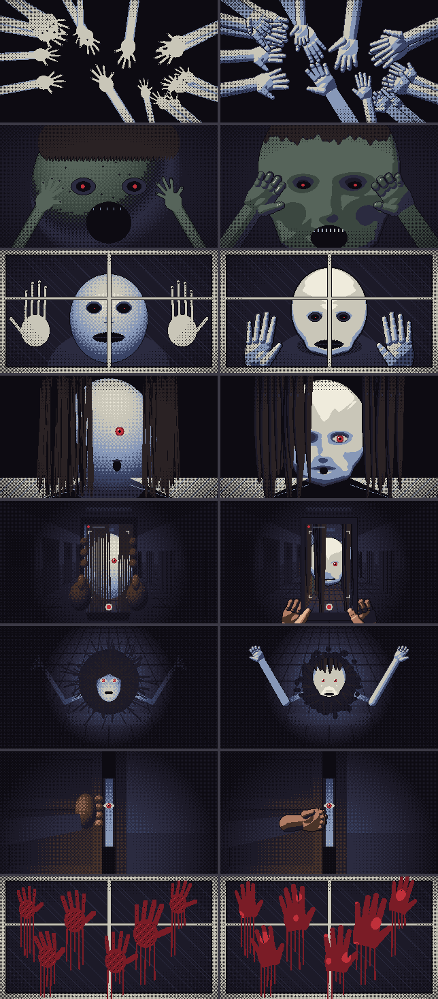

# 픽셀 기법 노트: 손·얼굴·머리카락

2026-11-17. "손 모양 등 일부 디자인이 도형을 이어붙인 느낌이 든다"는 피드백을 받고, 원인을 찾아 레퍼런스를 모으고, 그리는 방식을 바꾼 기록입니다. 새로 그릴 때와 사람 아티스트에게 넘길 때의 기준으로 씁니다.

Claude(LLM)로 픽셀 아트를 만드는 방식, 수집한 프롬프트, 이 저장소용 프롬프트 템플릿은 [`claude-pixel/`](claude-pixel/README.md)에 따로 모았습니다.

왼쪽이 이전, 오른쪽이 이번에 다시 그린 것입니다(점프스케어 마지막 프레임, 원래 크기). 위에서부터 손, 좀비, 창문, 소복 귀신, 휴대폰(1인칭), 천장(1인칭), 문틈(1인칭), 피 묻은 손바닥(고어).

## 1. 무엇이 문제였나

| 증상 | 원인 | 있던 곳 |
|---|---|---|
| 손이 "동그라미에 바늘을 꽂은" 모양 | 손바닥을 원 하나, 손가락을 1~3px 직선으로 그림. 마디·두께 변화·엄지 구조가 없음 | 손 점프스케어, 좀비, 1인칭 손전등 |
| 손이 벙어리장갑·소시지 덩어리 | 타원 여러 개를 겹침. 손가락 사이 경계와 손등 면이 없음 | 1인칭 휴대폰·세면대·사물함·문틈 |
| 얼굴이 달걀·가면 | 완전한 타원에 구(球) 셰이딩. 눈구멍·코·광대·턱 같은 면이 없어 이목구비가 표면에 붙은 스티커처럼 보임 | 좀비, 창문, 소복 귀신, 사물함, 천장 |
| 머리카락이 바코드·빗살·성게 가시 | 같은 굵기의 직선 수십 개, 또는 방사형 쐐기 | 소복 귀신, 휴대폰 화면, 교실(고어), 천장 |
| 손자국이 패턴 도장 | 원 + 직선 손가락 + 규칙적인 빗금 | 고어 손바닥 점프스케어 |
| 전체적으로 지글거림 | 그라데이션을 규칙 디더(Bayer)로만 만들어 외톨이 픽셀이 많고, 외곽을 따라 같은 폭의 띠가 생김(필로우 셰이딩) | 여러 곳 |

## 2. 레퍼런스

그림은 가져오지 않고 링크와 원리만 정리했습니다. 저작권은 각 저자에게 있습니다.

### 픽셀 기법

| 자료 | 배운 것 |
|---|---|
| [Pixel Parmesan: Anti-Aliasing Fundamentals for Pixel Artists](https://pixelparmesan.com/anti-aliasing-fundamentals-for-pixel-artists) | AA는 손으로, 아껴서. 색은 색상보다 명도로 고름. 긴 선분일수록 AA도 길게. 같은 길이의 평행한 계단은 격자를 드러내고 필로우 셰이딩으로 이어짐. 외곽 AA는 배경이 바뀌면 깨지므로 가능하면 안쪽에. 셀아웃은 "모서리를 어둡게 하기"가 아니라 형태가 나오고 들어가는 곳을 보여 주는 것 |
| [Lospec: Pixel Art Outlines Part 2: Using Color](https://lospec.com/articles/pixel-art-outlines-part-2-using-color) | 외곽선은 물체 자기 색의 어두운 단계로. 셀아웃: 빛 받는 쪽은 밝은 외곽선, 그림자 쪽은 어두운 외곽선, 외곽선과 물체의 대비를 둘레 전체에서 비슷하게. 검정은 꼭 필요한 곳에만. 내부선은 한 단계 어두운 색이면 충분하고, 관절 끝에서 밝게 사라지게 |
| [Arne Niklas Jansson: Pixel art tutorial](https://www.androidarts.com/pixtut/pixelart.htm) | 픽셀을 덩어리(클러스터)로 모으고 외톨이 픽셀을 없앰. 곡선은 1,1,2,3 같은 일정한 계단. 바닥에 닿는 쪽에는 검은 선을 두지 않음. 내부 검은 선 대신 색 대비로 나눔. 광원 하나, 명암 경계(터미네이터)는 압축해서 뚜렷하게, 하이라이트는 아껴서. 디더는 아껴서. 필로우 셰이딩 대신 면을 끊어서 조각하듯. 피부 그림자는 회보라, 중간은 주황, 밝은 곳은 노랑 쪽으로 |
| [Pixel Joint: The Pixel Art Tutorial (cure)](https://pixeljoint.com/forum/forum_posts.asp?TID=11299) | 용어(클러스터, AA, 디더)와 피해야 할 것(재기, 밴딩)의 기준 |
| [Pedro Medeiros: 저해상도에 대한 생각](https://saint11.art/blog/thoughts_on_low_resolution), [튜토리얼 모음](https://saint11.art/blog/pixel-art-tutorials) | 픽셀 하나하나가 뜻을 가져야 함. 광원은 하나(역광 하나까지). 얼굴 근처에 떠도는 픽셀 금지. 다 못 그리면 접근을 바꿈(전신 대신 머리만). 모음에 Blood, Darkness, Portrait, Outlines, Shading 튜토리얼이 있음 |
| [Tiny Warrior Games: Pixel Line-art Cleanup](https://tinywarriorgames.com/2018/12/07/game-development-pixel-line-art-cleanup/) | 선은 1px로, 곡선의 계단 길이는 5,4,3,2,1처럼 점점 변하게. 일정하지 않으면 엉뚱한 곳이 꺾여 보임 |
| [imonk: Pixel Tutorial - Selective Outlines](https://itch.io/t/2422252/pixel-tutorial-selective-outlines) | 검은 외곽선에서 출발해 셀아웃으로 바꾸는 단계별 예시 |
| [pixnote: Pixel Art Glossary](https://pixnote.net/en/learn/glossary) | 밴딩·필로우 셰이딩·재기·AA 용어 정리 |

### 손

| 자료 | 배운 것 |
|---|---|
| [Proko: How to Draw Hands from Imagination](https://proko.com/lesson/how-to-draw-hands-from-imagination-step-by-step) | 손바닥은 가로세로가 비슷한 상자, 새끼손가락 쪽이 짧고 앞면이 휨. 손가락 12마디(엄지 제외)를 원통으로, 관절에 상자. 엄지는 삼각 상자 → 원통 → 흙손 모양 끝. 손목은 팔보다 약간 낮게 꺾임. 세부는 구조가 맞은 뒤에 |
| [David Rickert: Hand Anatomy](https://davidrickert.substack.com/p/drawing-hands-part-1-hand-anatomy), [Finger Bundling](https://davidrickert.substack.com/p/drawing-hands-3-finger-bundling) | 손바닥은 대체로 정사각형. 가운데손가락이 가장 길고 새끼가 가장 짧아 손끝이 호를 그림. 손가락 묶음은 손바닥보다 약간 짧음. 엄지는 손바닥 모서리에서 대각으로, 길이는 검지·약지와 비슷. 굽힌 손가락 끝은 손바닥 가운데에 닿음. 손가락을 묶어 한 덩어리로 그려도 됨 |
| [George B. Bridgman, Constructive Anatomy (1920)](https://archive.org/details/constructiveanat00brid) | 손·손목·엄지를 덩어리와 쐐기로 나누는 구성 도해(1920년 출판, 미국 퍼블릭 도메인으로 보임 — 다른 나라는 미확인) |
| [Streamline: How to design hand icons](https://blog.streamlinehq.com/how-to-design-hand-icons/) | 작은 크기에서는 손가락 넷을 다 보여 주는 편이 잘 읽힘. 너무 줄이면 손으로 안 보임 |

### 머리카락

| 자료 | 배운 것 |
|---|---|
| [Proko: How to Draw Hair](https://proko.com/course-lesson/how-to-draw-hair/notes) | 가닥이 아니라 덩어리(매스)와 명암으로 |
| 픽셀 커뮤니티 공통 조언 (Pixel Joint 포럼 등) | 픽셀 크기에서는 한 가닥씩 그리지 않고 리본 같은 덩어리로. 덩어리마다 한 색, 윤기는 형태를 따라 휘는 띠 |

## 3. 이 저장소의 규칙

새로 그리거나 고칠 때 확인합니다.

1. **실루엣 먼저.** 1배 크기에서 실루엣만으로 무엇인지 읽혀야 합니다. 손은 손가락 넷과 엄지가 실루엣에서 보이게 합니다.
2. **손은 구조로.** 손바닥은 상자, 손가락마다 3마디(길이 비 약 0.48 : 0.29 : 0.23), 손끝을 이은 선은 가운데가 높은 호, 손가락 묶음은 손바닥보다 약간 짧게, 엄지는 손바닥 아래 모서리에서 대각으로 나와 손가락보다 짧고 굵게. 손가락은 끝으로 가며 가늘어지고 관절에서 살짝 불룩합니다. 굽힘은 마디마다 따로 줍니다(쥔 손 = 큰 굽힘, 뻗은 손 = 작은 굽힘).
3. **광원은 하나.** 이 프로젝트는 왼쪽 위 앞을 기본으로 씁니다(손전등 장면은 손전등 쪽). 명암 단계는 경계를 뚜렷하게 두고 디더로 섞지 않습니다. 하이라이트는 손끝·코끝·이마처럼 튀어나온 곳에 몇 픽셀만.
4. **외곽선은 셀아웃.** 빛 받는 쪽 외곽선은 그 물체의 가장 어두운 색, 그림자 쪽만 검정(`K`). 내부선은 앞 부분이 뒤 부분을 가릴 때(손가락이 손바닥 위로 겹칠 때)만 긋고, 같은 면 안에는 긋지 않습니다.
5. **얼굴은 면으로.** 실루엣은 두개골 타원 + 좁아지는 턱 + 둥근 턱끝. 그 위에 눈두덩(들어감), 이마뼈·콧대·코끝·광대·턱끝(나옴), 입선(들어감)을 올려 명암이 면을 따라 끊기게 합니다. 이목구비는 그 위에 그립니다.
6. **머리카락은 덩어리.** 같은 굵기 직선을 늘어놓지 않습니다. 끝으로 갈수록 가늘어지는 리본을 겹치고, 리본마다 그림자 쪽에 어두운 틈, 윤기는 짧은 띠로.
7. **외톨이 픽셀 정리.** 손·얼굴 안에서 주변 넷과 모두 다른 픽셀 하나는 주변 색으로 바꿉니다. 디더는 배경 그라데이션, 안개, 비네트처럼 일부러 거칠게 둘 곳에만 씁니다.
8. **흔적은 형태를 따라.** 피가 흐른 자국은 굵기가 줄어들며 조금씩 흔들리고 끝에 방울이 맺힙니다. 직선 막대로 긋지 않습니다.

## 4. 그리는 방법 (저작용 스크립트)

`.pix` 원본을 만드는 저작용 스크립트에 다음 도구를 넣어 위 규칙을 자동으로 지키게 했습니다. 스크립트 자체는 저장소에 두지 않고(`.pix` 텍스트가 원본), 방법만 기록합니다.

| 도구 | 하는 일 |
|---|---|
| 손 구성 | 손바닥 다각형 + 엄지 두덩, 손가락 4개 × 3마디 캡슐과 엄지 3마디를 3D로 놓고, 포즈(편 손·뻗는 손·할퀴는 손·누른 손·쥔 손·늘어진 손)마다 마디별 굽힘 각도를 줌. 손바닥 쪽/손등 쪽, 왼손/오른손을 고를 수 있음. 픽셀마다 앞에 있는 부위의 법선으로 빛을 계산해 4~5단계로 나누고, 손등에는 손톱, 관절에는 주름, 겹치는 곳에는 내부선, 바깥은 셀아웃. 손자국은 같은 손의 실루엣만 찍음 |
| 부피 셰이딩 | 실루엣에서 안쪽까지의 거리로 높이를 만들고(형태가 외곽을 따라감), 가우시안 혹으로 면을 올리고 내린 뒤, 높이의 기울기로 빛을 계산해 단계로 나눔. 높이는 크기에 비례(√크기)하게 키워 큰 얼굴도 납작해지지 않게 함 |
| 머리카락 덩어리 | 끝이 가늘어지는 리본을 흔들림·굽음과 함께 겹치고, 그림자 쪽 틈과 윤기 띠를 넣음. 가르마(틈) 위치와 폭을 지정 |
| 외톨이 정리 | 그린 영역 안에서 주변 넷이 모두 다르고 그중 셋 이상이 같은 색인 픽셀을 그 색으로 |

## 5. 이번에 다시 그린 것

- 점프스케어: 손(사방에서 뻗는 손), 좀비(얼굴과 할퀴는 손), 창문(얼굴과 유리에 누른 손바닥), 소복 귀신(얼굴과 머리카락), 저승사자(얼굴)
- 1인칭 점프스케어: 손전등을 쥔 손과 다가오는 형체의 손, 휴대폰을 쥔 두 손과 화면 속 얼굴, 세면대를 짚은 손과 거울 속 얼굴, 사물함 문을 잡은 손과 안의 얼굴·손바닥, 책상 밑의 손, 천장의 팔·얼굴·머리카락, 문틈을 잡은 손, 고어 교실의 얼굴
- 고어: 피 묻은 손바닥(창문), 피눈물(흐르는 자국)

## 6. 남은 일

- **작은 스프라이트의 손**(24x32 캐릭터의 손은 1~3px, 바닥의 손 32x24)은 구성 도구로 그리면 뭉개집니다. 이 크기는 사람이 픽셀을 직접 찍는 편이 낫습니다. 지금 것은 읽히는 수준이라 그대로 두었습니다.
- 얼굴 도구는 정면만 됩니다. 옆얼굴·고개 숙인 얼굴은 아직 예전 방식입니다.
- 손 도구의 쥔 손은 손가락이 물체 뒤로 돌아가는 것을 가림 처리 없이 짧게 줄여서만 표현합니다. 물체를 감싸는 손을 크게 보여 줄 장면이 생기면 손으로 다듬어야 합니다.
- 최종 아트는 사람 픽셀 아티스트가 이 규칙을 기준으로 다듬는 것을 전제로 합니다([`decisions.md`](decisions.md) D6).

## 7. 품질 기준 예시: ARCANUM XXII 픽셀 작업 (2026-11-22)

프로젝트 책임자가 "더 나아진 퀄리티의 도트 이미지 예시"로 보낸 묶음입니다. 《미방송분》 컷 개선안 6장은 팩에 그대로 들어갔습니다([`assets/original/mibangsong/README.md`](../assets/original/mibangsong/README.md) 10절). 아래는 같은 컷의 이전 그림과 나란히 놓고 본 차이이고, 앞으로 큰 그림(320x180 컷, CU)을 그릴 때의 기준으로 씁니다.

| 항목 | 이전 그림 | 개선안 |
|---|---|---|
| 색 수 (320x180 한 장) | 5~16색 | 19~27색. 트랙 팔레트는 그대로 두고, 그 그림에 필요한 재질 색만 6~12개 더함(피부, 물에 불은 살, 갈대, 테이프, 배수구 물) |
| 재질 램프 | 재질마다 2~3단계 | 4~6단계, 어두운 쪽은 붉은 갈색·보라로, 밝은 쪽은 노랑·흰색으로 색상이 돎(피부 `6e4446 → c8957a → e0b493 → f0ceb0 → fbe8d6`) |
| 얼굴 | 정면 타원에 이목구비를 얹음 | 한쪽(왼쪽 위)에서 오는 빛. 그림자 쪽 얼굴은 한 덩어리 중간 어둠으로, 경계는 콧대와 광대를 따라 뚜렷하게. 코는 코 그림자로만, 눈은 작게 두고 위 눈꺼풀 선, 주름은 피부 그림자 색 1px(검정 아님) |
| 머리카락 | 같은 색 덩어리 + 들쭉날쭉한 앞머리 | 밝은 덩어리와 그림자 덩어리 둘, 앞머리 끝은 계단, 윤기는 짧은 띠 하나 |
| 배경 | 화면 전체에 디더 또는 단색 | 대부분 평면. 디더는 그라데이션 한 곳에만(인물 그림자 쪽 벽, 하늘 띠, 불빛 주변). 벽돌은 벽돌마다 디더 밀도를 달리해 빛이 줄어드는 것을 보여 줌 |
| 밤 장면의 깊이 | 앞뒤 명도 차이가 적음 | 하늘 띠 → 먼 산(평면 실루엣) → 댐 → 물(가로 붓질 줄) → 앞의 군중(검은 실루엣 위에 1px 자홍 테두리 빛) 순서로 명도를 나눔. 등불은 작은 따뜻한 점, 물에 비친 빛은 끊긴 세로 줄 |
| 괴이·고어 | 큰 덩어리에 빨강 점 | 형태로 먼저 읽힘(원근이 있는 바닥선 위의 얼굴, 위에서 본 배수구에서 올라오는 손). 그다음 특징 몇 개만: 1px 곡선 갈대에 밝은 점 하나, 꿰맨 자리는 어두운 점과 밝은 점을 번갈아, 부적은 밝은 사각형 하나. 채도 높은 빨강 없이 불은 살·테이프·빠진 손톱으로 충분히 끔찍함 |
| 초점 | 여러 곳이 비슷하게 밝음 | 가장 밝은 곳과 가장 높은 대비가 한 곳(얼굴, 손, 배). 가장자리에는 만장·갈대 같은 어두운 테두리 소품 |

새 컷을 그리거나 기존 컷을 다시 그릴 때:

1. 트랙 팔레트를 바꾸지 말고 확장 팔레트(`2026_ext.pal`, `linear_ext.pal`처럼 앞 20키는 그대로)에 그 그림에 필요한 재질 램프만 더합니다.
2. 인물 CU는 빛 방향을 먼저 정하고, 그림자 면을 한 덩어리로 칠한 뒤 이목구비를 그립니다(3절 5번을 더 강하게).
3. 디더는 한 그림에 한두 곳, 그라데이션이 필요한 곳에만 씁니다.
4. 1x로 줄여 봤을 때 무엇인지(얼굴인지, 손인지, 배인지) 실루엣만으로 읽히는지 먼저 확인합니다.
